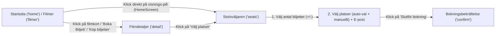

# DESIGN.md — Filmvisarna (Figma Make-prototyp)

Detta dokument är den fullständiga design- och gränssnittsspecifikationen för **Filmvisarna**, baserad uteslutande på Figma Make-prototypen i `docs/figma-make/src/`. Alla färger, mått, tillstånd, flöden och UI-texter är extraherade direkt ur prototypens källfiler och kravspecifikationer.

---

## 1. Designspråk och principer

**Källfiler:**
- `docs/figma-make/src/index.css`
- `docs/figma-make/src/imports/pasted_text/filmvisarna-booking-spec.md` (identisk med `docs/figma-make/src/assets/spec2.png`)
- `docs/figma-make/src/imports/pasted_text/cinema-app-screens.md` (identisk med `docs/figma-make/src/assets/upload.png`)

### Visuell identitet
- **Endast mörkt tema (Dark Theme Only):** Applikationen använder en djup grafitmörk sidbakgrund (`#0B0F19`) kombinerad med upphöjda kortytor i marinblå skiffer (`#161F30`) och mörkblå sekundärytor (`#1E2D47`). Ytor avgränsas med diskreta, semitransparenta kantlinjer (`1px solid rgba(148, 163, 184, 0.15)`).
- **Biografkänsla och glasmorfism (Glassmorphism):** Navigationsfält, klibbiga filterrader, bildmärkningar och överlägg använder semitransparenta bakgrunder med oskärpa (`backdrop-filter: blur(4px)` till `blur(20px)`). Hero-sektioner och salongsbilder tonas ut mot sidbakgrunden med mörka linjära gradienter (`linear-gradient`).
- **Tydlig färgkodad semantik:**
  - **Biografröd (`#E50914`):** Primära knappar (CTA), aktiva filterval, fokusringar, 15-årsgräns, Salong 1-identitet och destruktiva åtgärder. Ljusare röd (`#ff6b6b`) används för varningstext vid få platser kvar, sekundära avbokningsknappar och inställda visningar.
  - **Smaragdgrön (`#10B981`):** Valda platser i salongskartan (med grön glöd), genomförda steg, bokningsbekräftelse, "Alla"-åldersgräns, betalda bokningar och Salong 2-identitet på salongssidan.
  - **Bärnstensgul/orange (`#F59E0B` / `#D97706`):** IMDb-stjärnor och betyg, premiärbadges, 7- och 11-årsgräns på filmsidan, väntande betalning ("Inväntar") samt beläggningsvarning (> 80 %).
  - **Blå (`#3B82F6` / `#60A5FA`):** Rullstolsplatser, tillgänglighetsmärkning, Salong 2-badge i admin-schemat samt KPI-indikator för dagens bokningar.
- **Typografisk hierarki:**
  - **Poppins** (`--font-display`) används för rubriker (`h1`–`h3`), logotyp, filmtitlar, belopp och statistiska nyckeltal.
  - **Inter** (`--font-sans`) används för brödtext, knappar, formulärfält, etiketter och tabeller.
  - **JetBrains Mono** (`--font-jetbrains` / `--font-mono`) används för bokningskoder (`FV-XXXXX`), klockslag i admin, radbokstäver i salongskartor och sifferbetyg.
- **Konsekvent geometri och mikrointeraktioner:**
  - Bygger på ett 8px-baserat avståndssystem (`8px`, `16px`, `24px`, `32px`, `48px`, `64px`) och rundade hörn (`16px` för kort, `10px` för knappar/fält, `6px` för stolar, `20px`/`9999px` för chips och badges).
  - Interaktiva element har mjuka övergångar (`0.1s`–`0.35s`): filmkort lyfter vid hover (`translateY(-4px)`) med förstärkt skugga, affischer zoomar in (`scale(1.05)`), och lediga/valda stolar förstoras vid hover (`scale(1.15)`).
- **Tillgänglighet (WCAG AA):**
  - Hög kontrast mellan primär text (`#F8FAFC`) och bakgrund (`#0B0F19`).
  - Synlig fokusindikator (`outline: 2px solid #E50914`, `outline-offset: 2px`) för `input:focus` och `button:focus-visible`.

---

## 2. Designtokens

Alla värden nedan är översatta till konkreta mått (`hex`, `rgba`, `px`, `rem`) anpassade för Bootstrap 5 + SCSS.

### 2.1 Färger

| Namn | Värde | Användning | Föreslaget SCSS-variabelnamn | Källfil |
| :--- | :--- | :--- | :--- | :--- |
| `--background` | `#0B0F19` | Sidbakgrund (Deep Graphite Dark) | `$fv-bg` | `src/index.css`, `src/imports/pasted_text/filmvisarna-booking-spec.md` |
| `--foreground` / `--card-foreground` | `#F8FAFC` | Primär text och rubriker (Crisp White) | `$fv-fg` | `src/index.css`, `src/imports/pasted_text/filmvisarna-booking-spec.md` |
| `--card` | `#161F30` | Kort, paneler, modaler, tabeller, bottennavigering (Elevated Navy Slate) | `$fv-card-bg` | `src/index.css`, `src/imports/pasted_text/filmvisarna-booking-spec.md` |
| `--primary` / `--ring` | `#E50914` | Primär accent, CTA-knappar, aktivt chip, fokusring, 15-årsbadge, Salong 1 | `$fv-primary` | `src/index.css`, `src/imports/pasted_text/filmvisarna-booking-spec.md` |
| `--primary-foreground` / `--accent-foreground` | `#ffffff` | Text och ikoner på primär och grön accentbakgrund | `$fv-white` | `src/index.css` |
| `--secondary` | `#1E2D47` | Sekundär mörkblå yta definierad i `:root` | `$fv-secondary` | `src/index.css` |
| `--secondary-foreground` / `--muted-foreground` | `#94A3B8` | Sekundär/dämpad text, etiketter, inaktiva länkar (Cool Slate Gray) | `$fv-muted-fg` | `src/index.css`, `src/imports/pasted_text/filmvisarna-booking-spec.md` |
| `--muted` | `#111827` | Dämpad mörk bakgrundsyta definierad i `:root` | `$fv-muted-bg` | `src/index.css` |
| `--accent` / `--success` | `#10B981` | Vald stol, bekräftelse, "Alla"-åldersbadge, betald status, Salong 2 (`SalongerScreen.tsx`) | `$fv-success` | `src/index.css`, `src/imports/pasted_text/filmvisarna-booking-spec.md` |
| `--border` | `rgba(148, 163, 184, 0.15)` | Standardkantlinje (`1px solid`) för kort, inmatningsfält och tabeller | `$fv-border` | `src/index.css`, `src/imports/pasted_text/filmvisarna-booking-spec.md` |
| Seat Available | `#334155` | Ledig stol i salongskartor (`.seat-available`) och lägre beläggningsstapel (<= 50 %) | `$fv-seat-available` | `src/index.css`, `src/components/SeatSelectionScreen.tsx`, `src/components/admin/SchemaTab.tsx` |
| Seat Occupied | `#1E293B` (`opacity: 0.4`) | Upptagen/inaktiverad stol i salongskarta (`.seat-occupied`) | `$fv-seat-occupied` | `src/index.css`, `src/components/SeatSelectionScreen.tsx` |
| Danger Light | `#ff6b6b` | Varningstext vid få platser kvar, avboka-knapp, aktiv adminflik, Salong 1-badge i admin, inställd visning | `$fv-danger-light` | `src/components/HomeScreen.tsx`, `src/components/MovieDetailScreen.tsx`, `src/components/AdminScreen.tsx` |
| Warning / Amber | `#F59E0B` | IMDb-stjärna och betyg, 7/11-årsbadge (`FilmerScreen.tsx`), "Inväntar"-status, beläggning > 80 %, lösenordsstyrka "Okej" | `$fv-warning` | `src/components/FilmerScreen.tsx`, `src/components/ProfilScreen.tsx`, `src/components/admin/BokningarTab.tsx` |
| Warning Dark | `#D97706` | Startfärg i premiärbadge-gradient (`linear-gradient(135deg, #D97706 0%, #F59E0B 100%)`) | `$fv-warning-dark` | `src/components/FilmerScreen.tsx` |
| Info / Accessible Blue | `#3B82F6` | Rullstolsplatser, "Tillgänglig"-badge, punktlista (`SalongerScreen.tsx`), KPI-kort "Dagens bokningar" | `$fv-info` | `src/components/SalongerScreen.tsx`, `src/components/admin/BokningarTab.tsx`, `src/components/admin/SalongerAdminTab.tsx` |
| Info Light Blue | `#60A5FA` | Textfärg för Salong 2-badge i admin-visningsschema (`SchemaTab.tsx`) | `$fv-info-light` | `src/components/admin/SchemaTab.tsx` |
| Password Weak Red | `#EF4444` | Färg för lösenordsstyrka nivå 1 ("Svagt") | `$fv-danger-weak` | `src/components/ProfilScreen.tsx` |
| Avatar Purple | `#7C3AED` | Slutfärg i profil-avatargradient (`linear-gradient(135deg, #E50914 0%, #7C3AED 100%)`) | `$fv-purple` | `src/components/ProfilScreen.tsx` |
| Primary Dark | `#B2070F` | Slutfärg i gäst-avatargradient (`linear-gradient(135deg, #E50914 0%, #B2070F 100%)`) | `$fv-primary-dark` | `src/components/MobileDrawer.tsx` |
| Drawer Background | `#0F1729` | Bakgrundsfärg på sidopanelen i `MobileDrawer` | `$fv-drawer-bg` | `src/components/MobileDrawer.tsx` |
| Poster Placeholder | `#0d1321` / `#0f172a` / `#1e293b` | Bakgrund bakom film- och salongsbilder (`#0d1321`, `bg-slate-900`, `bg-slate-800`) | `$fv-poster-bg` | `src/components/FilmerScreen.tsx`, `src/components/HomeScreen.tsx`, `src/components/admin/FilmarkivTab.tsx` |
| Video Player Background | `#050810` | Bakgrund i 16:9 trailer-modal | `$fv-video-bg` | `src/components/FilmerScreen.tsx` |
| Policy Notice Bg | `rgba(255, 200, 0, 0.06)` | Bakgrund för gul kassabetalningsnotis i stolsväljaren | `$fv-policy-bg` | `src/components/SeatSelectionScreen.tsx` |
| Policy Notice Border | `rgba(255, 200, 0, 0.15)` | Kantlinje för gul kassabetalningsnotis i stolsväljaren | `$fv-policy-border` | `src/components/SeatSelectionScreen.tsx` |
| Cancelled Badge Bg | `rgba(153, 27, 27, 0.2)` | Bakgrund för "Inställd"-badge på desktop i admin-schemat | `$fv-cancelled-bg` | `src/components/admin/SchemaTab.tsx` |
| Glass Surface Bg | `rgba(22, 31, 48, 0.7)` | Semitransparent bakgrund för `.glass`-ytor (`border: 1px solid rgba(255, 255, 255, 0.08)`) | `$fv-glass-bg` | `src/index.css` |
| Nav Surface Bg | `rgba(11, 15, 25, 0.9)` | Semitransparent bakgrund för publik toppnavigering (`0.95` i admin) | `$fv-nav-bg` | `src/components/Nav.tsx`, `src/components/AdminScreen.tsx` |

### 2.2 Typografi

| Token / Element | Typsnitt | Storlek (px / rem) | Vikt & Egenskaper | Föreslaget SCSS-variabelnamn | Källfil |
| :--- | :--- | :--- | :--- | :--- | :--- |
| `--font-display` | `'Poppins', system-ui, sans-serif` | — | Vikt `400, 500, 600, 700, 800` | `$fv-font-display` | `src/index.css` |
| `--font-sans` | `'Inter', system-ui, sans-serif` | — | Vikt `300, 400, 500, 600, 700` | `$fv-font-sans` | `src/index.css` |
| `--font-jetbrains` / `--font-mono` | `'JetBrains Mono', 'Courier New', monospace` | — | Vikt `400, 600` | `$fv-font-mono` | `src/index.css` |
| Hero-rubrik (`h1`) | `Poppins` | Mobil: `48px` (`3rem`), `>= 640px`: `60px` (`3.75rem`) *(Spec: `28px` mobil / `48px` desktop)* | `font-weight: 700`, `line-height: 1.25` | `$fv-fs-hero` | `src/components/HomeScreen.tsx`, `src/imports/pasted_text/cinema-app-screens.md` |
| Sidrubrik stor (`h1`) | `Poppins` | Mobil: `36px` (`2.25rem`), `>= 640px`: `48px` (`3rem`) | `font-weight: 700`, `line-height: 1.25` | `$fv-fs-h1-lg` | `src/components/MovieDetailScreen.tsx`, `src/components/SalongerScreen.tsx` |
| Sidrubrik responsiv (`h1`) | `Poppins` | `clamp(24px, 4vw, 38px)` (`1.5rem`–`2.375rem`) | `font-weight: 800`, `letter-spacing: -0.02em` | `$fv-fs-h1-clamp` | `src/components/FilmerScreen.tsx` |
| Bekräftelserubrik & Bokningskod | `Poppins` / `JetBrains Mono` | `30px` (`1.875rem`) | `font-weight: 700` (kod: `letter-spacing: 0.2em`) | `$fv-fs-display-sm` | `src/components/BookingConfirmScreen.tsx` |
| Sidrubrik profil (`h1`) | `Poppins` | `28px` (`1.75rem`) | `font-weight: 700` | `$fv-fs-h1-md` | `src/components/ProfilScreen.tsx` |
| Sektionsrubrik (`h2`) | `Poppins` | `24px` (`1.5rem`) | `font-weight: 600` / `700` | `$fv-fs-h2` | `src/components/HomeScreen.tsx`, `src/components/SalongerScreen.tsx`, `src/components/admin/BokningarTab.tsx` |
| Admin-/modalrubrik (`h1`/`h2`) | `Poppins` | `22px` (`1.375rem`) | `font-weight: 700` | `$fv-fs-h2-sm` | `src/components/AdminScreen.tsx`, `src/components/FilmerScreen.tsx` |
| Kort-/undersektion (`h2`/`h3`) | `Poppins` | `20px` (`1.25rem`) | `font-weight: 700` | `$fv-fs-h3` | `src/components/MyBookingsScreen.tsx`, `src/components/SalongerScreen.tsx`, `src/components/admin/SalongerAdminTab.tsx` |
| Panel-/modalrubrik (`h2`/`h3`) | `Poppins` | `17px`–`18px` (`1.0625rem`–`1.125rem`) | `font-weight: 600` / `700` | `$fv-fs-h4` | `src/components/SeatSelectionScreen.tsx`, `src/components/ProfilScreen.tsx`, `src/components/admin/SchemaTab.tsx` |
| Logotyp (`FILMVISARNA`) | `Poppins` | Publik: `16px` (`1rem`), Admin: `14px` (`13px` mobil) | `font-weight: 700`, `uppercase`, `letter-spacing: 0.18em` (`0.16em` admin) | `$fv-fs-logo` | `src/components/Nav.tsx`, `src/components/AdminScreen.tsx` |
| Brödtext stor / Korttitel | `Inter` / `Poppins` | `16px` (`1rem`) / `15px` (`0.9375rem`) | `font-weight: 400` / `600`, `line-height: 1.625` | `$fv-fs-base` | `src/components/HomeScreen.tsx`, `src/components/FilmerScreen.tsx` |
| Standardtext / Knappar / Fält | `Inter` | `14px` (`0.875rem`) | `font-weight: 400` / `500` / `600` | `$fv-fs-sm` | `src/components/Nav.tsx`, `src/components/ProfilScreen.tsx` |
| Chip / Kompakt knapp | `Inter` | `13px` (`0.8125rem`) | `font-weight: 500` / `600` | `$fv-fs-xs-plus` | `src/index.css`, `src/components/FilmerScreen.tsx` |
| Etikett / Tabellhuvud / Badge | `Inter` | `12px` (`0.75rem`) / `11px` (`0.6875rem`) | `font-weight: 500` / `600` / `700` | `$fv-fs-xs` | `src/components/MovieDetailScreen.tsx`, `src/components/admin/BokningarTab.tsx` |
| Mikrotext / Bottennav / Minikarta | `Inter` / `JetBrains Mono` | `10px` (`0.625rem`) / `9px` (`0.5625rem`) / `8px` (`0.5rem`) | `font-weight: 400` / `600` / `700` | `$fv-fs-xxs` | `src/components/BottomNav.tsx`, `src/components/SalongerScreen.tsx`, `src/components/admin/SalongerAdminTab.tsx` |

### 2.3 Avstånd (Spacing) och Layoutmått

| Namn | Värde | Användning | Föreslaget SCSS-variabelnamn | Källfil |
| :--- | :--- | :--- | :--- | :--- |
| Bas-skala (8px-system) | `8px`, `16px`, `24px`, `32px`, `48px`, `64px` (`0.5rem`–`4rem`) | Generellt avståndssystem för marginaler, padding och gaps | `$fv-space-1` … `$fv-space-6` | `src/imports/pasted_text/filmvisarna-booking-spec.md` |
| Nav-höjd (publik) | `64px` (`4rem`) | Fast höjd på global toppnavigering (`Nav.tsx`) | `$fv-nav-height` | `src/components/Nav.tsx` |
| Nav-höjd (admin) | `56px` (`3.5rem`) | Fast höjd på admin-huvudrad (`AdminScreen.tsx`) | `$fv-admin-nav-height` | `src/components/AdminScreen.tsx` |
| BottomNav-höjd (mobil) | `64px` (`4rem`) | Fast höjd på mobil bottennavigering (`BottomNav.tsx`) | `$fv-bottom-nav-height` | `src/components/BottomNav.tsx` |
| Container Max-Width (Admin) | `1600px` (`100rem`) | Maxbredd i `AdminScreen.tsx` (`padding: 0 40px` desktop, `0 16px` mobil) | `$fv-container-admin` | `src/components/AdminScreen.tsx` |
| Container Max-Width (XL / 7xl) | `1280px` (`80rem`) | Maxbredd i `Nav.tsx`, `HomeScreen.tsx`, `FilmerScreen.tsx`, `SalongerScreen.tsx` | `$fv-container-7xl` | `src/components/Nav.tsx`, `src/components/HomeScreen.tsx` |
| Container Max-Width (6xl) | `1152px` (`72rem`) | Maxbredd i `MovieDetailScreen.tsx`, `SeatSelectionScreen.tsx` | `$fv-container-6xl` | `src/components/MovieDetailScreen.tsx`, `src/components/SeatSelectionScreen.tsx` |
| Container Max-Width (5xl) | `1024px` (`64rem`) | Maxbredd i `ProfilScreen.tsx` | `$fv-container-5xl` | `src/components/ProfilScreen.tsx` |
| Container Max-Width (4xl) | `896px` (`56rem`) | Maxbredd i `CookieBanner.tsx` | `$fv-container-4xl` | `src/components/CookieBanner.tsx` |
| Container Max-Width (3xl) | `768px` (`48rem`) | Maxbredd i `MyBookingsScreen.tsx` och hero-text på `HomeScreen.tsx` | `$fv-container-3xl` | `src/components/MyBookingsScreen.tsx`, `src/components/HomeScreen.tsx` |
| Desktop Grid (Spec) | `1440px` bredd, 12 kolumner, `24px` gutter, `120px` yttre marginal | Kravspecens övergripande desktop-grid | `$fv-grid-gutter-desktop` | `src/imports/pasted_text/filmvisarna-booking-spec.md` |
| Mobile Grid (Spec) | `390px` bredd, 4 kolumner, `16px` gutter, `16px` yttre marginal | Kravspecens övergripande mobil-grid | `$fv-grid-gutter-mobile` | `src/imports/pasted_text/filmvisarna-booking-spec.md` |

### 2.4 Hörnradier (Border Radius)

| Namn | Värde | Användning | Föreslaget SCSS-variabelnamn | Källfil |
| :--- | :--- | :--- | :--- | :--- |
| `--radius-sm` | `6px` (`0.375rem`) | Små badges, biljettkodbrickor, ålderschips (`AgeChip`) | `$fv-radius-sm` | `src/index.css`, `src/components/FilmerScreen.tsx` |
| `--radius` / `--radius-md` | `10px` (`0.625rem`) | Standardknappar ("Bli Medlem"), inmatningsfält, menyval i mobilmeny | `$fv-radius-md` | `src/index.css`, `src/imports/pasted_text/filmvisarna-booking-spec.md` |
| `--radius-lg` | `14px` (`0.875rem`) | Mobila kort i admin (`BokningarTab.tsx`, `SchemaTab.tsx`, `FilmarkivTab.tsx`) | `$fv-radius-lg` | `src/index.css`, `src/components/admin/BokningarTab.tsx` |
| `--card-radius` | `16px` (`1rem`) | Standardkort (`rounded-2xl`), paneler, tabellcontainers och modaler | `$fv-card-radius` | `src/index.css`, `src/imports/pasted_text/filmvisarna-booking-spec.md` |
| Inner Card / Button XL | `12px` (`0.75rem`) | Hero-knappar (`rounded-xl`), inre informationsrutor, cookie-knappar | `$fv-radius-xl` | `src/components/HomeScreen.tsx`, `src/components/CookieBanner.tsx` |
| Modal / BottomSheet Radius | `20px` (`1.25rem`) | `TrailerModal` (`20px`) samt mobila `BottomSheet` (`20px 20px 0 0`) | `$fv-radius-modal` | `src/components/FilmerScreen.tsx`, `src/components/admin/SchemaTab.tsx` |
| Confirmation Card Radius | `24px` (`1.5rem`) | Yttre kort på bokningsbekräftelsen (`rounded-3xl`) | `$fv-radius-3xl` | `src/components/BookingConfirmScreen.tsx` |
| Seat Radius | `6px 6px 3px 3px` | Stolsikoner i stolsväljaren (`.seat`), `6px` enligt spec | `$fv-radius-seat` | `src/index.css`, `src/imports/pasted_text/filmvisarna-booking-spec.md` |
| Chip / Pill Radius | `20px` / `9999px` | Filterchips (`.chip` har `20px`), runda knappar, avatarer och statuspills (`9999px`) | `$fv-radius-pill` | `src/index.css`, `src/imports/pasted_text/filmvisarna-booking-spec.md` |

### 2.5 Skuggor och Oskärpa (Shadows & Blur)

| Namn | Värde | Användning | Föreslaget SCSS-variabelnamn | Källfil |
| :--- | :--- | :--- | :--- | :--- |
| Card Hover Shadow (Home) | `0 16px 40px rgba(0, 0, 0, 0.4)` | Skugga vid hover på filmkort på startsidan | `$fv-shadow-card-lg` | `src/components/HomeScreen.tsx` |
| Card Hover Shadow (Filmer) | `0 12px 32px rgba(0, 0, 0, 0.4)` | Skugga vid hover på filmkort på filmsidan | `$fv-shadow-card-md` | `src/components/FilmerScreen.tsx` |
| Poster Shadow (`shadow-2xl`) | `0 25px 50px -12px rgba(0, 0, 0, 0.25)` | Skugga på filmposter i `MovieDetailScreen.tsx` | `$fv-shadow-poster` | `src/components/MovieDetailScreen.tsx` |
| BottomNav Shadow | `0 -4px 24px rgba(0, 0, 0, 0.4)` | Uppåtriktad skugga på mobil bottennavigering | `$fv-shadow-bottom-nav` | `src/components/BottomNav.tsx` |
| Selected Seat Glow | `0 0 10px rgba(16, 185, 129, 0.5)` | Grön glöd på vald stol (`.seat-selected`, `8px` i legend) | `$fv-glow-seat` | `src/index.css`, `src/components/SeatSelectionScreen.tsx` |
| Trailer Play Glow | `0 0 40px rgba(229, 9, 20, 0.5)` | Röd glöd runt play-knappen i `TrailerModal` | `$fv-glow-play` | `src/components/FilmerScreen.tsx` |
| Glass Blur | `blur(12px)` | Standardoskärpa för `.glass` (`14px` i `Nav`/`AdminScreen`, `20px` i `CookieBanner`) | `$fv-blur-glass` | `src/index.css`, `src/components/Nav.tsx`, `src/components/CookieBanner.tsx` |

### 2.6 Brytpunkter och Z-index

| Kategori | Namn | Värde | Användning | Föreslaget SCSS-variabelnamn | Källfil |
| :--- | :--- | :--- | :--- | :--- | :--- |
| Brytpunkt | Mobile Spec | `390px` | Referensbredd för mobil i kravspecen | `$fv-bp-xs` | `src/imports/pasted_text/filmvisarna-booking-spec.md` |
| Brytpunkt | `sm` | `640px` | 2 kolumner i filmgrid (`HomeScreen`), större rubriker, sidopadding | `$fv-bp-sm` | `src/components/HomeScreen.tsx`, `src/components/MovieDetailScreen.tsx` |
| Brytpunkt | `md` / `useIsMobile` | `768px` | Skiljelinje mellan mobil (`< 768px`) och desktop (`>= 768px`) i `useIsMobile`, `Nav`, `BottomNav` | `$fv-bp-md` | `src/hooks/useIsMobile.ts`, `src/components/Nav.tsx`, `src/components/BottomNav.tsx` |
| Brytpunkt | `lg` | `1024px` | 3 kolumner i filmgrid, flerkolumnslayout i `MovieDetailScreen`, `SeatSelectionScreen`, `SalongerScreen`, `ProfilScreen` | `$fv-bp-lg` | `src/components/MovieDetailScreen.tsx`, `src/components/SeatSelectionScreen.tsx` |
| Brytpunkt | `xl` | `1280px` | 4 kolumner i filmgrid på startsidan (`xl:grid-cols-4`) | `$fv-bp-xl` | `src/components/HomeScreen.tsx` |
| Brytpunkt | Desktop Spec | `1440px` | Referensbredd för desktop i kravspecen | `$fv-bp-xxl` | `src/imports/pasted_text/filmvisarna-booking-spec.md` |
| Z-index | Innehåll över hero | `10` | Innehållskolumner som överlappar hero-bild (`MovieDetailScreen`, `SalongerScreen`) | `$fv-z-content` | `src/components/MovieDetailScreen.tsx`, `src/components/SalongerScreen.tsx` |
| Z-index | Sticky Filter | `40` | Klibbig filterrad under toppnavigeringen (`top: 64px`) | `$fv-z-sticky` | `src/components/HomeScreen.tsx`, `src/components/FilmerScreen.tsx` |
| Z-index | Navigation & Modaler | `50` | `Nav`, `BottomNav`, `CookieBanner`, `AdminScreen`-topbar, avbokningsmodal och desktop-modaler i admin | `$fv-z-fixed` | `src/components/Nav.tsx`, `src/components/BottomNav.tsx`, `src/components/CookieBanner.tsx` |
| Z-index | Admin BottomSheet | `200` / `201` | Backdrop (`200`) och panel (`201`) för mobila `BottomSheet` i admin | `$fv-z-bottom-sheet` | `src/components/admin/SchemaTab.tsx`, `src/components/admin/FilmarkivTab.tsx` |
| Z-index | MobileDrawer | `998` / `999` | Backdrop (`998`) och sidopanel (`999`) för mobilmeny | `$fv-z-drawer` | `src/components/MobileDrawer.tsx` |
| Z-index | TrailerModal | `1000` | Högsta lager för videomodal på filmsidan | `$fv-z-modal-top` | `src/components/FilmerScreen.tsx` |

---

## 3. Komponenter

Här dokumenteras samtliga återanvända UI-delar i prototypen med utseende, mått, tillstånd och källfiler.

### 3.1 Knappar (Buttons)

1. **Primär knapp (Primary CTA)**
   - **Utseende:** Bakgrund `#E50914` (`var(--primary)`), text `#ffffff`, `font-weight: 600`, `border: none`.
   - **Storlekar och radier:**
     - Nav (`Bli Medlem`, `Nav.tsx`): `padding: 8px 16px`, `font-size: 14px`, `border-radius: 10px`.
     - Hero (`Boka Biljett`, `HomeScreen.tsx`): `padding: 12px 24px`, `font-size: 14px`, `border-radius: 12px`, med högerpilikon (`16×16px`).
     - Kortknapp (`Köp biljetter`, `FilmerScreen.tsx`): `width: 100%`, `padding: 10px`, `font-size: 13px`, `border-radius: 8px`, `letter-spacing: 0.02em`.
     - Checkout (`Slutför bokning`, `SeatSelectionScreen.tsx`): `width: 100%`, `padding: 14px 0`, `font-size: 14px`, `border-radius: 12px`.
   - **Tillstånd:**
     - **Standard:** `opacity: 1`, `cursor: pointer`.
     - **Fokus (`focus-visible`):** `outline: 2px solid #E50914`, `outline-offset: 2px` (`src/index.css`).
     - **Inaktiverad (`disabled`):** `opacity: 0.4`, `cursor: not-allowed` (`SeatSelectionScreen.tsx`).
     - **Sparad-bekräftelse (`FilmarkivTab.tsx`):** Skiftar bakgrund till `#10B981` under 2 sekunder med bockikon och texten `Sparad!`.
   - **Källfiler:** `src/index.css`, `src/components/Nav.tsx`, `src/components/HomeScreen.tsx`, `src/components/FilmerScreen.tsx`, `src/components/SeatSelectionScreen.tsx`, `src/components/admin/FilmarkivTab.tsx`.

2. **Sekundär knapp (Dark Outline / Ghost)**
   - **Utseende:** Transparent eller svagt tonad bakgrund (`rgba(255, 255, 255, 0.04)` till `0.08`), kantlinje `1px solid rgba(148, 163, 184, 0.25)` (eller `rgba(255, 255, 255, 0.1)`), text `#F8FAFC` eller `#94A3B8`, `border-radius: 8px`–`12px`.
   - **Variant – Glasmorfisk (`Se Trailer` på `HomeScreen.tsx`, `Tillbaka` på `MovieDetailScreen.tsx`):** Klass `.glass` (`background: rgba(22, 31, 48, 0.7)`, `backdrop-filter: blur(12px)`), `border: 1px solid rgba(255, 255, 255, 0.18)` (eller `0.1`), text `#F8FAFC`.
   - **Tillstånd:** I `Nav.tsx` (`Logga in`) får aktivt tillstånd (`currentScreen === 'profil'`) text `#F8FAFC` och bakgrund `rgba(248, 250, 252, 0.07)`.
   - **Källfiler:** `src/index.css`, `src/components/Nav.tsx`, `src/components/HomeScreen.tsx`, `src/components/MovieDetailScreen.tsx`, `src/components/BookingConfirmScreen.tsx`, `src/components/ProfilScreen.tsx`.

3. **Destruktiv / Röd sekundärknapp (`Avboka biljett`, `Avboka`, `Ställ in`, `Ta bort`)**
   - **Utseende:** Bakgrund `transparent` eller `rgba(229, 9, 20, 0.06)`–`0.1`, kantlinje `1px solid rgba(229, 9, 20, 0.2)`–`0.3`, text `#ff6b6b` (i `MobileDrawer.tsx` `Logga ut`: kantlinje `rgba(229, 9, 20, 0.4)`, text `#E50914`), `border-radius: 8px`–`12px`.
   - **Tillstånd:**
     - **Inaktiverad (`disabled`):** `opacity: 0.4` när en visning redan är inställd (`SchemaTab.tsx`).
     - **Inline-bekräftelse (`SchemaTab.tsx`, `FilmarkivTab.tsx`, `SalongerAdminTab.tsx`):** Vid klick ersätts knappen direkt av två knappar bredvid varandra: `Bekräfta` (bakgrund `#E50914`, vit text) och `Avbryt` (bakgrund `rgba(255, 255, 255, 0.05)`, text `#94A3B8`).
   - **Källfiler:** `src/components/BookingConfirmScreen.tsx`, `src/components/MyBookingsScreen.tsx`, `src/components/MobileDrawer.tsx`, `src/components/admin/BokningarTab.tsx`, `src/components/admin/SchemaTab.tsx`, `src/components/admin/FilmarkivTab.tsx`, `src/components/admin/SalongerAdminTab.tsx`.

4. **Grön åtgärdsknapp (`Markera betald`)**
   - **Utseende:** Bakgrund `rgba(16, 185, 129, 0.12)` (mobil) / `0.15` (desktop), kantlinje `1px solid rgba(16, 185, 129, 0.3)` (mobil) / `0.25` (desktop), text `#10B981`, bockikon, `border-radius: 10px` (mobil) / `8px` (desktop).
   - **Tillstånd:** När bokningen är betald ersätts knappen av en icke-klickbar bricka med bakgrund `rgba(16, 185, 129, 0.08)` och texten `✓ Betald` i `#10B981`.
   - **Källfil:** `src/components/admin/BokningarTab.tsx`.

5. **Tertiär knapp / Textlänk**
   - **Utseende:** Ingen bakgrund eller kantlinje, text `#94A3B8` (`Tillbaka till startsidan` i `BookingConfirmScreen.tsx`, `Tillbaka` i `SeatSelectionScreen.tsx` och `ProfilScreen.tsx`, understrukna länkar i footer) eller `#E50914` (`Rensa filter` och `Visa alla filmer` i `FilmerScreen.tsx`).
   - **Källfiler:** `src/components/BookingConfirmScreen.tsx`, `src/components/SeatSelectionScreen.tsx`, `src/components/ProfilScreen.tsx`, `src/components/FilmerScreen.tsx`, `src/components/HomeScreen.tsx`.

### 3.2 Filter-chips och Visnings-pills

1. **Standard-chip (`.chip`)**
   - **Utseende:** `display: inline-flex`, `align-items: center`, `padding: 6px 14px`, `border-radius: 20px`, `font-size: 13px`, `font-weight: 500`.
   - **Tillstånd:**
     - **Inaktiv (`.chip-inactive`):** Bakgrund `#161F30`, text `#94A3B8`, kantlinje `1px solid rgba(148, 163, 184, 0.15)`.
     - **Hover på inaktiv (`.chip-inactive:hover`):** Kantlinje `rgba(255, 255, 255, 0.2)`, text `#F8FAFC`.
     - **Aktiv (`.chip-active`):** Bakgrund `#E50914`, text `#ffffff`, kantlinje `1px solid transparent`.
   - **Källfiler:** `src/index.css`, `src/components/HomeScreen.tsx`, `src/components/MovieDetailScreen.tsx`, `src/components/admin/SchemaTab.tsx`.

2. **Genre-chip (`GenreChip` på `FilmerScreen.tsx` och datum-chip på mobil i `SchemaTab.tsx`)**
   - **Utseende:** `padding: 6px 14px` (`8px 16px` i `SchemaTab` mobil), `border-radius: 20px`, `font-size: 13px`.
   - **Tillstånd:**
     - **Inaktiv:** Bakgrund `rgba(255, 255, 255, 0.03)`, kantlinje `1px solid rgba(148, 163, 184, 0.2)`, text `#94A3B8`, `font-weight: 400`.
     - **Aktiv:** Bakgrund `rgba(229, 9, 20, 0.15)`, kantlinje `1px solid #E50914`, text `#E50914`, `font-weight: 600`.
   - **Källfiler:** `src/components/FilmerScreen.tsx`, `src/components/admin/SchemaTab.tsx`.

3. **Ålders-chip (`AgeChip` på `FilmerScreen.tsx`)**
   - **Utseende:** `padding: 5px 11px`, `border-radius: 6px`, `font-size: 12px`, `font-weight: 600`.
   - **Tillstånd:**
     - **Inaktiv:** Bakgrund `transparent`, kantlinje `1px solid rgba(148, 163, 184, 0.2)`, text `#94A3B8`.
     - **Aktiv:** Bakgrund `#E50914`, kantlinje `1px solid #E50914`, text `#ffffff`.
   - **Källfil:** `src/components/FilmerScreen.tsx`.

4. **Visningstids-pill (Screening Pill på filmkort)**
   - **Utseende på `HomeScreen.tsx` (klickbara `button`):** `padding: 6px 10px` (`px-2.5 py-1.5`), `border-radius: 8px`, `font-size: 12px`, `font-weight: 500`. Visar `{time} · Stora` eller `{time} · Lilla`.
     - **Normalt tillstånd (`seatsLeft >= 10`):** Bakgrund `rgba(255, 255, 255, 0.07)`, kantlinje `1px solid rgba(255, 255, 255, 0.1)`, text `#F8FAFC`.
     - **Få platser kvar (`seatsLeft < 10`):** Bakgrund `rgba(229, 9, 20, 0.15)`, kantlinje `1px solid rgba(229, 9, 20, 0.3)`, text `#ff6b6b`, samt tilläggstext `({seatsLeft} kvar)` med `opacity: 0.7`.
   - **Utseende på `FilmerScreen.tsx` (icke-klickbara `span`):** `padding: 4px 9px`, `border-radius: 6px`, `font-size: 12px`, `font-weight: 500`. Visar endast `{time}`. Vid `seatsLeft < 10`: bakgrund `rgba(229, 9, 20, 0.15)`, kantlinje `1px solid rgba(229, 9, 20, 0.3)`, text `#E50914`; annars bakgrund `rgba(255, 255, 255, 0.06)`, kantlinje `1px solid rgba(148, 163, 184, 0.15)`, text `#F8FAFC`.
   - **Källfiler:** `src/components/HomeScreen.tsx`, `src/components/FilmerScreen.tsx`.

### 3.3 Badges och Märkningar

| Typ | Utseende & Färger | Textformat | Källfil |
| :--- | :--- | :--- | :--- |
| **Åldersbadge (`HomeScreen`)** | Övre vänstra hörnet på poster (`top: 12px`, `left: 12px`), `padding: 2px 8px`, `border-radius: 4px`, `font-size: 12px`, `font-weight: 700`, vit text. Bakgrund: `#10B981` om `Alla`, annars `#E50914`. | `Alla` eller `{ageRating} år` | `src/components/HomeScreen.tsx` |
| **Åldersbadge (`FilmerScreen`)** | Övre vänstra hörnet på poster (`top: 10px`, `left: 10px`), `padding: 3px 7px`, `border-radius: 5px`, `font-size: 11px`, `font-weight: 700`, vit text. Bakgrund: `#10B981` om `Alla`, `#E50914` om `15`, `#F59E0B` för övriga (`7`, `11`). | `{ageRating}` (utan "år") | `src/components/FilmerScreen.tsx` |
| **Åldersbadge (`FilmarkivTab`)** | `padding: 2px 8px`, `border-radius: 9999px` (desktop) / `5px` (mobil), `font-size: 12px` (`11px` mobil), `font-weight: 700`. Om `Alla`: bakgrund `rgba(16, 185, 129, 0.15)`, text `#10B981`. Annars: bakgrund `rgba(229, 9, 20, 0.12)`, text `#ff6b6b`. | `Alla` eller `{ageRating} år` | `src/components/admin/FilmarkivTab.tsx` |
| **Speltidsbadge på poster** | Övre högra hörnet (`top: 10px`, `right: 10px`), `padding: 3px 7px`, `border-radius: 5px`, `font-size: 11px`, `font-weight: 500`, bakgrund `rgba(0, 0, 0, 0.7)`, `backdrop-filter: blur(4px)`, text `rgba(255, 255, 255, 0.85)`. | `{runtime}` | `src/components/FilmerScreen.tsx` |
| **Premiärbanderoll** | Ligger överst över hela posterbredden (`padding: 8px 10px`), bakgrund `linear-gradient(135deg, #D97706 0%, #F59E0B 100%)`, `font-size: 10px`, `font-weight: 700`, `Poppins`, vit text, `letter-spacing: 0.08em`. | `PREMIÄR {PREMIEREDATE}` | `src/components/FilmerScreen.tsx` |
| **Genre-pills** | Hero (`HomeScreen`): `rgba(255, 255, 255, 0.12)`, text `#F8FAFC`, `uppercase`, `rounded-full`. Kort (`HomeScreen`): `rgba(255, 255, 255, 0.06)`, text `#94A3B8`, `rounded-full`. Kort (`FilmerScreen`): `rgba(255, 255, 255, 0.06)`, text `#94A3B8`, `border-radius: 4px`. | `{genre}` | `src/components/HomeScreen.tsx`, `src/components/FilmerScreen.tsx` |
| **Salongsbadge (`SchemaTab`)** | `padding: 4px 10px` (`2px 8px` mobil), `border-radius: 8px` (`5px` mobil), `font-size: 12px` (`11px` mobil), `font-weight: 600`. `Salong 1`: bakgrund `rgba(229, 9, 20, 0.12)`, text `#ff6b6b`. `Salong 2`: bakgrund `rgba(59, 130, 246, 0.12)`, text `#60A5FA`. | `Salong 1` / `Salong 2` | `src/components/admin/SchemaTab.tsx` |
| **Statusbadge (Bokning)** | `border-radius: 20px` / `9999px`, `font-size: 11px`–`12px`, `font-weight: 600`. `Betald`: bakgrund `rgba(16, 185, 129, 0.15)`, text `#10B981`. `Inväntar`: bakgrund `rgba(245, 158, 11, 0.15)`, text `#F59E0B`. | `Betald` / `Inväntar` | `src/components/admin/BokningarTab.tsx` |
| **Statusbadge (Visning)** | `border-radius: 20px` / `9999px`, `font-size: 11px`–`12px`. `Aktiv`: bakgrund `rgba(16, 185, 129, 0.15)`, text `#10B981`. `Inställd`: bakgrund `rgba(153, 27, 27, 0.2)` (desktop) / `rgba(229, 9, 20, 0.12)` (mobil), text `#ff6b6b`. | `Aktiv` / `Inställd` | `src/components/admin/SchemaTab.tsx` |
| **IMDb-betyg (`StarRating`)** | Gul stjärnikon (`13×13px`, `#F59E0B`), betyg i `JetBrains Mono` (`13px`, `font-weight: 600`, `#F59E0B`) med 1 decimal, följt av `IMDb` (`12px`, `#94A3B8`). | `{rating.toFixed(1)} IMDb` | `src/components/FilmerScreen.tsx` |

### 3.4 Kort (Cards)

1. **Filmkort (`HomeScreen.tsx` och `FilmerScreen.tsx`)**
   - **Yta:** Bakgrund `#161F30` (`var(--card)`), kantlinje `1px solid rgba(148, 163, 184, 0.15)`, `border-radius: 16px`, `overflow: hidden`.
   - **Bilddel:** Proportion `2:3` (`aspect-[2/3]` eller `padding-bottom: 150%`), bild med `object-fit: cover` som skalar till `1.05` vid hover.
   - **Hover-effekt på kortet:** `transform: translateY(-4px)` och `box-shadow: 0 16px 40px rgba(0, 0, 0, 0.4)` (`HomeScreen`) respektive `0 12px 32px rgba(0, 0, 0, 0.4)` (`FilmerScreen`).
   - **Skillnad mellan sidorna:** På `HomeScreen.tsx` visas speltid och regissör samt klickbara visnings-pills; hela kortet är klickbart. På `FilmerScreen.tsx` visas speltidsbadge på postern, IMDb-betyg, icke-klickbara visningstider och en primärknapp `Köp biljetter`.
   - **Källfiler:** `src/components/HomeScreen.tsx`, `src/components/FilmerScreen.tsx`.

2. **Kommande premiär-kort (`UpcomingCard` i `FilmerScreen.tsx`)**
   - **Layout:** Horisontellt 2-kolumnskort (`grid-template-columns: 140px 1fr`), bakgrund `#161F30`, kantlinje `1px solid var(--border)`, `border-radius: 16px`.
   - **Innehåll:** Vänster kolumn med poster (`min-height: 200px`) och orange premiärbanderoll. Höger kolumn (`padding: 20px`) med IMDb-betyg, titel, originaltitel/speltid/regissör, genre- och ålders-taggar, trunkerad synopsis (160 tecken + `…`), 3 skådespelar-pills samt knapparna `Se Trailer` och `Bli påmind vid biljettsläpp` (som vid klick växlar till grön `Påminnelse aktiv`).
   - **Källfil:** `src/components/FilmerScreen.tsx`.

3. **Bokningskort (`MyBookingsScreen.tsx`, `ProfilScreen.tsx`, `BokningarTab.tsx`)**
   - **Mina Sidor (`MyBookingsScreen.tsx`):** Kort med grön toppremsa (`background: rgba(16, 185, 129, 0.08)`, `border-bottom: 1px solid rgba(16, 185, 129, 0.15)`) med texten `Kommande föreställning` till vänster och bokningskod till höger. Innehållsdel (`padding: 20px`) med poster (`56×84px`), titel, salong + tid, platser, totalpris samt knapparna `Visa biljett` och `Avboka`.
   - **Min Profil (`ProfilScreen.tsx`):** Kort (`padding: 20px`) med poster (`56×84px`), titel, tid + salong, röd bokningskodsbadge, grön badge `Bekräftad` och en `60×60px` stiliserad QR-rutnätsikon till höger.
   - **Admin mobilkort (`BookingCard` i `BokningarTab.tsx`):** Kort (`border-radius: 14px`, `padding: 16px`) med bokningskod, statusbadge (`Betald`/`Inväntar`), 2-kolumns infogrid (`Kund`, `Salong`, `Film & Tid`, `Belopp`, `Platser`) och fullbredds touchknappar (`Markera betald` / `✓ Betald` samt `Avboka`).
   - **Källfiler:** `src/components/MyBookingsScreen.tsx`, `src/components/ProfilScreen.tsx`, `src/components/admin/BokningarTab.tsx`.

4. **KPI-kort (`BokningarTab.tsx`)**
   - **Utseende:** Bakgrund `#161F30`, kantlinje `1px solid var(--border)`, `border-radius: 16px` (desktop, `padding: 20px`) / `14px` (mobil, `padding: 14px`).
   - **Indikator:** På desktop en `40×40px` rundad ruta (`border-radius: 12px`) med 12,5 % tonad bakgrund (`${color}20`); på mobil en `8×8px` färgad cirkel (`#3B82F6`, `#10B981`, `#F59E0B`).
   - **Källfil:** `src/components/admin/BokningarTab.tsx`.

### 3.5 Tabeller / Datarader (Admin Desktop)

- **Utseende:** Container med bakgrund `#161F30`, kantlinje `1px solid var(--border)`, `border-radius: 16px`, `overflow: hidden`.
- **Tabellhuvud:** CSS Grid-rad med `padding: 12px 20px`, `background: rgba(255, 255, 255, 0.02)`, `border-bottom: 1px solid var(--border)`, `font-size: 12px`, `font-weight: 600`, `uppercase`, `letter-spacing: 0.05em`, text `#94A3B8`.
- **Datarader:** CSS Grid-rader med `padding: 16px 20px`, `border-bottom: 1px solid var(--border)` (utom sista raden), hover-bakgrund `rgba(255, 255, 255, 0.015)`.
- **Kolumnmallar:**
  - `BokningarTab.tsx`: `110px 1fr 120px 80px 1fr 100px 110px`
  - `SchemaTab.tsx`: `80px 80px 110px 1fr 60px 90px 80px 80px 140px`
  - `FilmarkivTab.tsx`: `52px 1fr 80px 80px 1fr 80px 160px`
- **Responsivt beteende:** Vid `< 768px` (`useIsMobile`) ersätts tabellerna helt av staplade kort (`BookingCard`, visningskort, filmkort).
- **Källfiler:** `src/components/admin/BokningarTab.tsx`, `src/components/admin/SchemaTab.tsx`, `src/components/admin/FilmarkivTab.tsx`.

### 3.6 Formulär och Inmatningsfält

- **Textfält, `select` och `textarea`:**
  - Bakgrund: `rgba(255, 255, 255, 0.04)` till `0.06`.
  - Kantlinje: `1px solid rgba(148, 163, 184, 0.15)` (eller `rgba(255, 255, 255, 0.12)` i `SeatSelectionScreen.tsx`).
  - Hörnradie: `8px` (`ProfilScreen.tsx`), `10px` (`FilmerScreen.tsx`, `FilmarkivTab.tsx`, `SchemaTab.tsx`) eller `12px` (`SeatSelectionScreen.tsx`, `BokningarTab.tsx`, `SalongerAdminTab.tsx`).
  - Text: `#F8FAFC`, `font-size: 14px`, `Inter` (`JetBrains Mono` för tidsfält i `SchemaTab.tsx`). `<option>`-element i `<select>` har `background: #161F30`.
  - Fokus: `outline: 2px solid #E50914`, `outline-offset: 2px` (`src/index.css`).
- **Etiketter (`label`):** `font-size: 11px`–`12px`, `font-weight: 500`–`600`, text `#94A3B8`, ofta `uppercase` med `letter-spacing: 0.05em`–`0.07em`.
- **Sökfält med ikon:** Förstoringsglasikon (`16×16px`, `#94A3B8`) absolutpositionerad till vänster (`left: 12px`–`14px`), fält med vänsterpadding `36px`–`40px`.
- **Lösenordsfält med visa/dölj och styrkemätare (`PasswordStrength` i `ProfilScreen.tsx`):**
  - Ögonikon till höger (`18×18px`, `#94A3B8`) växlar mellan `type="password"` och `type="text"`.
  - Styrkemätare visas när nytt lösenord inte är tomt: 4 horisontella segment (`height: 3px`, `gap: 4px`, `border-radius: 2px`) + etikett under (`12px`). Poäng (1–4) beräknas utifrån: längd >= 8, versal `[A-Z]`, siffra `[0-9]`, specialtecken `[^A-Za-z0-9]`.
  - Nivåer: `1 = Svagt` (`#EF4444`), `2 = Okej` (`#F59E0B`), `3 = Starkt` (`#10B981`), `4 = Mycket starkt` (`#10B981`). Ouppfyllda segment har `rgba(148, 163, 184, 0.2)`.
- **Källfiler:** `src/index.css`, `src/components/FilmerScreen.tsx`, `src/components/SeatSelectionScreen.tsx`, `src/components/ProfilScreen.tsx`, `src/components/admin/BokningarTab.tsx`, `src/components/admin/SchemaTab.tsx`, `src/components/admin/FilmarkivTab.tsx`, `src/components/admin/SalongerAdminTab.tsx`.

### 3.7 Modaler och BottomSheets

1. **Centrerad modal (Desktop & Mobil)**
   - **Backdrop:** `position: fixed`, `inset: 0`, mörk övertoning (`rgba(0, 0, 0, 0.7)` i `MyBookingsScreen.tsx`, `rgba(0, 0, 0, 0.75)` med `backdrop-filter: blur(4px)` i admin, `rgba(0, 0, 0, 0.85)` med `backdrop-filter: blur(8px)` i `TrailerModal`). Klick på backdrop stänger modalen.
   - **Modal-kort:** Bakgrund `#161F30`, kantlinje `1px solid var(--border)` (eller `rgba(255, 255, 255, 0.1)`), `border-radius: 16px` (`20px` för `TrailerModal`).
   - **Källfiler:** `src/components/FilmerScreen.tsx`, `src/components/MyBookingsScreen.tsx`, `src/components/admin/SchemaTab.tsx`, `src/components/admin/FilmarkivTab.tsx`, `src/components/admin/SalongerAdminTab.tsx`.

2. **Mobilt BottomSheet (`SchemaTab.tsx` och `FilmarkivTab.tsx` vid `< 768px`)**
   - **Backdrop:** `position: fixed`, `inset: 0`, `z-index: 200`, `background: rgba(0, 0, 0, 0.7)`, `backdrop-filter: blur(4px)`.
   - **Panel:** `position: fixed`, `bottom: 0`, `left: 0`, `right: 0`, `z-index: 201`, bakgrund `#161F30`, `border-radius: 20px 20px 0 0`, `border: 1px solid rgba(148, 163, 184, 0.15)` (utan nederkant), `max-height: 92vh` (`SchemaTab`) / `94vh` (`FilmarkivTab`), `overflow-y: auto`.
   - **Animation och handtag:** Glider in nedifrån med `transform: translateY(0)` / `translateY(100%)` (`transition: transform 0.32s cubic-bezier(0.4, 0, 0.2, 1)`). Överst finns ett centrerat draghandtag (`36×4px`, `border-radius: 2px`, `background: rgba(148, 163, 184, 0.3)`).
   - **Källfiler:** `src/components/admin/SchemaTab.tsx`, `src/components/admin/FilmarkivTab.tsx`.

### 3.8 Tabbar (flikkomponenter)

Prototypen innehåller fem varianter av tabb-navigering:
1. **Understrukna textflikar (`FilmerScreen.tsx`):** `På bio nu` och `Kommande premiärer` (med gul räknarbadge `4`). Aktiv flik har `border-bottom: 2px solid #E50914`, text `#F8FAFC`, `font-weight: 700` (`Poppins`).
2. **Segmenterad pill-box (`MyBookingsScreen.tsx` och `ProfilScreen.tsx` mobil):** Container i `#161F30` med `padding: 4px`. I `MyBookingsScreen.tsx` har aktiv flik bakgrund `rgba(255, 255, 255, 0.1)`; i `ProfilScreen.tsx` (mobil) har aktiv flik bakgrund `#E50914` och vit text.
3. **Vertikal sidomeny med vänsterkant (`ProfilScreen.tsx` desktop):** Staplade knappar i `#161F30`-kort. Aktiv flik har `border-left: 3px solid #E50914`, bakgrund `rgba(229, 9, 20, 0.06)`, text `#F8FAFC` och `font-weight: 600`.
4. **Fristående knappflikar (`ProfilScreen.tsx` underflikar under Bokningshistorik):** `Kommande visningar` (aktiv: bakgrund `#E50914`, vit text) och `Tidigare besök` (inaktiv: bakgrund `#161F30`, text `#94A3B8`).
5. **Admin-toppflikar (`AdminScreen.tsx`):**
   - **Desktop:** Ikon + fullständig etikett (`padding: 8px 14px`, `border-radius: 8px 8px 0 0`). Aktiv flik har bakgrund `rgba(229, 9, 20, 0.12)`, text `#ff6b6b` och `border-bottom: 2px solid #E50914`.
   - **Mobil:** Andra rad i toppbaren med staplad ikon + kort etikett (`Bokningar`, `Schema`, `Filmer`, `Salonger`), `font-size: 10px`. Aktiv flik har text `#E50914` och `border-bottom: 2px solid #E50914`.

### 3.9 Toasts och Inline-feedback

Prototypen använder inga flytande toast-komponenter, utan ger direkt återkoppling inline vid knappen:
- **Kopiera bokningskod (`BookingConfirmScreen.tsx`):** Knappen `Kopiera` växlar under 2 sekunder till grön bakgrund `rgba(16, 185, 129, 0.15)`, text `#10B981`, bockikon och texten `Kopierat`.
- **Spara profiluppgifter (`ProfilScreen.tsx`):** Till höger om knappen `Spara ändringar` visas under 2,5 sekunder en grön bockikon (`16×16px`) och texten `Sparat!` i `#10B981`.
- **Spara film i admin (`FilmarkivTab.tsx`):** Knappen `Spara film` ändrar bakgrund till `#10B981` och text till `Sparad!` med bockikon under 2 sekunder innan modalen stängs.

### 3.10 Platskarta (Seat Map)

Det finns fyra varianter av salongskarta i prototypen:

1. **Publik interaktiv platskarta (`SeatSelectionScreen.tsx` och `src/index.css`)**
   - **Bioduk:** Kurvad båge överst (`width: 80%`, `height: 40px`, `border-radius: 50% 50% 0 0 / 20px 20px 0 0`, `background: linear-gradient(to bottom, rgba(255,255,255,0.15), rgba(255,255,255,0.03))`, `border: 1px solid rgba(255,255,255,0.15)` utan nederkant) med texten `BIODUK` (`font-size: 12px`, `letter-spacing: 0.25em`, `rgba(255,255,255,0.5)`), följt av en `24px` hög projektionsglöd (`linear-gradient(to bottom, rgba(255,255,200,0.06), transparent)`).
   - **Matris:** 10 rader (`A`–`J`) × 12 stolar per rad (`1`–`12`), omsluten av en horisontellt scrollbar container (`overflow-x: auto`). Varje rad har radbokstaven i `JetBrains Mono` (`12px`, `#94A3B8`, bredd `20px`) på både vänster och höger sida. Avstånd mellan stolar: `4px` (`gap-1`), avstånd mellan rader: `6px` (`mb-1.5`).
   - **Stolselement (`.seat`):** `28×26px`, `border-radius: 6px 6px 3px 3px`, `title="Rad {row}, Stol {seatNum}"` (eller `"Upptagen"`).
     - **Ledig (`.seat-available`):** Bakgrund `#334155`. Vid hover: `transform: scale(1.15)`.
     - **Vald (`.seat-selected`):** Bakgrund `#10B981`, skugga `0 0 10px rgba(16, 185, 129, 0.5)`. Vid hover: `transform: scale(1.15)`.
     - **Upptagen (`.seat-occupied`):** Bakgrund `#1E293B`, `opacity: 0.4`, `cursor: not-allowed`, med diagonal vit linje via `::after` (`linear-gradient(135deg, transparent 40%, rgba(255,255,255,0.3) 40%, rgba(255,255,255,0.3) 60%, transparent 60%)`).
   - **Legend:** Tre indikatorer (`20×16px` rundade rutor + etikett i `12px` `#94A3B8`): `Ledig` (`#334155`), `Vald` (`#10B981` med glöd), `Upptagen` (`#1E293B` med `opacity: 0.4`). Ingen rullstolsmarkering finns i den publika bokningskartan.

2. **Mini-salongskarta på Salonger-sidan (`MiniAuditoriumMap` i `SalongerScreen.tsx`)**
   - Icke-interaktiv översiktskarta med liten `BIODUK`-båge, stolrutor på `10×9px` (`border-radius: 3px 3px 2px 2px`) och legend: `Ledig` (`#334155`), `Exempelval` (`#E50914` för Salong 1, `#10B981` för Salong 2, visas på rad 4 stol 3–5), samt `Rullstol` (`#3B82F6`, visas på ytterplatserna i sista raden). Första raden har `opacity: 0.5`.

3. **Admin Live-salongskarta (`MiniSeatMap` i `BokningarTab.tsx`)**
   - Icke-interaktiv `8×10`-matris i höger sidopanel på desktop med stolrutor på `9×8px` (`border-radius: 2px 2px 1px 1px`).
   - Legend och färger: `Ledig` (`#334155`), `Bokad` (`#E50914` med `opacity: 0.5`), `Inväntar` (`#10B981`).

4. **Admin Salongsförhandsgranskning (`SeatPreviewGrid` i `SalongerAdminTab.tsx`)**
   - Visas både på salongskorten och som live-förhandsgranskning i modalen (begränsad till max 10 rader × 16 stolar i modalen).
   - Visar radbokstav (`A`, `B`, …) till vänster och antal stolar per rad till höger i `JetBrains Mono` (`9px`). Stolrutor `14×12px` med `Ledig` (`#334155`) och `Rullstol` (`#3B82F6` på första och sista stolen i rad A).

### 3.11 Antal-väljare (Steppers & Progress Stepper)

1. **Biljetträknare (`TicketCounter` i `SeatSelectionScreen.tsx`)**
   - Rad med biljettyp (`#F8FAFC`, `14px`, `font-weight: 500`) och pris (`#94A3B8`, `14px`) till vänster, samt `−`, antal och `+` till höger.
   - Knappar (`−` och `+`): Cirkulära (`32×32px`, `border-radius: 9999px`), bakgrund `rgba(255, 255, 255, 0.08)`, teckenstorlek `18px`. Vid `count === 0` är `−` `disabled` med textfärg `#94A3B8`. Maxvärde per biljettyp är `8`.
2. **Rader/Stolar-stepper (`SalongerAdminTab.tsx`)**
   - Runda/kvadratiska knappar (`28×28px`, `border-radius: 8px`, bakgrund `rgba(255, 255, 255, 0.08)`) inuti en `rgba(255, 255, 255, 0.05)`-container. Minvärde `1`, maxvärde `20`.
3. **Stegindikator (`StepIndicator` i `SeatSelectionScreen.tsx`)**
   - Visar 3 steg: `1. Biljetter` — `2. Välj platser` — `3. Bekräftelse`.
   - Cirkel (`28×28px`, `font-size: 12px`, `font-weight: 700`):
     - **Aktivt steg:** Bakgrund `#E50914`, vit siffra, etikett i `#F8FAFC`.
     - **Avklarat steg:** Bakgrund `#10B981`, vit bockikon, linje till nästa steg i `#10B981`.
     - **Kommande steg:** Bakgrund `rgba(255, 255, 255, 0.08)`, siffra och etikett i `#94A3B8`, linje i `rgba(255, 255, 255, 0.1)`.
   - Etiketterna döljs på skärmar `< 640px` (`hidden sm:block`).

### 3.12 Cookie-banner (`CookieBanner.tsx`)

- **Placering och yta:** Fast längst ned (`position: fixed`, `bottom: 0`, `left: 0`, `right: 0`, `z-index: 50`), `padding: 16px` (`24px` på `>= 640px`), bakgrund `linear-gradient(to top, rgba(11, 15, 25, 0.98) 0%, rgba(11, 15, 25, 0.9) 100%)`, `backdrop-filter: blur(20px)`, `border-top: 1px solid rgba(255, 255, 255, 0.08)`. Visas på alla publika vyer tills användaren stänger den (`showCookie` i `App.tsx`).
- **Innehåll (maxbredd `896px`):**
  - **Ikon:** `40×40px` rundad ruta (`border-radius: 12px`, bakgrund `rgba(229, 9, 20, 0.15)`) med röd kak-ikon (`20×20px`, `#E50914`).
  - **Rubrik:** `Vi använder cookies` (`14px`, `font-weight: 600`, `#F8FAFC`).
  - **Brödtext:** `Nödvändiga cookies används för autentisering och sessionshantering. Analytiska cookies hjälper oss förbättra upplevelsen.` (`12px`, `#94A3B8`) följt av en understruken toggle-knapp i `#F8FAFC` med texten `Anpassa` (i hopfällt läge) eller `Dölj inställningar` (i utfällt läge).
  - **Utfällt läge (`expanded === true`):** Visar två rader med toggle-switchar (`40×24px`, `border-radius: 9999px`, vit cirkel `16×16px`):
    1. `Nödvändiga cookies` / `Alltid aktiva` — låst i aktivt läge (bakgrund `#10B981`, cirkel till höger).
    2. `Statistik & Analys` / `Valfritt` — klickbar toggle (`analyticsEnabled`, inaktiv bakgrund `rgba(255, 255, 255, 0.12)` med cirkel till vänster; aktiv bakgrund `#10B981` med cirkel till höger).
  - **Knappar till höger (`padding: 10px 16px`, `border-radius: 12px`, `font-size: 12px`):**
    - `Anpassa` (visas endast när `expanded === true`, bakgrund `rgba(255, 255, 255, 0.08)`, text `#F8FAFC` — stänger bannern vid klick).
    - `Endast nödvändiga` (bakgrund `rgba(255, 255, 255, 0.08)`, kantlinje `1px solid rgba(255, 255, 255, 0.1)`, text `#F8FAFC` — stänger bannern vid klick).
    - `Acceptera alla` (bakgrund `#E50914`, vit text, `font-weight: 600` — stänger bannern vid klick).
- **Källfil:** `src/components/CookieBanner.tsx`.

---

## 4. Layout och navigering

### 4.1 Applikationsskal (`App.tsx`)

- **Rot-container:** `min-height: 100vh`, `background: var(--background)` (`#0B0F19`).
- **Publikt skal (`!isAdminScreen`, dvs. alla skärmar utom `admin`):**
  - Renderar `Nav` (toppnavigering), `MobileDrawer` (utfällbar sidomeny), `<main className="pb-16 md:pb-0">` (`padding-bottom: 64px` på `< 768px` för att ge plats åt `BottomNav`, `0` på `>= 768px`), `BottomNav` samt `CookieBanner` (om `showCookie === true`).
- **Admin-skal (`screen === 'admin'`):**
  - Döljer `Nav`, `MobileDrawer`, `BottomNav` och `CookieBanner`. Renderar i stället `AdminScreen` som har sin egen fasta toppbar.
- **Källfil:** `src/App.tsx`.

### 4.2 Publik toppnavigering (`Nav.tsx`)

- **Placering och yta:** `position: fixed`, `top: 0`, `left: 0`, `right: 0`, `z-index: 50`, höjd `64px` (`h-16`). Bakgrund `rgba(11, 15, 25, 0.9)`, `backdrop-filter: blur(14px)`, `border-bottom: 1px solid rgba(148, 163, 184, 0.15)`.
- **Container:** Maxbredd `1280px` (`max-w-7xl`), horisontell padding `20px` (`px-5`), `32px` vid `>= 640px` (`sm:px-8`), `64px` vid `>= 1024px` (`lg:px-16`).
- **Vänster – Logotyp:** Klickbar knapp (navigerar till `home`) med texten `FILMVISARNA` (`Poppins`, `16px`, `font-weight: 700`, `letter-spacing: 0.18em`, `#F8FAFC`, `uppercase`) följt av en röd cirkel (`6×6px`, `border-radius: 50%`, `#E50914`, `margin-bottom: 10px`).
- **Mitten – Desktop-länkar (`hidden md:flex`, visas vid `>= 768px`, `gap: 2px`):**
  1. `Hem` (`screen: 'home'`, aktiv vid `['home']`)
  2. `Filmer & Repertoar` (`screen: 'filmer'`, aktiv vid `['filmer', 'detail', 'seats', 'confirm']`)
  3. `Salonger` (`screen: 'salonger'`, aktiv vid `['salonger']`)
  4. `Mina Bokningar` (`screen: 'bookings'`, aktiv vid `['bookings']`)
  - **Utseende och tillstånd:** `padding: 8px 16px` (`px-4 py-2`), `border-radius: 8px`, `font-size: 14px`, `font-weight: 500`.
    - **Aktiv:** Text `#F8FAFC`, bakgrund `rgba(248, 250, 252, 0.07)`.
    - **Inaktiv:** Text `#94A3B8`, bakgrund `transparent`. Vid hover (`onMouseEnter`): text `#F8FAFC`.
- **Höger – Åtgärder (`gap: 8px`):**
  - **Desktop (`>= 768px`):**
    1. **Sökknapp:** `36×36px` (`w-9 h-9`), `border-radius: 8px`, bakgrund `rgba(255, 255, 255, 0.04)`, förstoringsglasikon `16×16px` i `#94A3B8` (har ingen klick-handler kopplad i prototypen).
    2. **`Logga in`-knapp:** Klick navigerar till `profil`. `padding: 8px 16px`, `border-radius: 8px`, `font-size: 14px`, `font-weight: 500`, kantlinje `1px solid rgba(148, 163, 184, 0.25)`. Om `currentScreen === 'profil'`: text `#F8FAFC` och bakgrund `rgba(248, 250, 252, 0.07)`, annars `#94A3B8` och `transparent`.
    3. **`Bli Medlem`-knapp:** `padding: 8px 16px`, `border-radius: 10px`, `font-size: 14px`, `font-weight: 600`, bakgrund `#E50914`, vit text (har ingen klick-handler kopplad i prototypen).
  - **Mobil (`< 768px`, `md:hidden`):**
    1. **Hamburgermeny-knapp:** `padding: 8px`, `border-radius: 8px`, färg `#94A3B8`, `aria-label="Öppna meny"`, ikon `20×20px`. Öppnar `MobileDrawer`.
    2. **Profilknapp:** `padding: 6px`, `border-radius: 9999px`, bakgrund `rgba(255, 255, 255, 0.08)`, färg `#94A3B8`, användarikon `16×16px`. Navigerar till `profil`.
- **Publik vs. Inloggad status i `Nav.tsx`:** Prototypen har ingen separat inloggad header-vy i `Nav.tsx`, utan visar alltid `Logga in` och `Bli Medlem` på desktop.
- **Källfil:** `src/components/Nav.tsx`.

### 4.3 Admin-toppnavigering (`AdminScreen.tsx`)

- **Placering och yta:** `position: fixed`, `top: 0`, `left: 0`, `right: 0`, `z-index: 50`, bakgrund `rgba(11, 15, 25, 0.95)`, `backdrop-filter: blur(14px)`, `border-bottom: 1px solid rgba(148, 163, 184, 0.12)`.
- **Huvudrad (`height: 56px`, maxbredd `1600px`, padding `0 40px` desktop / `0 16px` mobil):**
  - **Vänster:** Klickbar logotyp `FILMVISARNA` (`Poppins`, `14px` desktop / `13px` mobil, `font-weight: 700`, `letter-spacing: 0.16em`) + röd prick (`5×5px`) + badge `Backoffice` (endast desktop: `10px`, `uppercase`, bakgrund `rgba(229, 9, 20, 0.15)`, text `#E50914`, `padding: 2px 7px`, `border-radius: 5px`). Klick navigerar tillbaka till `home`.
  - **Mitten (endast desktop, `!isMobile`):** Horisontell flikrad med 4 flikar:
    1. `Bokningar & Kassa` (`id: 'bokningar'`)
    2. `Visningsschema` (`id: 'schema'`)
    3. `Filmarkiv` (`id: 'filmarkiv'`)
    4. `Salonger` (`id: 'salonger'`)
  - **Höger:**
    - **Användarbricka (endast desktop):** Container (`padding: 6px 12px`, `border-radius: 10px`, bakgrund `rgba(255, 255, 255, 0.06)`, kantlinje `1px solid var(--border)`) med röd cirkelavatar `A` (`24×24px`, `#E50914`), primär text `Admin: Ameer` (`11px`, `font-weight: 600`) och sekundär text `Superadmin` (`10px`, `#94A3B8`).
    - **Utloggningsknapp:** `padding: 7px 12px` (`7px 10px` mobil), `border-radius: 8px`, kantlinje `1px solid var(--border)`, bakgrund `rgba(255, 255, 255, 0.04)`, text `#94A3B8`, utloggningsikon (`14×14px`) + text `Logga ut` (desktop) eller `Ut` (mobil). Klick navigerar till `home`.
- **Mobil flikrad (andra rad i toppbaren vid `isMobile`, `< 768px`):**
  - Horisontellt scrollbar rad med `border-top: 1px solid rgba(148, 163, 184, 0.08)`. Visar ikon + kort etikett (`Bokningar`, `Schema`, `Filmer`, `Salonger`).
- **Källfil:** `src/components/AdminScreen.tsx`.

### 4.4 Mobil bottennavigering (`BottomNav.tsx`)

- **Synlighet:** Renderas endast när `window.innerWidth < 768` och skärmen inte är `admin`.
- **Placering och yta:** `position: fixed`, `bottom: 0`, `left: 0`, `right: 0`, `z-index: 50`, `height: 64px`, bakgrund `#161F30`, `border-top: 1px solid rgba(148, 163, 184, 0.12)`, `box-shadow: 0 -4px 24px rgba(0, 0, 0, 0.4)`.
- **Flikar (4 st med `flex: 1`):**
  1. `Hem` (`screen: 'home'`, husikon `22×22px`)
  2. `Filmer` (`screen: 'filmer'`, filmklappa-ikon `22×22px`)
  3. `Biljetter` (`screen: 'bookings'`, biljettikon `22×22px`)
  4. `Profil` (`screen: 'profil'`, användarikon `22×22px`)
- **Tillstånd:**
  - **Aktiv (`currentScreen === screen`):** Ikon och text (`10px`, `font-weight: 600`) i `#E50914`, fylld ikonvariant (för Hem, Filmer, Biljetter), samt en röd linjeindikator högst upp i fliken (`position: absolute`, `top: 0`, `left: 20%`, `right: 20%`, `height: 2px`, `background: #E50914`, `border-radius: 0 0 2px 2px`).
  - **Inaktiv:** Ikon (outline-variant) och text (`10px`, `font-weight: 400`) i `#94A3B8`.
- **Källfil:** `src/components/BottomNav.tsx`.

### 4.5 Mobil sidomeny (`MobileDrawer.tsx`)

- **Beteende:** Låser sidscroll (`document.body.style.overflow = 'hidden'`) när `open === true`.
- **Backdrop:** `position: fixed`, `inset: 0`, `z-index: 998`, `background: rgba(0, 0, 0, 0.6)`, `backdrop-filter: blur(2px)`, `transition: opacity 0.25s ease`. Klick stänger menyn.
- **Panel:** `position: fixed`, `top: 0`, `right: 0`, `bottom: 0`, `z-index: 999`, `width: 80vw`, `max-width: 320px`, bakgrund `#0F1729`, `border-left: 1px solid rgba(148, 163, 184, 0.12)`, glider in från höger (`translateX(100%)` -> `translateX(0)`, `0.3s cubic-bezier(0.4, 0, 0.2, 1)`).
- **Struktur uppifrån och ned:**
  1. **Header (`padding: 20px 20px 16px`, `border-bottom: 1px solid rgba(148, 163, 184, 0.1)`):**
     - Cirkulär avatar (`44×44px`, `linear-gradient(135deg, #E50914 0%, #B2070F 100%)`) med bokstaven `G` (`18px`, `Poppins`, `font-weight: 700`, vit).
     - Text: `Gäst` (`14px`, `font-weight: 600`, `#F8FAFC`) och undertill `Inte inloggad` (`12px`, `#94A3B8`).
     - Stäng-knapp till höger (`32×32px`, `border-radius: 8px`, bakgrund `rgba(255, 255, 255, 0.06)`, kryssikon `16×16px` i `#94A3B8`).
  2. **Navigationslänkar (`padding: 12px`):**
     - 5 huvudlänkar (`padding: 14px 12px`, `border-radius: 10px`, `font-size: 15px`, ikon `20×20px` + etikett):
       - `Hem` (`screen: 'home'`)
       - `Filmer & Repertoar` (`screen: 'filmer'`)
       - `Salonger` (`screen: 'salonger'`)
       - `Mina Bokningar` (`screen: 'bookings'`)
       - `Min Profil` (`screen: 'profil'`)
     - **Aktivt tillstånd:** Bakgrund `rgba(229, 9, 20, 0.1)`, text `#E50914`, `font-weight: 600`, `border-left: 2px solid #E50914`.
     - **Inaktivt tillstånd:** Bakgrund `transparent`, text `#94A3B8`, `font-weight: 400`, `border-left: 2px solid transparent`.
     - **Avdelare:** Horisontell linje (`height: 1px`, `background: rgba(148, 163, 184, 0.1)`, `margin: 12px 0`).
     - **Adminlänk:** `Admin Backoffice` (`screen: 'admin'`) med lager-ikon (`20×20px`) och högerställd badge `ADMIN` (`10px`, `font-weight: 600`, `padding: 2px 6px`, `border-radius: 4px`, bakgrund `rgba(229, 9, 20, 0.15)`, text `#E50914`).
  3. **Footer-knappar (`padding: 16px 12px 32px`, `border-top: 1px solid rgba(148, 163, 184, 0.1)`, `gap: 10px`):**
     - `Logga in` (primär knapp, bakgrund `#E50914`, vit text, `padding: 12px`, `border-radius: 10px` — navigerar till `profil` och stänger menyn).
     - `Logga ut` (sekundär röd outline-knapp, `border: 1px solid rgba(229, 9, 20, 0.4)`, text `#E50914`, `padding: 12px`, `border-radius: 10px` — ingen klick-handler).
- **Källfil:** `src/components/MobileDrawer.tsx`.

### 4.6 Sidfot (`Footer` i `HomeScreen.tsx`)

- **Obs:** Sidfoten är i prototypen endast inlagd längst ned i `HomeScreen.tsx` (inte som en global komponent i `App.tsx`).
- **Yta:** `margin-top: 64px` (`mt-16`), `border-top: 1px solid var(--border)`, bakgrund `#161F30` (`var(--card)`).
- **Layout:** Maxbredd `1280px`, `padding: 48px 16px` (`py-12 px-4 sm:px-6 lg:px-8`), 1 kolumn på mobil och 3 kolumner vid `>= 640px` (`grid-cols-1 sm:grid-cols-3`, `gap: 32px`).
- **Kolumn 1 – Varumärke & Kontakt:**
  - Röd ikonruta (`28×28px`, `border-radius: 6px`, `#E50914`) med vit filmremsa-ikon (`16×16px`) + rubrik `FILMVISARNA Småstad` (`Poppins`, `font-weight: 700`).
  - Adresstext (`14px`, `#94A3B8`, radbrytningar):
    - `Stortorget 12`
    - `572 31 Småstad`
    - `Tel: 0491-123 45`
- **Kolumn 2 – Öppettider:**
  - Rubrik: `Öppettider` (`14px`, `font-weight: 600`, `#F8FAFC`, `margin-bottom: 12px`).
  - Text (`14px`, `#94A3B8`):
    - `Mån–Tor: 13.00–23.00`
    - `Fre–Lör: 11.00–01.00`
    - `Sön: 11.00–22.00`
- **Kolumn 3 – Information & Länkar:**
  - Rubrik: `Information` (`14px`, `font-weight: 600`, `#F8FAFC`, `margin-bottom: 12px`).
  - Notisruta (`padding: 12px`, `border-radius: 8px`, bakgrund `rgba(255, 255, 255, 0.04)`, kantlinje `1px solid var(--border)`, `14px`, `#94A3B8`):
    - `Betalning sker alltid på plats i kassan vid ankomst.`
  - Länkrad (`margin-top: 16px`, `gap: 12px`, `font-size: 12px`, understrukna knappar):
    - `Integritetspolicy` (`#94A3B8`, ingen klick-handler)
    - `Cookie-inställningar` (`#94A3B8`, ingen klick-handler)
    - `Admin` (`rgba(148, 163, 184, 0.4)`, navigerar till `admin`)
- **Källfil:** `src/components/HomeScreen.tsx`.

### 4.7 Grid och Responsivt beteende

- **Brytpunktslogik:**
  - Prototypen kombinerar CSS-mediaqueries (Tailwind `sm: 640px`, `md: 768px`, `lg: 1024px`, `xl: 1280px`) med JavaScript-hooken `useIsMobile(768)` (`src/hooks/useIsMobile.ts`).
  - Vid `< 768px` aktiveras mobilvy: `BottomNav` visas i nederkant, `main` får `padding-bottom: 64px`, desktop-länkarna i `Nav` ersätts av hamburger- och profilknapp, och i `AdminScreen` byts tabeller mot kortlistor och modaler i `SchemaTab`/`FilmarkivTab` byts mot `BottomSheet`.
- **Horisontell scroll på små skärmar:** Filterrader (`FilmerScreen`, `MovieDetailScreen`, `SchemaTab`), mobilflikar i `AdminScreen` samt den interaktiva salongskartan i `SeatSelectionScreen` ligger i horisontellt scrollbara containers (`overflow-x: auto`).

---

## 5. Sidor

### Översikt över skärmar och föreslagna routes

| Föreslagen route | Status i prototypen | Skärm-ID (`Screen`) | Källfil i `docs/figma-make/src/` |
| :--- | :--- | :--- | :--- |
| `/` (Föreslagen) | Finns | `'home'` | `src/components/HomeScreen.tsx` |
| `/filmer` (Föreslagen) | Finns | `'filmer'` | `src/components/FilmerScreen.tsx` |
| `/filmer/:id` (Föreslagen) | Finns | `'detail'` | `src/components/MovieDetailScreen.tsx` |
| `/boka/:visningId` (Föreslagen) | Finns | `'seats'` | `src/components/SeatSelectionScreen.tsx` |
| `/bekraftelse/:kod` (Föreslagen) | Finns | `'confirm'` | `src/components/BookingConfirmScreen.tsx` |
| `/salonger` (Föreslagen) | Finns | `'salonger'` | `src/components/SalongerScreen.tsx` |
| `/om-oss` (Föreslagen) | **Saknas i prototypen** | — | — |
| `/mina-bokningar` (Föreslagen) | Finns | `'bookings'` | `src/components/MyBookingsScreen.tsx` |
| `/profil` (Föreslagen) | Finns | `'profil'` | `src/components/ProfilScreen.tsx` |
| `/admin/bokningar` (Föreslagen) | Finns (som flik i `AdminScreen`) | `'admin'` (`activeTab: 'bokningar'`) | `src/components/AdminScreen.tsx`, `src/components/admin/BokningarTab.tsx` |
| `/admin/visningar` (Föreslagen) | Finns (som flik i `AdminScreen`) | `'admin'` (`activeTab: 'schema'`) | `src/components/AdminScreen.tsx`, `src/components/admin/SchemaTab.tsx` |
| `/admin/filmer` (Föreslagen) | Finns (som flik i `AdminScreen`) | `'admin'` (`activeTab: 'filmarkiv'`) | `src/components/AdminScreen.tsx`, `src/components/admin/FilmarkivTab.tsx` |
| `/admin/salonger` (Föreslagen) | Finns (som flik i `AdminScreen`) | `'admin'` (`activeTab: 'salonger'`) | `src/components/AdminScreen.tsx`, `src/components/admin/SalongerAdminTab.tsx` |
| `/admin/kiosk` (Föreslagen) | **Saknas i prototypen** | — | — |

---

### 5.1 Startsida (`HomeScreen`)

- **Föreslagen route:** `/` (Föreslagen)
- **Skärm-ID:** `'home'`
- **Källfiler:** `src/components/HomeScreen.tsx`, `src/data.ts`, `src/imports/pasted_text/filmvisarna-booking-spec.md`, `src/imports/pasted_text/cinema-app-screens.md`

#### Struktur uppifrån och ned
1. **Hero-sektion (`height: 75vh`, `min-height: 500px`, `max-height: 720px`):**
   - Fullbredds bakgrundsbild (`HERO_MOVIE.backdrop`, Exempeldata: *Stjärnornas Krig: Arvet*).
   - Två överlagrade gradienter:
     - Nedifrån och upp: `linear-gradient(to top, #0B0F19 0%, rgba(11, 15, 25, 0.55) 55%, transparent 100%)` *(Spec anger `0.4` vid `60%`)*.
     - Från vänster: `linear-gradient(to right, rgba(11, 15, 25, 0.7) 0%, transparent 40%)`.
   - Innehållsblock nere till vänster (`max-width: 768px`, `padding: 80px 16px 32px` mobil, `sm:px-8`, `lg:px-16`):
     - **Taggrad:** Genre-pills (`Sci-Fi`, `Äventyr` — Exempeldata), röd åldersbadge (`{ageRating} år`, t.ex. `15 år` — Exempeldata), speltid (`2h 45m` — Exempeldata).
     - **Huvudrubrik (`h1`):** Filmtitel (`Stjärnornas Krig: Arvet` — Exempeldata).
     - **Ingress:** De första 140 tecknen av filmens synopsis följt av `…` (`rgba(240, 242, 247, 0.7)`).
     - **Knapprad:**
       - `Se Trailer` (sekundär `.glass`-knapp med play-ikon, ingen klick-handler).
       - `Boka Biljett` (primär röd knapp med högerchevron, anropar `onSelectMovie(HERO_MOVIE)`).
2. **Klibbig filterrad (`position: sticky`, `top: 64px`, `z-index: 40`, klass `.glass`, `border-bottom: 1px solid rgba(255, 255, 255, 0.07)`):**
   - Container (`max-width: 1280px`, `padding: 12px 16px`), staplad på mobil (`flex-col`), rad på `>= 640px` (`sm:flex-row`).
   - **Datumgrupp:** Etikett `Datum` (`12px`, `uppercase`, `#94A3B8`) + filterchips från `DATE_FILTERS`: `Idag`, `Imorgon`, `I helgen` *(Spec nämner även `"Helgen"`)* + en knapp med kalenderikon (`14×14px`, `.chip-inactive`, ingen klick-handler).
   - **Vertikal avdelare (`hidden sm:block`):** `width: 1px`, `background: rgba(255, 255, 255, 0.08)`.
   - **Åldersgrupp:** Etikett `Åldersgräns` (`12px`, `uppercase`, `#94A3B8`) + filterchips från `AGE_FILTERS`: `Alla`, `Barntillåten`, `7 år`, `11 år`, `15 år`.
3. **Repertoarsektion (`max-width: 1280px`, `padding: 40px 16px`):**
   - **Rubrik (`h2`):** `Repertoar — {activeDate}` (t.ex. `Repertoar — Idag`, `24px`, `Poppins`, `font-weight: 600`).
   - **Filmgrid:** `grid-cols-1` (`< 640px`), `sm:grid-cols-2` (`>= 640px`), `lg:grid-cols-3` (`>= 1024px`), `xl:grid-cols-4` (`>= 1280px`), `gap: 24px`.
   - **Filmkort:** Visar affisch, åldersbadge (`Alla` i grönt `#10B981`, övriga `{ageRating} år` i rött `#E50914`), filmtitel, `{runtime} · {director}`, genre-pills samt upp till 3 klickbara visnings-pills (`{time} · Stora` eller `{time} · Lilla`, plus `({seatsLeft} kvar)` i rött om `seatsLeft < 10`).
4. **Sidfot (`Footer`):** Se sektion 4.6.

#### Tillstånd och Interaktioner
- **Standardtillstånd:** `activeDate = 'Idag'`, `activeAge = 'Alla'`.
- **Filtrering:**
  - `activeAge` filtrerar `MOVIES`: `'Alla'` visar alla; `'Barntillåten'` matchar `m.ageRating === 'Alla'`; övriga matchar `m.ageRating === activeAge.replace(' år', '')`.
  - `activeDate` ändrar rubriken `Repertoar — {activeDate}` men filtrerar inte bort filmer i prototypens mockdata.
- **Tomt tillstånd (`filteredMovies.length === 0`, t.ex. vid val av `7 år` i prototypens exempeldata):**
  - Centrerad text (`padding: 96px 0`, `#94A3B8`): `Inga filmer matchar det valda filtret.`
- **Klick på filmkort eller `Boka Biljett`:** Anropar `handleSelectMovie(movie)` i `App.tsx`, nollställer valda biljetter/platser och byter skärm till `'detail'`.
- **Klick på visnings-pill (`e.stopPropagation()`):** Anropar `handleSelectScreening(movie, s)` i `App.tsx` och går direkt till `'seats'` (stolsväljaren).

---

### 5.2 Filmer & Repertoar (`FilmerScreen`)

- **Föreslagen route:** `/filmer` (Föreslagen)
- **Skärm-ID:** `'filmer'`
- **Källfiler:** `src/components/FilmerScreen.tsx`, `src/data.ts`

#### Struktur uppifrån och ned
1. **Sidhuvud / Hero-remsa (`background: linear-gradient(to bottom, rgba(22, 31, 48, 0.9), var(--background))`, `border-bottom: 1px solid var(--border)`):**
   - Container (`max-width: 1280px`, `padding-top: 32px` under `80px` topp-padding):
     - **Rubrik (`h1`):** `Filmer & Repertoar` (`clamp(24px, 4vw, 38px)`, `font-weight: 800`, `Poppins`).
     - **Underrubrik:** `Vad vill du se? Vi spelar nu {MOVIES.length} filmer på FILMVISARNA.` (med exempeldata: `Vad vill du se? Vi spelar nu 8 filmer på FILMVISARNA.`).
     - **Flikar:**
       1. `På bio nu` (`id: 'bio'`)
       2. `Kommande premiärer` (`id: 'kommande'`) med gul badge `4` (`UPCOMING_MOVIES.length`, `#F59E0B`).
2. **Flik 1: `På bio nu` (`activeTab === 'bio'`):**
   - **Klibbig filterpanel (`position: sticky`, `top: 64px`, `z-index: 40`, `background: rgba(11, 15, 25, 0.92)`, `backdrop-filter: blur(10px)`):**
     - **Rad 1 (Sök + Sortering):**
       - Sökfält med ikon och placeholder: `Sök film eller genre...`
       - Sorterings-dropdown (`<select>`) med alternativen: `Mest populär`, `Högst betyg`, `Nyast`, `A–Ö`.
     - **Rad 2 (Genre-chips, horisontellt scrollbar):** `Alla`, `Action`, `Animation`, `Drama`, `Fantasy`, `Krim`, `Romance`, `Sci-Fi`, `Thriller`, `Western`.
     - **Rad 3 (Ålders-chips, horisontellt scrollbar):** Etikett `Åldersgräns:` följt av `Alla`, `Barntillåten`, `7 år`, `11 år`, `15 år`.
   - **Resultatrad:**
     - Text till vänster: `Visar {filteredMovies.length} av {MOVIES.length} filmer` (antalet i `<strong>`).
     - Länkknapp till höger (visas endast om `activeGenre !== 'Alla' || activeAge !== 'Alla' || search`): `Rensa filter` (`#E50914`).
   - **Filmgrid:** `grid-template-columns: repeat(auto-fill, minmax(200px, 1fr))`, `gap: 20px`. Renderar `MovieCard` med knapp `Köp biljetter`.
   - **Tomt tillstånd (`filteredMovies.length === 0`):**
     - Emoji `🔍` (`40px`), text `Inga filmer matchar din sökning.` och röd länkknapp `Visa alla filmer`.
3. **Flik 2: `Kommande premiärer` (`activeTab === 'kommande'`):**
   - **Ingress:** `Kommande premiärer på FILMVISARNA hösten 2026. Bli påmind när biljetterna släpps.`
   - **Kortlista (`flex-direction: column`, `gap: 16px`):** Renderar `UpcomingCard` för varje film i `UPCOMING_MOVIES` (Exempeldata: 4 kommande filmer).
   - **Kortinnehåll (`UpcomingCard`):**
     - Vänster: Poster med banderoll `PREMIÄR {PREMIEREDATE}` (t.ex. `PREMIÄR 24 OKTOBER 2026` — Exempeldata).
     - Höger: IMDb-betyg (`{rating} IMDb`), titel, `{originalTitle} · {runtime} · Regi: {director}`, genre-taggar, ålders-tagg (`Alla åldrar` eller `{ageRating}+`), trunkerad synopsis (160 tecken + `…`), upp till 3 skådespelar-pills samt knapparna:
       - `Se Trailer` (öppnar `TrailerModal`)
       - `Bli påmind vid biljettsläpp` (växlar lokalt state `reminded` till `Påminnelse aktiv` i grönt `#10B981`).
4. **Trailer-modal (`TrailerModal`, visas när `trailerMovie !== null`):**
   - 16:9 videospelar-mock med mörktonad backdrop-bild, rund röd play-knapp (`72×72px`), text `Trailer — {movie.title}` och stäng-kryss uppe till höger.
   - Nedre del (`padding: 24px`): Filmtitel, IMDb-betyg, genre-taggar, speltid, fullständig synopsis samt knapparna:
     - `Gå till visningstider & boka` (primär röd knapp, stänger modalen och navigerar till `home`).
     - `Stäng` (sekundär outline-knapp, stänger modalen).

---

### 5.3 Filmdetaljer (`MovieDetailScreen`)

- **Föreslagen route:** `/filmer/:id` (Föreslagen)
- **Skärm-ID:** `'detail'`
- **Källfiler:** `src/components/MovieDetailScreen.tsx`, `src/data.ts`, `src/imports/pasted_text/filmvisarna-booking-spec.md`, `src/imports/pasted_text/cinema-app-screens.md`

#### Struktur uppifrån och ned
1. **Backdrop & Trailer Hero (`height: 320px` på mobil `h-80`, `384px` på `>= 640px` `sm:h-96`):**
   - Bakgrundsbild (`movie.backdrop`) med gradient `linear-gradient(to top, #0B0F19 0%, rgba(11, 15, 25, 0.5) 60%, transparent 100%)`.
   - Centrerad rund play-knapp (`64×64px`, `.glass`, `border: 2px solid rgba(255, 255, 255, 0.4)`, skalar `1.10` vid hover; `onClick` är en tom funktion i prototypen).
   - **Tillbaka-knapp** uppe till vänster (`top: 80px`, `left: 16px` / `sm:left-8`): `.glass`-knapp med vänsterchevron och texten `Tillbaka` (navigerar i `App.tsx` tillbaka till `'filmer'`).
2. **Huvudinnehåll (`max-width: 1152px`, överlappar hero med `-mt-16` / `-64px`, `z-index: 10`):**
   - **Grid:** 1 kolumn på `< 1024px`, 3 kolumner på `>= 1024px` (`lg:grid-cols-3`, `gap: 32px`).
   - **Vänster kolumn (`lg:col-span-1`):**
     - **Filmposter:** `aspect-[2/3]`, `max-width: 320px` (`max-w-xs`), `border-radius: 16px`, `shadow-2xl`.
     - **Faktaruta (`#161F30`, `border-radius: 16px`, `padding: 20px`):**
       - Rubrik: `Fakta` (`14px`, `uppercase`, `#94A3B8`).
       - Nyckel–värde-rader (`padding: 8px 0`, `border-bottom: 1px solid var(--border)`):
         - `Åldersgräns`: `Alla åldrar` (om `'Alla'`) eller `{ageRating} år`
         - `Premiärår`: `{year}` (Exempeldata: `2026`)
         - `Speltid`: `{runtime}`
         - `Originaltitel`: `{originalTitle}`
         - `Språk`: `{language}`
         - `Undertexter`: `{subtitles}` (raden döljs om `movie.subtitles` är tom sträng, t.ex. för *Lille Björnens Stora Äventyr*).
   - **Höger kolumn (`lg:col-span-2`):**
     - **Titelblock:** Genre-pills (`uppercase`), filmtitel (`h1`, `36px` mobil / `48px` desktop, `Poppins`), samt texten `Regi: {movie.director}` (`14px`, `#94A3B8`).
     - **Synopsis:** Brödtext (`16px`, `rgba(240, 242, 247, 0.8)`).
     - **Medverkande:** Rubrik `Medverkande` (`14px`, `uppercase`, `#94A3B8`) följt av runda skådespelar-pills (`movie.cast`).
     - **Visningsschema-kort (`#161F30`, `border-radius: 16px`, `padding: 24px`):**
       - **Datumrad:** 4 chips (`Idag`, `Imorgon`, `Lördag`, `Söndag`). I prototypen är `Idag` (`i === 0`) statiskt satt som `.chip-active` och övriga som `.chip-inactive`.
       - **Salongssektioner:** Grupperade efter `Stora Salongen` och `Lilla Salongen` (sektioner utan visningar för filmen döljs).
       - **Visningsrad (`padding: 12px`, `border-radius: 12px`, `background: rgba(255, 255, 255, 0.04)`, `border: 1px solid rgba(255, 255, 255, 0.07)`):**
         - Vänster: Starttid (`{time}`, `16px`, `font-weight: 600`), sluttid (`–{endTime}`, `12px`, `#94A3B8`), formatbadge (`{format}`, t.ex. `2D`).
         - Höger: `{seatsLeft} platser kvar` (`12px`, färg `#ff6b6b` om `seatsLeft < 15`, annars `#94A3B8`) + primär knapp `Välj platser` (anropar `onSelectScreening(movie, s)` och byter skärm till `'seats'`).

---

### 5.4 Stolsväljaren & Bokning (`SeatSelectionScreen`)

- **Föreslagen route:** `/boka/:visningId` (Föreslagen)
- **Skärm-ID:** `'seats'`
- **Källfiler:** `src/components/SeatSelectionScreen.tsx`, `src/data.ts`, `src/index.css`, `src/imports/pasted_text/filmvisarna-booking-spec.md`, `src/imports/pasted_text/cinema-app-screens.md`

#### Struktur uppifrån och ned (`max-width: 1152px`, `padding-top: 96px`)
1. **Topprad:**
   - Vänster: Tillbaka-knapp med vänsterchevron och filmens titel `{movie.title}` (`14px`, `#94A3B8`, går tillbaka till `'detail'`).
   - Höger: `StepIndicator` med stegen `1. Biljetter`, `2. Välj platser`, `3. Bekräftelse`.
2. **Film-mini-info (`#161F30`, `border-radius: 12px`, `padding: 16px`, `margin-bottom: 32px`):**
   - Liten poster (`48×72px`, `border-radius: 8px`), filmtitel (`16px`, `Poppins`) och undertill `{auditorium} · {time}–{endTime} · {format}` (`14px`, `#94A3B8`).
3. **Huvudgrid (1 kolumn på `< 1024px`, 3 kolumner `lg:grid-cols-3` på `>= 1024px`, `gap: 32px`):**
   - **Vänster/Mitten (`lg:col-span-2`, `space-y-6`):**
     - **Kort 1 – Biljettval (`#161F30`, `border-radius: 16px`, `padding: 24px`):**
       - Rubrik (`h2`): `1. Välj biljetter` (`18px`, `Poppins`).
       - Underrubrik: `Välj antal biljetter per kategori` (`12px`, `#94A3B8`).
       - Tre `TicketCounter`-rader (priser från `TICKET_PRICES` — Exempeldata):
         - `Vuxen` — `140 kr`
         - `Pensionär` — `120 kr`
         - `Barn (under 12 år)` — `80 kr`
       - **Grön totalsummeringsruta (visas när `totalTickets > 0`):** Bakgrund `rgba(16, 185, 129, 0.1)`, kantlinje `1px solid rgba(16, 185, 129, 0.2)`, bockikon till höger och text i `#10B981`:
         - `Totalt: {totalPrice} kr för {totalTickets} biljett` (om 1) respektive `Totalt: {totalPrice} kr för {totalTickets} biljetter` (om > 1).
     - **Kort 2 – Platskarta (visas endast när `totalTickets > 0`, `#161F30`, `border-radius: 16px`, `padding: 24px`):**
       - Rubrik (`h2`): `2. Välj platser` (`18px`, `Poppins`).
       - Underrubrik: `Bästa tillgängliga platser är förvalda — klicka för att ändra` (`12px`, `#94A3B8`).
       - Bioduk (`BIODUK`), stolsmatris (`A`–`J`, `1`–`12`) och legend (`Ledig`, `Vald`, `Upptagen`) enligt sektion 3.10.
   - **Höger – Checkout-panel (`lg:col-span-1`, `position: sticky`, `top: 96px`, `#161F30`, `border-radius: 16px`, `padding: 24px`):**
     - Rubrik (`h2`): `Din bokning` (`16px`, `Poppins`).
     - **Valda platser-ruta (visas när `selectedSeats.length > 0`):** Visar `{screening.auditorium}` (`12px`, `#94A3B8`) och sorterad lista `Rad {rad}, Stol {stol}` separerade med ` · ` (`14px`, `#F8FAFC`).
     - **Prisuppdelning (visas när `totalTickets > 0`):**
       - `{adultCount}× Vuxen` / `{adultCount * 140} kr` (om `adultCount > 0`)
       - `{seniorCount}× Pensionär` / `{seniorCount * 120} kr` (om `seniorCount > 0`)
       - `{childCount}× Barn` / `{childCount * 80} kr` (om `childCount > 0`)
       - Avdelare + rad: `Totalt` / `{totalPrice} kr` (`font-weight: 600`).
     - **Gul kassapolicy-notis:**
       - `Ingen onlinebetalning krävs. Biljetterna betalas och hämtas ut i kassan senast 15 minuter innan föreställningen börjar.`
     - **E-postfält (visas när `totalTickets > 0 && selectedSeats.length === totalTickets`):**
       - Etikett: `E-post för bokningsbekräftelse`
       - Input (`type="email"`): placeholder `din@epost.se`.
     - **Primär CTA-knapp (dynamisk etikett och disabled-status):**
       - Om `totalTickets === 0`: `Välj biljetter` (`disabled`, `opacity: 0.4`)
       - Om `selectedSeats.length < totalTickets`: `Välj {totalTickets - selectedSeats.length} platser till` (`disabled`, `opacity: 0.4`)
       - Om `selectedSeats.length === totalTickets` (`> 0`): `Slutför bokning` (aktiv; klick sparar e-post, genererar bokningskod `FV-XXXXX` och navigerar till `'confirm'`).

#### Algoritm för automatiskt platsval
- När `totalTickets` ändras väljer prototypen automatiskt sammanhängande lediga platser genom att söka i radordningen `['E', 'F', 'D', 'G', 'C', 'H', 'B', 'I', 'A', 'J']` från stol `1` till `12`. Om inga sammanhängande platser ryms på en rad plockas enskilda lediga stolar i samma radordning.
- Vid klick på en ledig stol: om stolen redan är vald avmarkeras den; om färre än `totalTickets` är valda läggs den till; om `selectedSeats.length === totalTickets` ersätts den senast valda stolen (`[...selected.slice(0, -1), seatId]`).

---

### 5.5 Bokningsbekräftelse (`BookingConfirmScreen`)

- **Föreslagen route:** `/bekraftelse/:kod` (Föreslagen)
- **Skärm-ID:** `'confirm'`
- **Källfiler:** `src/components/BookingConfirmScreen.tsx`, `src/data.ts`, `src/imports/pasted_text/filmvisarna-booking-spec.md`, `src/imports/pasted_text/cinema-app-screens.md`

#### Struktur uppifrån och ned
Centrerat kort (`max-width: 512px` / `max-w-lg`, `border-radius: 24px`, bakgrund `#161F30`, `border: 1px solid rgba(255, 255, 255, 0.08)`):
1. **Grön toppsektion (`padding: 40px 32px 32px`, `background: linear-gradient(to bottom, rgba(16, 185, 129, 0.12), transparent)`):**
   - Cirkel (`64×64px`, `background: rgba(16, 185, 129, 0.15)`, `border: 2px solid rgba(16, 185, 129, 0.4)`) med grön bockikon (`36×36px`, `#10B981`).
   - **Huvudrubrik (`h1`):** `Tack för din bokning!` (`30px`, `Poppins`, `font-weight: 700`) *(Spec `cinema-app-screens.md` nämner även `"Bokning bekräftad!"`)*.
   - **Underrubrik:** `En bekräftelse skickas till {email || 'din e-post'}` (`14px`, e-postadressen i `#F8FAFC`).
2. **Bokningskod-sektion (`padding: 0 32px 24px`):**
   - Etikett: `Bokningskod` (`12px`, `uppercase`, `letter-spacing: 0.1em`, `#94A3B8`, centrerad).
   - Kodruta (`padding: 16px 20px`, `border-radius: 16px`, `background: rgba(255, 255, 255, 0.05)`, `border: 1px solid rgba(255, 255, 255, 0.1)`):
     - Vänster: `{bookingRef}` (t.ex. `FV-8K49P` — Exempeldata; genereras slumpmässigt med prefix `FV-` följt av 5 tecken ur `ABCDEFGHJKLMNPQRSTUVWXYZ23456789`, `30px`, `JetBrains Mono`, `font-weight: 700`, `letter-spacing: 0.2em`).
     - Höger: Knapp `Kopiera` med kopiera-ikon (växlar till grön `Kopierat` med bockikon i 2 sekunder vid klick via `navigator.clipboard.writeText`).
3. **Biljettavdelare (Perforerad linje):**
   - Två halvcirklar i sidbakgrundsfärg (`24×24px`, `#0B0F19`, `margin: -28px`) på sidorna om en streckad horisontell linje (`border-top: 1px dashed rgba(255, 255, 255, 0.1)`).
4. **Sammanfattning och QR-kod (`padding: 24px 32px 32px`):**
   - **Filminfo:** Poster (`56×84px`, `border-radius: 8px`), filmtitel (`16px`, `Poppins`), `{auditorium}` (`14px`, `#94A3B8`) och `{time}–{endTime}` (`14px`, `#F8FAFC`).
   - **Platser grupperade per rad:** `Rad {row}: Stol {seats.join(', ')}` (t.ex. `Rad E: Stol 1, 2, 3`).
   - **Prisruta (`padding: 16px`, `border-radius: 12px`, `background: rgba(255, 255, 255, 0.04)`):**
     - Biljettrader (`{count}× Vuxen`, `{count}× Pensionär`, `{count}× Barn`) med delsummor i `kr`.
     - Summeringsrad under kantlinje: `Att betala i kassan` till vänster (`#94A3B8`) och `{totalPrice} kr` till höger i grönt (`#10B981`, `font-weight: 600`).
   - **QR-kodruta (`padding: 20px`, `border-radius: 16px`, `background: rgba(255, 255, 255, 0.03)`):**
     - Text överst: `Visa upp vid kassan` (`12px`, `#94A3B8`).
     - Vit ruta (`112×112px`, `border-radius: 12px`, `padding: 8px`) med en `21×21` SVG-QR-kod.
     - Bokningskoden `{bookingRef}` i `JetBrains Mono` (`12px`, `#94A3B8`) under QR-koden.
   - **Åtgärdsknappar (`space-y-3`):**
     1. `Skriv ut / Spara som PDF` (sekundär knapp, anropar `window.print()`).
     2. `Avboka biljett` (röd outline-knapp, navigerar till `'bookings'`).
     3. `Tillbaka till startsidan` (tertiär textknapp, navigerar till `'home'`).

---

### 5.6 Våra Salonger (`SalongerScreen`)

- **Föreslagen route:** `/salonger` (Föreslagen)
- **Skärm-ID:** `'salonger'`
- **Källfil:** `src/components/SalongerScreen.tsx`

#### Struktur uppifrån och ned
1. **Sidhuvud (`background: linear-gradient(135deg, #0B0F19 0%, #161F30 50%, #0B0F19 100%)`, `border-bottom: 1px solid var(--border)`):**
   - Subtilt bakgrundsrutnät (`40×40px`, `opacity: 0.05`, vita `1px`-linjer).
   - Container (`max-width: 1280px`, `padding: 112px 20px 56px`):
     - Röd pill-badge: `Filmvisarna Småstad` (`12px`, `uppercase`, `letter-spacing: 0.1em`, bakgrund `rgba(229, 9, 20, 0.15)`, text `#E50914`).
     - **Rubrik (`h1`):** `Våra Salonger` (`36px` mobil / `48px` desktop, `Poppins`, `font-weight: 700`).
     - **Ingress:** `Två salonger med det bästa i ljud och bild — oavsett om du söker storslaget eller intimt.` (`16px`, `#94A3B8`, `max-width: 576px`).
2. **Salongskort-grid (`max-width: 1280px`, `padding: 48px 20px`, 1 kolumn på `< 1024px`, 2 kolumner `lg:grid-cols-2` på `>= 1024px`, `gap: 32px`):**
   - Två salongskort i `#161F30` (`border-radius: 16px`, `border: 1px solid var(--border)`).
   - **Exempeldata i `SALONGER`:**
     - **Salong 1:**
       - Namn: `Salong 1`, Undertitel: `Stora Salongen`, Färg: `#E50914`
       - Badges nere till vänster på bilden (`aspect-video`): `80 platser` (bakgrund `#E50914`), `4K Laser` (`.glass`), `Dolby Atmos` (`.glass`).
       - Badge uppe till höger på bilden: `Premiärsalong` (`rgba(0, 0, 0, 0.6)`).
       - Tillgänglighetsbadge till höger om rubriken: `Tillgänglig` (blå rullstolsikon + text `#3B82F6`, bakgrund `rgba(59, 130, 246, 0.12)`).
       - Punktlista med röda bockikoner (`#E50914`):
         - `4K Laser Projektor`
         - `Dolby Atmos Ljud`
         - `Bred duk (18m)`
         - `Rullstolsplatser (rad A)`
         - `Barservering tillgänglig`
       - Minikarta (`MiniAuditoriumMap`): Rubrik `Salongskarta` (`12px`, `uppercase`), `BIODUK`, 10 rader × 8 stolar, legend: `Ledig`, `Exempelval`, `Rullstol`.
     - **Salong 2:**
       - Namn: `Salong 2`, Undertitel: `Lilla Salongen`, Färg: `#10B981`
       - Badges nere till vänster på bilden: `40 platser` (bakgrund `#10B981`), `2D` (`.glass`), `Stereo` (`.glass`).
       - Badge uppe till höger på bilden: `Bekväma fåtöljer`.
       - Tillgänglighetsbadge: `Tillgänglig` (`#3B82F6`).
       - Punktlista med gröna bockikoner (`#10B981`):
         - `2D Digital Projektor`
         - `Premium Fåtöljer`
         - `Intim atmosfär`
         - `Rullstolsplatser (rad A)`
         - `Familjevänlig`
       - Minikarta (`MiniAuditoriumMap`): Rubrik `Salongskarta`, `BIODUK`, 5 rader × 8 stolar, legend: `Ledig`, `Exempelval`, `Rullstol`.
   - **CTA-knapp längst ned i varje salongskort:** `Se schema →` (primär röd knapp, `width: 100%`, navigerar till `'home'`).
3. **Informationsruta längst ned (`#161F30`, `border-radius: 16px`, `padding: 32px`, 1 kolumn på `< 768px`, 2 kolumner `md:grid-cols-2` på `>= 768px`, `gap: 32px`):**
   - **Vänster kolumn:**
     - Rubrik (`h3`): `Tillgänglighet & Rullstolsplatser` (`20px`, `Poppins`, `font-weight: 700`).
     - Brödtext: `Båda salongerna är fullt tillgängliga för besökare med rörelsehinder. Rullstolsplatser finns i den första raden (Rad A) vid sidan av salongen, med fri sikt till duken.`
     - Punktlista (med blå cirkelprickar `6×6px`, `#3B82F6`):
       - `Bred ingång utan tröskel`
       - `Ramp till alla salonger`
       - `Tillgängliga toaletter i foajén`
       - `Induktionsslinga för hörselhjälpmedel`
   - **Höger kolumn:**
     - Rubrik (`h3`): `Dukens placering` (`20px`, `Poppins`, `font-weight: 700`).
     - Brödtext: `Båda salongerna har trappande sittning för fri sikt. Duken är placerad centralt med optimalt siktavstånd från alla platser.`
     - 2×2 faktarutor (`border-radius: 12px`, `padding: 12px`, `background: rgba(255, 255, 255, 0.04)`):
       - `Stora salongen` / `18 × 8 m duk`
       - `Lilla salongen` / `10 × 4,5 m duk`
       - `Optimal sittrad` / `Rad D–G`
       - `Öppningsår` / `1987 / 2019`

---

### 5.7 Om oss

- **Föreslagen route:** `/om-oss` (Föreslagen)
- **Status:** **Saknas i prototypen** (`docs/figma-make/src/` innehåller ingen Om oss-sida).

---

### 5.8 Mina Sidor / Mina Bokningar (`MyBookingsScreen`)

- **Föreslagen route:** `/mina-bokningar` (Föreslagen)
- **Skärm-ID:** `'bookings'`
- **Källfiler:** `src/components/MyBookingsScreen.tsx`, `src/imports/pasted_text/filmvisarna-booking-spec.md`, `src/imports/pasted_text/cinema-app-screens.md`

#### Struktur uppifrån och ned (`max-width: 768px` / `max-w-3xl`, `padding-top: 96px`)
1. **Profilöversiktskort (`#161F30`, `border-radius: 16px`, `padding: 24px`, `margin-bottom: 32px`):**
   - Röd cirkelavatar (`64×64px`, `#E50914`) med initialerna `AL` (`20px`, `Poppins`, `font-weight: 700` — Exempeldata).
   - Rubrik (`h2`): `Mina Sidor` (`20px`, `Poppins`, `font-weight: 700`).
   - E-post: `{savedBookings[0]?.email || 'anna.lindqvist@example.se'}` (Exempeldata).
   - Grön pill-badge: `Gästmedlem` (`12px`, bakgrund `rgba(16, 185, 129, 0.15)`, text `#10B981`).
2. **Segmenterad flikväljare (`#161F30`, `border-radius: 12px`, `padding: 4px`, `margin-bottom: 24px`):**
   - Flik 1: `Aktuella bokningar` (`id: 'active'`)
   - Flik 2: `Bokningshistorik` (`id: 'history'`) *(Spec `filmvisarna-booking-spec.md` nämner även kortformen `"Historik"`)*.
3. **Innehåll under `Aktuella bokningar`:**
   - **Tomt tillstånd (`activeBookings.length === 0`):**
     - Rund ikon-container (`64×64px`, `background: rgba(255, 255, 255, 0.06)`) med filmremsa-ikon (`32×32px`, `#94A3B8`).
     - Rubrik: `Inga aktuella bokningar` (`#F8FAFC`, `font-weight: 500`).
     - Beskrivning: `Dina bokningar visas här när du har bokat biljetter.` (`14px`, `#94A3B8`).
     - Primär knapp: `Se repertoaren` (`#E50914`, navigerar till `'home'`).
   - **Lista med aktiva bokningskort (`space-y-4`):**
     - Grön toppremsa med `Kommande föreställning` till vänster och `{bookingRef}` till höger.
     - Kortkropp med poster (`56×84px`), `{movie.title}`, `{screening.auditorium} · {screening.time}`, sorterade platser (`Rad {rad}, Stol {stol}`), totalpris `{total} kr`, samt knapparna:
       - `Visa biljett` (sekundär knapp, anropar `onViewConfirm(booking)` och går till `'confirm'`).
       - `Avboka` (röd sekundärknapp, öppnar avbokningsmodalen).
4. **Innehåll under `Bokningshistorik`:**
   - Visar alltid tomt tillstånd (`padding: 80px 0`, centrerad text i `#94A3B8`): `Ingen bokningshistorik ännu.`
5. **Avbokningsmodal (`showCancelModal && cancelTarget`):**
   - Backdrop (`rgba(0, 0, 0, 0.7)`), centrerat kort (`max-width: 384px` / `max-w-sm`, `border-radius: 16px`, `padding: 28px`, `#161F30`).
   - Röd varningstriangel-ikon (`24×24px`, `#E50914`) i en cirkel (`48×48px`, `rgba(229, 9, 20, 0.12)`).
   - Rubrik (`h3`): `Är du säker på att du vill avboka?` (`18px`, `Poppins`, `font-weight: 700`).
   - Sammanfattning: `{movie.title} · {screening.time}` (`14px`, `#94A3B8`).
   - Knappar (`gap: 12px`):
     - `Behåll bokning` (sekundär knapp, `rgba(255, 255, 255, 0.08)`, stänger modalen) *(Spec `filmvisarna-booking-spec.md` nämner kortformen `"Behåll"`)*.
     - `Bekräfta avbokning` (primär röd knapp `#E50914`, stänger modalen; i prototypen tas bokningen inte bort ur `savedBookings`-arrayen).

---

### 5.9 Min Profil (`ProfilScreen`)

- **Föreslagen route:** `/profil` (Föreslagen)
- **Skärm-ID:** `'profil'`
- **Källfil:** `src/components/ProfilScreen.tsx`

#### Struktur uppifrån och ned (`max-width: 1024px` / `max-w-5xl`, `padding: 80px 16px 88px`)
1. **Sidhuvud (`margin-bottom: 32px`):**
   - Tillbaka-knapp med vänsterpil och texten `Tillbaka` (`13px`, `#94A3B8`, navigerar till `'home'`).
   - **Rubrik (`h1`):** `Min Profil` (`28px`, `Poppins`, `font-weight: 700`).
   - **Underrubrik:** `Hantera ditt konto och bokningar` (`14px`, `#94A3B8`).
2. **Tvåkolumnslayout (`lg:grid lg:grid-cols-[1fr_2fr]`, `gap: 32px`):**
   - **Vänster sidopanel:**
     - **Användarkort (`#161F30`, `border-radius: 16px`, `padding: 24px`):**
       - `Avatar` (`80×80px`, `linear-gradient(135deg, #E50914 0%, #7C3AED 100%)`, initialer `{initials || 'G'}`, med rund redigera-knapp `26×26px` med pennikon nere till höger).
       - Visningsnamn: `{firstName} {lastName}` eller `Gäst` om fälten är tomma (`16px`, `font-weight: 600`).
       - E-post: `{email}` (förifyllt med `gast@example.com` — Exempeldata).
       - Grön status-pill: grön prick (`6×6px`) + `Aktiv medlem` (`12px`, `#10B981`, bakgrund `rgba(16, 185, 129, 0.1)`).
       - Horisontell avdelare + 2 små statistikrutor (`grid-template-columns: 1fr 1fr`, `gap: 12px`):
         - `Bokningar`: `{upcoming.length + past.length}`
         - `Poäng`: `240` (Exempeldata)
     - **Vertikal flikmeny på desktop (`hidden lg:flex`, `#161F30`, `border-radius: 16px`, `margin-top: 16px`):**
       1. `Mina uppgifter` (`id: 'uppgifter'`)
       2. `Säkerhet` (`id: 'sakerhet'`)
       3. `Bokningshistorik` (`id: 'historik'`)
   - **Höger innehållspanel:**
     - **Horisontell flikmeny på mobil (`flex lg:hidden`, `#161F30`, `border-radius: 10px`, `padding: 4px`):** Samma 3 flikar (`Mina uppgifter`, `Säkerhet`, `Bokningshistorik`).
     - **Flik 1 – `Mina uppgifter` (`#161F30`, `border-radius: 16px`, `padding: 28px`):**
       - Rubrik (`h2`): `Personuppgifter` (`18px`, `Poppins`, `font-weight: 600`).
       - 2-kolumnsrad (`1fr 1fr`, `gap: 16px`):
         - `Förnamn` (placeholder: `Ditt förnamn`)
         - `Efternamn` (placeholder: `Ditt efternamn`)
       - `E-postadress` (förifyllt `gast@example.com`, med grön badge `VERIFIERAD` inuti fältets högerkant).
       - `Telefonnummer` (placeholder: `+46 70 000 00 00`).
       - Knapprad: Primär knapp `Spara ändringar` (visar grön bockikon + `Sparat!` i 2,5 sekunder vid klick).
     - **Flik 2 – `Säkerhet` (`#161F30`, `border-radius: 16px`, `padding: 28px`):**
       - Rubrik (`h2`): `Lösenord & Säkerhet` (`18px`, `Poppins`, `font-weight: 600`).
       - Tre lösenordsfält (alla med placeholder `••••••••` och visa/dölj-ögonikon till höger):
         1. `Nuvarande lösenord`
         2. `Nytt lösenord` (med `PasswordStrength`-indikator: `Svagt`, `Okej`, `Starkt`, `Mycket starkt`)
         3. `Bekräfta nytt lösenord`
       - Hjälptext (`12px`, `#94A3B8`):
         - `Lösenordet måste vara minst 8 tecken och innehålla minst en stor bokstav, en siffra och ett specialtecken.`
       - Sekundär outline-knapp: `Uppdatera lösenord` (ingen klick-handler i prototypen).
     - **Flik 3 – `Bokningshistorik`:**
       - Underflikar (`gap: 4px`, `margin-bottom: 20px`): `Kommande visningar` (statiskt aktiv i rött) och `Tidigare besök` (inaktiv).
       - **Tomt tillstånd (`upcoming.length === 0`):** Kort med emoji `🎬` (`40px`), text `Inga bokningar att visa ännu.` och primär knapp `Utforska filmer` (navigerar till `'filmer'`).
       - **Bokningslista (`upcoming.length > 0`):** Kort med poster, `{movie.title}`, `{time} · {auditorium}`, röd bokningskodsbadge `{bookingRef}`, grön badge `Bekräftad` och `60×60px` mini-QR-kod.

---

### 5.10 Admin – Bokningar & Kassa (`BokningarTab` i `AdminScreen`)

- **Föreslagen route:** `/admin/bokningar` (Föreslagen)
- **Skärm-ID:** `'admin'` med `activeTab === 'bokningar'`
- **Källfiler:** `src/components/AdminScreen.tsx`, `src/components/admin/BokningarTab.tsx`, `src/components/admin/adminData.ts`

#### Sidhuvud i `AdminScreen`
- **Desktop (`>= 768px`):**
  - Rubrik (`h1`): `Bokningar & Kassa` (`22px`, `Poppins`, `font-weight: 700`).
  - Underrubrik: `Hantera dagens bokningar och kassa` (`13px`, `#94A3B8`).
  - Brödsmula till höger: `Backoffice` > `Bokningar & Kassa`.
- **Mobil (`< 768px`):**
  - Rubrik (`h2`): `Bokningar & Kassa` (`18px`, `Poppins`, `font-weight: 700`).
  - Underrubrik: `Hantera dagens bokningar` (`12px`, `#94A3B8`).

#### Struktur och komponenter i `BokningarTab`
1. **Snabb incheckning (Sökpanel):**
   - Rubrik (endast desktop): `Snabb incheckning` (`12px`, `uppercase`, `letter-spacing: 0.1em`, `#94A3B8`).
   - Sökfält med förstoringsglasikon:
     - Placeholder desktop: `Sök bokningsnummer (t.ex. FV-8K49P) eller kundens e-post…`
     - Placeholder mobil: `Sök bokningsnummer eller e-post…`
   - Primär knapp med bockikon: `Checka in` (`#E50914`).
2. **KPI-kort (3 st — 3 kolumner på desktop `grid-cols-3`, 2 kolumner på mobil där kort 3 spänner över full bredd `1 / -1`):**
   - Kort 1 (`#3B82F6`): `Dagens bokningar` — `{bookings.length} st` — `{pending} inväntar · {paid} betalda` (Exempeldata start: `8 st`, `4 inväntar · 4 betalda`).
   - Kort 2 (`#10B981`): `Förväntad intäkt` — `{(totalRevenue + pending * 300).toLocaleString('sv')} kr` — `{totalRevenue} kr betalt`.
   - Kort 3 (`#F59E0B`): `Beläggning` — `{occupancy}%` — `{soldSeats}/{totalSeats} platser` (Exempeldata: `78%`, `62/80 platser`).
3. **Visningsfilter:**
   - Etikett: `Filtrerar visning:` (desktop) / `Filtrerar visning` (mobil).
   - Dropdown (`<select>`) med 7 visningsalternativ i `SCREENING_OPTIONS` (Exempeldata, förvald: `Idag 18:00 — Stjärnornas Krig: Arvet, Salong 1`).
   - På desktop visas till höger en grön prick (`8×8px`, `#10B981`) och texten `Live`.
4. **Bokningslista (Tabell på desktop, kortlista på mobil):**
   - På mobil visas räknetexten `{filteredBookings.length} bokningar visas` ovanför korten.
   - **Tabellkolumner på desktop:** `Bokningsnr` | `Kund` | `Film & Tid` | `Salong` | `Platser / Biljetter` | `Belopp` | `Åtgärd`.
   - **Fält på mobilkort (`BookingCard`):** Bokningskod, statusbadge (`Betald`/`Inväntar`), `Kund`, `Salong`, `Film & Tid`, `Belopp`, `Platser` samt knapparna `Markera betald` (eller `✓ Betald`) och `Avboka`.
   - **Interaktioner:**
     - Klick på `Markera betald` sätter `status = 'paid'`, lägger till boknings-ID i `checkedIn` (vilket färgar bokningskodsbrickan grön `rgba(16, 185, 129, 0.15)` med `#10B981`-text) och uppdaterar KPI-korten.
     - Klick på `Avboka` tar bort bokningen direkt ur listan.
   - **Tomt tillstånd (`filteredBookings.length === 0`):** `Inga bokningar hittades.`
5. **Höger sidopanel (endast desktop, `width: 256px` / `w-64`):**
   - **Kort 1 – Live salongskarta:**
     - Rubrik: `Salongskarta — live`, underrubrik: `Salong 1 · 18:00 visning` (Exempeldata).
     - Renderar `MiniSeatMap` med legend: `Ledig` (`#334155`), `Bokad` (`#E50914`), `Inväntar` (`#10B981`).
     - Beläggningsmätare under avdelare: `Beläggning` / `{occupancy}%`, progressbar (`#E50914` om > 80 %, `#F59E0B` om > 50 %, annars `#10B981`) samt texten `{soldSeats} bokade · {totalSeats - soldSeats} lediga`.
   - **Kort 2 – Kassaöversikt:**
     - Rubrik: `Kassaöversikt`.
     - Rader:
       - `Kontant att ta emot`: `{summa pending} kr` (`#F59E0B`)
       - `Redan betalat`: `{totalRevenue} kr` (`#10B981`)
       - `Totalt idag`: `{total summa} kr` (`#F8FAFC`)

---

### 5.11 Admin – Visningsschema (`SchemaTab` i `AdminScreen`)

- **Föreslagen route:** `/admin/visningar` (Föreslagen)
- **Skärm-ID:** `'admin'` med `activeTab === 'schema'`
- **Källfiler:** `src/components/AdminScreen.tsx`, `src/components/admin/SchemaTab.tsx`, `src/components/admin/adminData.ts`

#### Sidhuvud i `AdminScreen`
- **Desktop (`>= 768px`):** Rubrik `Visningsschema`, underrubrik `Schemalägg och hantera filmvisningar`, brödsmula `Backoffice` > `Visningsschema`.
- **Mobil (`< 768px`):** Rubrik `Visningsschema` (`18px`).

#### Struktur och komponenter i `SchemaTab`
1. **Verktygsrad / Filter:**
   - **Datumchips:** `Idag`, `Imorgon`, `Hela veckan`.
   - **Primär CTA-knapp:**
     - Desktop (till höger i verktygsraden): `Schemalägg ny visning` (med plusikon).
     - Mobil (fullbredd ovanför datumchipsen): `+ Ny Visning` (med plusikon).
2. **Visningslista (Tabell på desktop, kortlista på mobil):**
   - **Tabellkolumner på desktop:** `Datum` | `Starttid` | `Salong` | `Film` | `Format` | `Sålda platser` | `Sluttid` | `Status` | `Åtgärder`.
   - **Sålda platser-indikator:** Visar `{soldSeats} / {totalSeats}` (desktop) respektive `Sålda platser` och `{soldSeats}/{totalSeats} ({pct}%)` (mobil), samt en horisontell progressbar (`#F59E0B` om `pct > 80`, `#10B981` om `pct > 50`, annars `#334155`).
   - **Statusbadge:** `Aktiv` (grön `#10B981`) eller `Inställd` (röd `#ff6b6b`, raden/kortet får `opacity: 0.5`).
   - **Åtgärdsknappar per rad/kort:**
     - `Redigera` (sekundär knapp med pennikon; ingen klick-handler i prototypen).
     - `Ställ in` (röd sekundärknapp med papperskorgsikon; vid klick visas inline-knapparna `Bekräfta` och `Avbryt`. Bekräftelse sätter `status = 'cancelled'`).
   - **Tomt tillstånd (`filtered.length === 0`):** `Inga visningar {dateFilter.toLowerCase()}.`
3. **Modal / BottomSheet: `Schemalägg ny visning` (`showModal === true`):**
   - Visas som centrerad modal på desktop (`max-width: 512px`) och som `BottomSheet` på mobil.
   - **Rubrik:** `Schemalägg ny visning`.
   - **Fält:**
     1. `Välj film`: Scrollbar lista (`max-height: 220px`) med alla filmer i `MOVIES` (visar liten poster `36×52px`, titel, `{runtime} · {Alla åldrar / X år}` och röd bockikon för vald film).
     2. `Välj salong`: 2 valbara kort i grid (`1fr 1fr`):
        - `Salong 1 — Stora` / `80 platser, 4K Laser`
        - `Salong 2 — Lilla` / `40 platser, 2D`
     3. `Datum` (`<select>`): `Idag`, `Imorgon`, `Lördag`, `Söndag`, `Måndag`.
     4. `Starttid` (`<input type="time">`, förifyllt `18:00`).
     5. **Grön informationsruta med klockikon:** `Beräknad sluttid: {autoEndTime} (inkl. 15 min)` (beräknas som `startTime + runtimeMin + 15` minuter).
   - **Footer-knappar:** `Avbryt` och `Publicera visning` (lägger till visningen sorterad på starttid).

---

### 5.12 Admin – Filmarkiv (`FilmarkivTab` i `AdminScreen`)

- **Föreslagen route:** `/admin/filmer` (Föreslagen)
- **Skärm-ID:** `'admin'` med `activeTab === 'filmarkiv'`
- **Källfiler:** `src/components/AdminScreen.tsx`, `src/components/admin/FilmarkivTab.tsx`, `src/components/admin/adminData.ts`

#### Sidhuvud i `AdminScreen`
- **Desktop (`>= 768px`):** Rubrik `Filmarkiv`, underrubrik `Lägg till, redigera och ta bort filmer i repertoaren`, brödsmula `Backoffice` > `Filmarkiv`.
- **Mobil (`< 768px`):** Rubrik `Filmarkiv` (`18px`).

#### Struktur och komponenter i `FilmarkivTab`
1. **Verktygsrad:**
   - **Sökfält:** Placeholder `Sök filmtitel eller regissör…` (desktop) / `Sök film eller regissör…` (mobil).
   - **Antalsindikator:** `{filtered.length} filmer`.
   - **Primär CTA-knapp:** `Lägg till ny film` (desktop) / `+ Ny Film` (mobil).
2. **Filmlista (Tabell på desktop, kortlista på mobil):**
   - **Tabellkolumner på desktop:** `Affisch` | `Titel` | `Åldersgräns` | `Speltid` | `Regissör` | `Visningar` | `Åtgärder`.
   - **Data per rad/kort:** Affisch (`40×56px` desktop / `52×74px` mobil), titel + genrer separerade med ` · `, åldersbadge (`Alla` eller `{ageRating} år`), speltid i minuter (`{runtimeMin} min`), regissör, antal aktiva visningar (`{1..3} aktiva` på desktop), samt knapparna:
     - `Redigera` (öppnar modalen förifyllt med filmens data).
     - `Ta bort` (visar vid klick inline-knapparna `Bekräfta` och `Avbryt`; bekräftelse raderar filmen ur listan).
3. **Modal / BottomSheet: `Lägg till ny film` / `Redigera film` (`showModal === true`):**
   - Visas som centrerad modal på desktop (`max-width: 576px` / `max-w-xl`) och som `BottomSheet` på mobil.
   - **Rubrik:** `Lägg till ny film` (vid ny) eller `Redigera film` (vid redigering).
   - **Formulärfält:**
     1. `Filmtitel (Svenska)` — placeholder: `Filmens titel`
     2. `Originaltitel` — placeholder: `Original title`
     3. `Beskrivning / Synopsis` (`textarea`, 3 rader) — placeholder: `Beskriv filmens handling…`
     4. `YouTube Trailer URL` — placeholder: `https://youtube.com/watch?v=…`
     5. `Affisch-bild URL` — placeholder: `https://… (400×600)` (om ifyllt visas en förhandsgranskningsruta med `40×56px` bild och texten `Affischförhandsgranskning`).
     6. `Regissör` — placeholder: `Regissörens namn`
     7. `Åldersgräns` (`<select>`): `Barntillåten / Alla` (`value="Alla"`), `7 år` (`value="7"`), `11 år` (`value="11"`), `15 år` (`value="15"`).
     8. `Speltid (minuter)` (`type="number"`) — placeholder: `t.ex. 120`
     9. `Genre (kommaseparerat)` — placeholder: `Action, Drama…`
     10. `Skådespelare (kommaseparerat)` — placeholder: `Skådespelarnas namn, separerade med komma` (om ifyllt renderas runda preview-pills under fältet).
   - **Footer-knappar:** `Avbryt` och `Spara film` (växlar till grön `Sparad!` vid sparning).

---

### 5.13 Admin – Salonger (`SalongerAdminTab` i `AdminScreen`)

- **Föreslagen route:** `/admin/salonger` (Föreslagen)
- **Skärm-ID:** `'admin'` med `activeTab === 'salonger'`
- **Källfiler:** `src/components/AdminScreen.tsx`, `src/components/admin/SalongerAdminTab.tsx`, `src/components/admin/adminData.ts`

#### Sidhuvud i `AdminScreen`
- **Desktop (`>= 768px`):** Rubrik `Salonger`, underrubrik `Konfigurera salonger och sittplatser`, brödsmula `Backoffice` > `Salonger`.

#### Struktur och komponenter i `SalongerAdminTab`
1. **Sektionshuvud:**
   - Vänster: Rubrik `Biografens Salonger` (`20px`, `Poppins`, `font-weight: 700`) och undertill `{salonger.length} salonger · {totalSeats} platser totalt` (Exempeldata: `2 salonger · 120 platser totalt`).
   - Höger: Primär knapp `Lägg till ny salong` (med plusikon).
2. **Salongskort-grid (`grid-cols-1 lg:grid-cols-2`, `gap: 24px`):**
   - Varje salongskort (`#161F30`, `border-radius: 16px`, `border: 1px solid var(--border)`) innehåller:
     - **Korthuvud:** `{name}` (`Salong 1` / `Salong 2`), `{fullName}` (`Stora Salongen` / `Lilla Salongen`) och röd badge `{rows * seatsPerRow} platser` (`rgba(229, 9, 20, 0.12)`, text `#ff6b6b`).
     - **Statistikrad (4 kolumner med vertikal kantlinje):** `Rader` (`8` / `5`), `Stolar/rad` (`10` / `8`), `Format` (`2D+` / `2D`), `Teknik` (`4K` / `Digital`).
     - **Salongskarta:** Rubrik `Salongskarta — numrering höger till vänster` följt av `SeatPreviewGrid` med radbokstäver till vänster, stolsantal till höger och legend (`Ledig`, `Rullstol`).
     - **Format & rullstolsrad:** Format-badges (`2D`, `4K`, `Dolby Atmos`) samt blå rullstolsikon med texten `Rullstolsplatser: {wheelchair}` (Exempeldata: `Rad A: Stol 1, 10` respektive `Rad A: Stol 1, 8`).
     - **Åtgärdsknappar:**
       - `Redigera rader & stolar` (sekundär knapp med pennikon, öppnar modalen).
       - `Ta bort` (röd sekundärknapp med papperskorgsikon, visar vid klick inline-knapparna `Bekräfta` och `Avbryt`).
3. **Modal: `Lägg till ny salong` / `Redigera salong` (`showModal === true`):**
   - Centrerad modal (`max-width: 512px`, används på både desktop och mobil i denna flik).
   - **Rubrik:** `Lägg till ny salong` eller `Redigera salong`.
   - **Formulärfält:**
     1. `Salongsnamn` — placeholder: `t.ex. "Salong 3 — VIP"`
     2. `Antal rader` — stepper `−` / `+` (min `1`, max `20`, standard `8`)
     3. `Stolar per rad` — stepper `−` / `+` (min `1`, max `20`, standard `10`)
     4. `Teknik / Format` — multi-select kryssknappar för `2D`, `3D`, `Dolby Atmos`, `4K Laser` (valda alternativ får röd bakgrund `rgba(229, 9, 20, 0.12)`, röd kantlinje och text `#ff6b6b`).
     5. `Rullstolsanpassade platser` — placeholder: `t.ex. Rad A: Stol 1, 10`
     6. **Live förhandsgranskning:** Kort med rubrik `Live förhandsgranskning`, röd pill-badge `{totalCapacity} platser totalt` och `SeatPreviewGrid`.
   - **Footer-knappar:** `Avbryt` och `Spara salongskonfiguration`.

---

### 5.14 Admin – Kiosk

- **Föreslagen route:** `/admin/kiosk` (Föreslagen)
- **Status:** **Saknas i prototypen** (`docs/figma-make/src/` innehåller ingen kiosk-flik i `AdminScreen.tsx`).

---

## 6. Användarflöden

**Källfiler:** `src/App.tsx`, `src/components/HomeScreen.tsx`, `src/components/FilmerScreen.tsx`, `src/components/MovieDetailScreen.tsx`, `src/components/SeatSelectionScreen.tsx`, `src/components/BookingConfirmScreen.tsx`, `src/components/MyBookingsScreen.tsx`, `src/components/AdminScreen.tsx`.

### 6.1 Bokningsflöde (Från start till bekräftelse)

1. **Ingång till bokning (`App.tsx`):**
   - **Väg A (via Filmdetaljer):** Användaren klickar på `Boka Biljett` i hero eller på ett filmkort på `HomeScreen` (eller `Köp biljetter` på `FilmerScreen`). `handleSelectMovie(movie)` anropas: sätter `booking.movie = movie`, nollställer `screening`, `selectedSeats`, biljetträknare och `bookingRef`, samt navigerar till `'detail'`. På `MovieDetailScreen` klickar användaren på `Välj platser` för en visning, varpå `handleSelectScreening(movie, screening)` sätter `booking.screening = screening` och navigerar till `'seats'`.
   - **Väg B (direkt från Startsida):** Användaren klickar på en visnings-pill (`{time} · Stora` / `Lilla`) direkt på ett filmkort på `HomeScreen`. `handleSelectScreening(movie, s)` anropas direkt och byter skärm till `'seats'`.
2. **Val av biljetter och platser (`SeatSelectionScreen.tsx`):**
   - Vid inträde är `step = 1` (`1. Biljetter` i `StepIndicator`). Platskartan och e-postfältet är dolda och knappen visar `Välj biljetter` (`disabled`).
   - När användaren ökar minst en biljetträknare (`Vuxen`, `Pensionär` eller `Barn (under 12 år)`) så att `totalTickets > 0`:
     - `step` ändras till `2` (`2. Välj platser`).
     - Den gröna summeringsraden `Totalt: {totalPrice} kr för {totalTickets} biljett/biljetter` visas.
     - Platskartan (`2. Välj platser`) fälls ut och `useEffect` förväljer automatiskt sammanhängande lediga stolar (med start i mittenraderna `E`, `F`, `D` osv.).
   - Användaren kan klicka på stolar i matrisen för att avmarkera eller byta platser. Om färre platser än `totalTickets` är valda är CTA-knappen `disabled` med texten `Välj {diff} platser till` och e-postfältet döljs.
   - När `selectedSeats.length === totalTickets` visas inmatningsfältet `E-post för bokningsbekräftelse` och CTA-knappen blir aktiv med texten `Slutför bokning`.
3. **Slutförande och bekräftelse (`App.tsx` -> `BookingConfirmScreen.tsx`):**
   - Klick på `Slutför bokning` anropar `handleConfirmBooking()` i `App.tsx`, som genererar en unik bokningskod via `generateBookingRef()` (`FV-XXXXX`), sparar bokningen i `savedBookings` och byter skärm till `'confirm'`.
   - På `BookingConfirmScreen` kan användaren kopiera bokningskoden (`Kopiera` -> `Kopierat`), skriva ut (`Skriv ut / Spara som PDF` -> `window.print()`), gå till avbokning (`Avboka biljett` -> `'bookings'`) eller återgå till startsidan (`Tillbaka till startsidan` -> `'home'`).

### 6.2 Avbokningsflöde

1. **Från Bokningsbekräftelsen eller Navigeringen:**
   - Klick på `Avboka biljett` på `BookingConfirmScreen` (eller `Mina Bokningar` i `Nav` / `MobileDrawer`, eller `Biljetter` i `BottomNav`) navigerar till `'bookings'` (`MyBookingsScreen`).
2. **På Mina Sidor (`MyBookingsScreen.tsx`):**
   - Under fliken `Aktuella bokningar` listas alla bokningar i `savedBookings`.
   - Klick på `Visa biljett` öppnar `BookingConfirmScreen` för den valda bokningen (`handleViewConfirm`).
   - Klick på `Avboka` sätter `cancelTarget = booking` och öppnar avbokningsmodalen (`Är du säker på att du vill avboka?`).
   - I modalen kan användaren välja `Behåll bokning` eller `Bekräfta avbokning`. *(Notera: I prototypen stänger båda knapparna endast modalen via `setShowCancelModal(false)` utan att mutera `savedBookings` — se sektion 10).*

### 6.3 Admin-flöden

1. **Åtkomst till Admin (`AdminScreen.tsx`):**
   - Nåbar via länken `Admin` i sidfoten på `HomeScreen` eller via `Admin Backoffice` i `MobileDrawer`.
   - Klick på logotypen `FILMVISARNA` eller knappen `Logga ut` (`Ut` på mobil) i admin-toppbaren navigerar tillbaka till `'home'`.
2. **Flik 1 – Bokningar & Kassa (`BokningarTab.tsx`):**
   - Sökning i realtid på bokningsnummer eller e-post via fältet `Snabb incheckning`.
   - Val av visning i dropdownen `Filtrerar visning`.
   - Klick på `Markera betald` ändrar bokningens status från `'pending'` (`Inväntar`) till `'paid'` (`Betald`), markerar bokningsnumret i grönt och räknar om KPI-kort och `Kassaöversikt`.
   - Klick på `Avboka` raderar bokningen direkt ur listan.
3. **Flik 2 – Visningsschema (`SchemaTab.tsx`):**
   - Filtrera visningar med chipsen `Idag`, `Imorgon`, `Hela veckan`.
   - Klick på `Schemalägg ny visning` (desktop) / `+ Ny Visning` (mobil) öppnar modal / `BottomSheet`. Admin väljer film, salong, datum och starttid, ser automatiskt beräknad sluttid (`inkl. 15 min`) och klickar `Publicera visning`.
   - Klick på `Ställ in` på en visningsrad visar inline-knapparna `Bekräfta` och `Avbryt`. Vid `Bekräfta` ändras visningens status till `'cancelled'` (`Inställd`, `opacity: 0.5`).
4. **Flik 3 – Filmarkiv (`FilmarkivTab.tsx`):**
   - Sök på filmtitel eller regissör.
   - Klick på `Lägg till ny film` / `+ Ny Film` öppnar modal / `BottomSheet` med tomt formulär; klick på `Redigera` öppnar samma modal förifyllt med filmens värden.
   - Klick på `Spara film` sparar filmen i listan, visar grön knapp `Sparad!` och stänger modalen.
   - Klick på `Ta bort` visar inline-knapparna `Bekräfta` och `Avbryt`; vid `Bekräfta` tas filmen bort ur listan.
5. **Flik 4 – Salonger (`SalongerAdminTab.tsx`):**
   - Klick på `Lägg till ny salong` eller `Redigera rader & stolar` öppnar modalen där admin ställer in salongsnamn, rader (`1`–`20`), stolar per rad (`1`–`20`), teknik/format och rullstolsplatser med en `Live förhandsgranskning` av salongskartan.
   - Klick på `Ta bort` visar inline-knapparna `Bekräfta` och `Avbryt`.

---

## 7. Roller och behörigheter som prototypen visar

Prototypen har ingen riktig autentisering eller rollstyrning i state, utan presenterar olika rolltillstånd visuellt på respektive vy:

| Roll / Status | Var den visas i prototypen | Visuella kännetecken och behörigheter i prototypen | Källfil |
| :--- | :--- | :--- | :--- |
| **Ej inloggad besökare / Gäst** | `Nav.tsx`, `MobileDrawer.tsx`, `SeatSelectionScreen.tsx` | I `Nav` visas knapparna `Logga in` och `Bli Medlem`. I `MobileDrawer` visas avatar `G` med texten `Gäst` och `Inte inloggad`. I `SeatSelectionScreen` bokar gästen genom att ange sin e-postadress (`E-post för bokningsbekräftelse`) utan konto. | `src/components/Nav.tsx`, `src/components/MobileDrawer.tsx`, `src/components/SeatSelectionScreen.tsx` |
| **Gästmedlem** | `MyBookingsScreen.tsx` | Visar profilkort med initialer `AL`, e-post (`savedBookings[0]?.email` eller `anna.lindqvist@example.se`) och grön badge `Gästmedlem`. Kan se aktuella bokningar, öppna biljettbekräftelsen och öppna avbokningsmodalen. | `src/components/MyBookingsScreen.tsx` |
| **Aktiv medlem** | `ProfilScreen.tsx` | Visar avatar (`G` eller initialer från för-/efternamn), e-post med badge `VERIFIERAD`, grön status-pill `Aktiv medlem`, statistik (`Bokningar` och `Poäng: 240`), samt flikar för att redigera personuppgifter, byta lösenord och se bokningshistorik. | `src/components/ProfilScreen.tsx` |
| **Admin / Superadmin** | `AdminScreen.tsx` (samt ingångar i `HomeScreen.tsx` och `MobileDrawer.tsx`) | Visar i toppbaren badge `Backoffice` samt användarbricka med avatar `A`, `Admin: Ameer` och `Superadmin`. Har tillgång till samtliga 4 backoffice-flikar (`Bokningar & Kassa`, `Visningsschema`, `Filmarkiv`, `Salonger`). | `src/components/AdminScreen.tsx`, `src/components/HomeScreen.tsx`, `src/components/MobileDrawer.tsx` |

---

## 8. Ikoner och bilder

### 8.1 Ikoner

Prototypen använder inga externa ikonbibliotek i komponenterna, utan renderar **inline SVG-ikoner** (`viewBox="0 0 24 24"`, Material Design-paths) samt två emojis:

| Ikon / Symbol | Användning | Färg & Storlek | Källfil(er) |
| :--- | :--- | :--- | :--- |
| **Förstoringsglas (Sök)** | Sökknapp i `Nav`, sökfält i `FilmerScreen`, `BokningarTab`, `FilmarkivTab` | `16×16px`, `#94A3B8` | `src/components/Nav.tsx`, `src/components/FilmerScreen.tsx`, `src/components/admin/BokningarTab.tsx`, `src/components/admin/FilmarkivTab.tsx` |
| **Hamburgermeny (3 streck)** | Öppna `MobileDrawer` på mobil | `20×20px`, `#94A3B8` | `src/components/Nav.tsx` |
| **Stäng (Kryss `X`)** | Stäng `MobileDrawer`, `TrailerModal`, admin-modaler | `16×16px`, `#94A3B8` / `#ffffff` | `src/components/MobileDrawer.tsx`, `src/components/FilmerScreen.tsx`, `src/components/admin/SchemaTab.tsx`, `src/components/admin/FilmarkivTab.tsx`, `src/components/admin/SalongerAdminTab.tsx` |
| **Hem (Hus)** | `BottomNav` (fylld som aktiv, outline som inaktiv), `MobileDrawer` | `22×22px` (`BottomNav`), `20×20px` (`MobileDrawer`) | `src/components/BottomNav.tsx`, `src/components/MobileDrawer.tsx` |
| **Filmklappa / Filmremsa** | `BottomNav`, `MobileDrawer`, footer-logotyp (`HomeScreen`), tomt tillstånd (`MyBookingsScreen`), `AdminScreen` | `16×16px`–`32×32px` | `src/components/BottomNav.tsx`, `src/components/MobileDrawer.tsx`, `src/components/HomeScreen.tsx`, `src/components/MyBookingsScreen.tsx`, `src/components/AdminScreen.tsx` |
| **Biljett** | `BottomNav` (`Biljetter`), `MobileDrawer` (`Mina Bokningar`) | `22×22px` / `20×20px` | `src/components/BottomNav.tsx`, `src/components/MobileDrawer.tsx` |
| **Användare (Profil)** | `Nav` (mobil), `BottomNav`, `MobileDrawer` | `16×16px` / `22×22px` / `20×20px` | `src/components/Nav.tsx`, `src/components/BottomNav.tsx`, `src/components/MobileDrawer.tsx` |
| **Lager / Stack** | `Admin Backoffice`-länk i `MobileDrawer` | `20×20px`, `stroke-width: 1.5` | `src/components/MobileDrawer.tsx` |
| **Kaka (Cookie)** | Vänsterikon i `CookieBanner` | `20×20px`, `#E50914` | `src/components/CookieBanner.tsx` |
| **Play-triangel** | `Se Trailer`-knappar (`HomeScreen`, `FilmerScreen`), hero-overlay (`MovieDetailScreen`), `TrailerModal` | `14×14px`–`32×32px` | `src/components/HomeScreen.tsx`, `src/components/FilmerScreen.tsx`, `src/components/MovieDetailScreen.tsx` |
| **Chevron / Pilar** | `Boka Biljett` (`HomeScreen`), `Tillbaka` (`MovieDetailScreen`, `SeatSelectionScreen`, `ProfilScreen`), brödsmula (`AdminScreen`) | `12×12px`–`16×16px` | `src/components/HomeScreen.tsx`, `src/components/MovieDetailScreen.tsx`, `src/components/SeatSelectionScreen.tsx`, `src/components/ProfilScreen.tsx`, `src/components/AdminScreen.tsx` |
| **Kalender** | Datumfilter i `HomeScreen`, flikikon `Visningsschema` i `AdminScreen` | `14×14px` / `16×16px` | `src/components/HomeScreen.tsx`, `src/components/AdminScreen.tsx` |
| **Stjärna (IMDb)** | `StarRating` i `FilmerScreen` | `13×13px`, `#F59E0B` | `src/components/FilmerScreen.tsx` |
| **Ringklocka (Påminnelse)** | `Bli påmind vid biljettsläpp` / `Påminnelse aktiv` i `FilmerScreen` | `14×14px`, `#94A3B8` / `#10B981` | `src/components/FilmerScreen.tsx` |
| **Bock (Checkmark)** | `StepIndicator`, biljettsummering, `BookingConfirmScreen`, `SalongerScreen`, `ProfilScreen`, admin-knappar | `12×12px`–`36×36px`, `#10B981` / `#E50914` / `#ffffff` | `src/components/SeatSelectionScreen.tsx`, `src/components/BookingConfirmScreen.tsx`, `src/components/SalongerScreen.tsx`, `src/components/ProfilScreen.tsx`, `src/components/admin/*` |
| **Kopiera (Urklipp)** | `Kopiera`-knapp på `BookingConfirmScreen` | `14×14px`, `#94A3B8` | `src/components/BookingConfirmScreen.tsx` |
| **QR-kod (Mock)** | `21×21` SVG-matris i `BookingConfirmScreen` samt `6×6` CSS-grid i `ProfilScreen` | `112×112px` / `60×60px`, `#000000` på `#ffffff` | `src/components/BookingConfirmScreen.tsx`, `src/components/ProfilScreen.tsx` |
| **Rullstol / Tillgänglighet** | Badge i `SalongerScreen` och `SalongerAdminTab` | `14×14px` / `12×12px`, `#3B82F6` | `src/components/SalongerScreen.tsx`, `src/components/admin/SalongerAdminTab.tsx` |
| **Varningstriangel** | Avbokningsmodal i `MyBookingsScreen` | `24×24px`, `#E50914` | `src/components/MyBookingsScreen.tsx` |
| **Penna (Redigera)** | Avatar-knapp i `ProfilScreen`, `Redigera`-knappar i `SchemaTab`, `FilmarkivTab`, `SalongerAdminTab` | `12×12px`–`16×16px` | `src/components/ProfilScreen.tsx`, `src/components/admin/SchemaTab.tsx`, `src/components/admin/FilmarkivTab.tsx`, `src/components/admin/SalongerAdminTab.tsx` |
| **Öga / Öga med streck** | Visa/dölj lösenord i `ProfilScreen` | `18×18px`, `#94A3B8` | `src/components/ProfilScreen.tsx` |
| **Utloggning (Dörr med pil)** | `Logga ut`-knapp i `AdminScreen` | `14×14px`, `#94A3B8` | `src/components/AdminScreen.tsx` |
| **Klocka** | Beräknad sluttid i `SchemaTab` | `16×16px`, `#10B981` | `src/components/admin/SchemaTab.tsx` |
| **Plus (`+`)** | Skapa-knappar i `SchemaTab`, `FilmarkivTab`, `SalongerAdminTab` | `16×16px`–`18×18px`, `#ffffff` | `src/components/admin/SchemaTab.tsx`, `src/components/admin/FilmarkivTab.tsx`, `src/components/admin/SalongerAdminTab.tsx` |
| **Papperskorg** | `Ställ in` (`SchemaTab`) och `Ta bort` (`FilmarkivTab`, `SalongerAdminTab`) | `12×12px`–`16×16px`, `#ff6b6b` | `src/components/admin/SchemaTab.tsx`, `src/components/admin/FilmarkivTab.tsx`, `src/components/admin/SalongerAdminTab.tsx` |
| **Diskett (Spara)** | `Spara film` (`FilmarkivTab`) och `Spara salongskonfiguration` (`SalongerAdminTab`) | `16×16px`, `#ffffff` | `src/components/admin/FilmarkivTab.tsx`, `src/components/admin/SalongerAdminTab.tsx` |
| **Emojis (`🔍`, `🎬`)** | Tomt sökresultat i `FilmerScreen` (`🔍`), tom bokningshistorik i `ProfilScreen` (`🎬`) | `40px` | `src/components/FilmerScreen.tsx`, `src/components/ProfilScreen.tsx` |

### 8.2 Bilder och Filer i `src/assets/`

1. **Externa bilder (Unsplash — Exempeldata):**
   - Alla filmer i `MOVIES` (8 st) och `UPCOMING_MOVIES` (4 st) i `src/data.ts` använder Unsplash-URL:er med parametrarna `?w=400&h=600&fit=crop&auto=format` för `poster` (2:3-format) och `?w=1440&h=600&fit=crop&auto=format` för `backdrop` (12:5-format).
   - `SalongerScreen.tsx` använder två Unsplash-bilder i `?w=800&h=450&fit=crop&auto=format` (16:9-format) för Salong 1 och Salong 2.
   - `FilmarkivTab.tsx` har en fallback-poster och fallback-backdrop från Unsplash när nya filmer läggs till utan egen bild-URL.
2. **Filer i `docs/figma-make/src/assets/`:**
   - `docs/figma-make/src/assets/spec2.png`: Trots filändelsen `.png` är detta en UTF-8-textfil med exakt samma innehåll som `docs/figma-make/src/imports/pasted_text/filmvisarna-booking-spec.md`. Den importeras inte i koden.
   - `docs/figma-make/src/assets/upload.png`: Trots filändelsen `.png` är detta en UTF-8-textfil med exakt samma innehåll som `docs/figma-make/src/imports/pasted_text/cinema-app-screens.md`. Den importeras inte i koden.

---

## 9. Ej med i vår app

1. **Rollväxlare `"Byt roll (DEMO)"` och kontaktformulär på `Om oss`:**
   - Enligt projektreglerna ska varken `"Byt roll (DEMO)"` eller kontaktformulär på `Om oss` vara med i vår app.
   - I `docs/figma-make/src/` finns varken någon `"Byt roll (DEMO)"`-komponent eller någon `Om oss`-sida. Däremot har prototypen öppna demogenvägar till Admin utan inloggning:
     - Länken `Admin` längst ned till höger i sidfoten på `HomeScreen.tsx`.
     - Menyvalet `Admin Backoffice` med badgen `ADMIN` i `MobileDrawer.tsx`.
   - I den riktiga applikationen styrs åtkomst till admin av faktisk autentisering och behörighet.
2. **Funktioner i prototypen som saknar backend-stöd (endast visuell mock i prototypen):**
   - **Lojalitetspoäng (`Poäng: 240`)** och badge `VERIFIERAD` i `ProfilScreen.tsx`.
   - **Bevakning av kommande filmer (`Bli påmind vid biljettsläpp` / `Påminnelse aktiv`)** i `FilmerScreen.tsx`.
   - **Affisch som ren text-URL (`Affisch-bild URL`)** i `FilmarkivTab.tsx` (i vår app hanteras affischuppladdning även via filuppladdning `POST /api/upload`).

---

## 10. Inkonsekvenser och OKLART

Nedan listas alla identifierade inkonsekvenser mellan kravspecifikationerna i `src/imports/pasted_text/`, mellan olika skärmar i prototypen, samt delar som är ofullständiga eller oklara i `docs/figma-make/src/`.

### 10.1 Inkonsekvenser i salongskapacitet, rader och stolar

- **Salong 1 (Stora Salongen) och Salong 2 (Lilla Salongen) har tre olika konfigurationer i prototypen:**
  1. `SeatSelectionScreen.tsx` (rad 13–14) och `data.ts` (`generateOccupiedSeats`, rad 301–304): Använder alltid **10 rader (`A`–`J`) × 12 stolar per rad = 120 platser**, oavsett om visningen går i Stora eller Lilla Salongen.
  2. `SalongerScreen.tsx` (rad 13, 20–21, 28, 35–36): Anger för Salong 1 **10 rader × 8 stolar = 80 platser** och för Salong 2 **5 rader × 8 stolar = 40 platser**.
  3. `adminData.ts` (`ADMIN_SALONGER`, rad 68–69): Anger för Salong 1 **8 rader × 10 stolar = 80 platser** och för Salong 2 **5 rader × 8 stolar = 40 platser**.
- **OKLART:** Vilka exakta rad- och stolsmått som gäller för Salong 1 vid seedning (10×8, 8×10 eller 10×12). I vår app styrs detta dynamiskt av salongsdata från backend.

### 10.2 Inkonsekvens i stolsnumrering och rullstolsplatser

- **Stolsnumrering (Höger-till-vänster vs. Vänster-till-höger):**
  - Båda kravspecifikationerna (`cinema-app-screens.md` rad 50 och `filmvisarna-booking-spec.md` rad 71), rubriken i `SalongerAdminTab.tsx` (rad 149: `Salongskarta — numrering höger till vänster`) och kommentaren i `SeatSelectionScreen.tsx` (rad 133: `numbered right to left = seats 1..12`) anger att stolar ska numreras från **höger till vänster, framifrån och bakåt**.
  - Trots detta renderar `SeatSelectionScreen.tsx` (rad 302: `Array.from({ length: SEATS_PER_ROW }, (_, i) => i + 1)`) stolarna `1` till `12` från **vänster till höger** i DOM:en (utan `flex-row-reverse`).
- **Radsyntax (Bokstäver vs. Siffror):**
  - `cinema-app-screens.md` (rad 49, 58, 73) skriver `Rad 1 to Rad N` och `Rad 4, Stol 12, 13, 14`.
  - `filmvisarna-booking-spec.md` (rad 70) skriver `from A to J (or 1 to 10)` och alla komponenter (`SeatSelectionScreen.tsx`, `BookingConfirmScreen.tsx`, `adminData.ts`, `SalongerAdminTab.tsx`) använder bokstäver (`Rad A`–`Rad J`).
- **Rullstolsplatsers radplacering i `SalongerScreen.tsx`:**
  - Texten i `SalongerScreen.tsx` (rad 17, 32, 266) och `SalongerAdminTab.tsx` (rad 29, 68–69) säger att rullstolsplatser finns på **första raden (`Rad A`)**.
  - Men i `MiniAuditoriumMap` i `SalongerScreen.tsx` (rad 61: `const isAccessible = ri === rows - 1 && (si === 0 || si === seatsPerRow - 1)`) färgas i stället **sista raden** blå samtidigt som första raden (`ri === 0`) tonas ned med `opacity: 0.5`.

### 10.3 Inkonsekvenser i UI-texter och färger mellan spec och kod

1. **Huvudrubrik på `BookingConfirmScreen.tsx`:**
   - `cinema-app-screens.md` (rad 68) anger `"Bokning bekräftad!"`.
   - `filmvisarna-booking-spec.md` (rad 84) och `BookingConfirmScreen.tsx` (rad 63) använder `"Tack för din bokning!"`.
2. **Totalbelopp-etikett på `BookingConfirmScreen.tsx`:**
   - `cinema-app-screens.md` (rad 75) anger `"Att betala i biografens kassa: 360 kr"`.
   - `filmvisarna-booking-spec.md` (rad 89) och `BookingConfirmScreen.tsx` (rad 179) använder `"Att betala i kassan"`.
3. **Navigationslänkar på desktop (`Nav.tsx`):**
   - Specarna anger 3 länkar: `"Filmer"`, `"Salonger"`, `"Mina Bokningar"`.
   - `Nav.tsx` (rad 9–14) har 4 länkar: `"Hem"`, `"Filmer & Repertoar"`, `"Salonger"`, `"Mina Bokningar"`.
   - I `Nav.tsx` på mobil ligger både hamburgerknapp och profilknapp till höger om logotypen, medan `filmvisarna-booking-spec.md` (rad 32) beskriver `"Hamburger menu left, centered logo, profile icon right"`.
4. **Datumfilter-etikett:**
   - `filmvisarna-booking-spec.md` (rad 38) skriver `"Helgen"`.
   - `cinema-app-screens.md` (rad 6) och `data.ts` (rad 295) använder `"I helgen"`.
5. **Åldersbadges (Färger och textformat):**
   - `HomeScreen.tsx` (rad 208–212): Använder `#10B981` för `'Alla'` och `#E50914` för alla andra åldrar, med texten `Alla` eller `{ageRating} år`.
   - `FilmerScreen.tsx` (rad 118–123): Använder `#10B981` för `'Alla'`, `#E50914` för `'15'` och `#F59E0B` för övriga (`7`, `11`), men skriver ut `{ageRating}` **utan** `" år"`.
   - `FilmarkivTab.tsx` (rad 190, 259): Använder semitransparent grön för `'Alla'` och semitransparent röd (`#ff6b6b`) för övriga åldrar.
6. **Gränsvärde för "få platser kvar":**
   - `HomeScreen.tsx` (rad 254) och `FilmerScreen.tsx` (rad 193) rödmarkerar visnings-pills vid `seatsLeft < 10`.
   - `MovieDetailScreen.tsx` (rad 197) rödmarkerar texten `{seatsLeft} platser kvar` vid `seatsLeft < 15`.
7. **Salong 2-färg:**
   - På `SalongerScreen.tsx` (rad 34) har Salong 2 accentfärgen grön (`#10B981`).
   - I `SchemaTab.tsx` (rad 269–270, 373) har Salong 2-badgen blå bakgrund (`rgba(59, 130, 246, 0.12)`) och ljusblå text (`#60A5FA`).
8. **Admin live-salongskarta (`BokningarTab.tsx` rad 28, 34):**
   - Färgar `Bokad` röd (`#E50914`) och `Inväntar` grön (`#10B981`), medan status-badgen för `Inväntar` i samma komponent (rad 70–71, 349) är bärnstensgul (`#F59E0B`).
9. **Städbuffert vid schemaläggning (`SchemaTab.tsx` rad 9, 181):**
   - `calcEndTime` i `SchemaTab.tsx` lägger på **15 minuter** (`inkl. 15 min`), medan backend-kontraktet i projektet använder 20 minuters städbuffert.
10. **Max antal biljetter i `SeatSelectionScreen.tsx` (rad 95):**
    - Varje biljetträknare tillåter upp till `8` biljetter per kategori (`Math.min(8, count + 1)`), alltså upp till 24 biljetter totalt, medan `SEATS_PER_ROW` är 12 (och projektets backend tillåter max 10 biljetter per bokning).

### 10.4 Tekniska brister och OKLART i prototypkoden

- **Odefinierad CSS-variabel i `src/index.css` (rad 108):** Klassen `.chip` sätter `font-family: var(--font-outfit);`, men `--font-outfit` existerar inte i `:root` (endast `--font-display`, `--font-sans` och `--font-jetbrains` är definierade).
- **Saknade sidor och vyer (OKLART i prototypen):**
  - **OKLART – `/om-oss`:** Sida för "Om oss" saknas helt i `docs/figma-make/src/`.
  - **OKLART – `/admin/kiosk`:** Vy/flik för kioskhantering i admin saknas helt i `docs/figma-make/src/`.
  - **OKLART – Inloggnings-, registrerings- och e-postavbokningsvyer:** Knappen `Logga in` i `Nav.tsx` går direkt till `ProfilScreen`, och knappen `Bli Medlem` har ingen funktion. Det finns inget separat login- eller registreringsformulär och ingen vy för avbokning via e-postlänk (`cancel-preview`) i prototypen.
  - **OKLART – Laddnings- och feltillstånd (Loading & Error states):** Prototypen använder lokal synkron mockdata och saknar helt laddningsskelett/spinners samt felmeddelanden vid API-/valideringsfel.
- **Knappar utan funktion i prototypen:**
  - Sökknappen och `Bli Medlem` i `Nav.tsx`.
  - `Logga ut` i `MobileDrawer.tsx`.
  - `Se Trailer` och kalenderknappen på `HomeScreen.tsx`.
  - Play-knappen och datumchipsen (`Imorgon`, `Lördag`, `Söndag`) på `MovieDetailScreen.tsx`.
  - `Integritetspolicy` och `Cookie-inställningar` i footern på `HomeScreen.tsx`.
  - `Bekräfta avbokning` i `MyBookingsScreen.tsx` (stänger endast modalen utan att ta bort bokningen).
  - Avatar-redigeringsknappen, `Uppdatera lösenord` och underfliken `Tidigare besök` i `ProfilScreen.tsx`.
  - `Checka in`-knappen i `BokningarTab.tsx` och `Redigera`-knappen i `SchemaTab.tsx`.

---

## 11. Täckningslista

Samtliga 28 filer under `docs/figma-make/src/` är inventerade och dokumenterade i detta dokument enligt tabellen nedan:

| # | Källfil i `docs/figma-make/src/` | Dokumenterad i sektion(er) i `DESIGN.md` |
| :--- | :--- | :--- |
| 1 | `docs/figma-make/src/App.tsx` | 3.12, 4.1, 4.7, 5 (översikt), 6.1, 6.2 |
| 2 | `docs/figma-make/src/main.tsx` | 4.1 (applikationsstart som monterar `App` och importerar `index.css`) |
| 3 | `docs/figma-make/src/vite-env.d.ts` | 11 (Vite TypeScript-referensfil `/// <reference types="vite/client" />`, ingen UI-logik) |
| 4 | `docs/figma-make/src/index.css` | 1, 2.1–2.5, 3.1, 3.2, 3.6, 3.10, 10.4 |
| 5 | `docs/figma-make/src/data.ts` | 2.1, 5.1–5.5, 6.1, 8.2, 10.1–10.3 |
| 6 | `docs/figma-make/src/hooks/useIsMobile.ts` | 2.6, 3.5, 4.3, 4.7 |
| 7 | `docs/figma-make/src/components/Nav.tsx` | 2.1–2.3, 2.5, 2.6, 3.1, 4.2, 7, 8.1, 10.3, 10.4 |
| 8 | `docs/figma-make/src/components/BottomNav.tsx` | 2.2, 2.3, 2.5, 2.6, 4.4, 8.1 |
| 9 | `docs/figma-make/src/components/MobileDrawer.tsx` | 2.1, 2.3, 2.5, 2.6, 3.1, 4.5, 6.3, 7, 8.1, 9, 10.4 |
| 10 | `docs/figma-make/src/components/CookieBanner.tsx` | 2.3–2.6, 3.12, 4.1, 8.1 |
| 11 | `docs/figma-make/src/components/HomeScreen.tsx` | 2.1–2.6, 3.1–3.4, 4.6, 5.1, 6.1, 7, 8.1, 9, 10.3, 10.4 |
| 12 | `docs/figma-make/src/components/FilmerScreen.tsx` | 2.1–2.6, 3.1–3.4, 3.6–3.8, 5.2, 6.1, 8.1, 9, 10.3 |
| 13 | `docs/figma-make/src/components/MovieDetailScreen.tsx` | 2.1–2.6, 3.1, 3.2, 5.3, 6.1, 8.1, 10.3, 10.4 |
| 14 | `docs/figma-make/src/components/SeatSelectionScreen.tsx` | 2.1–2.5, 3.1, 3.6, 3.10, 3.11, 5.4, 6.1, 7, 8.1, 10.1–10.3 |
| 15 | `docs/figma-make/src/components/BookingConfirmScreen.tsx` | 2.1–2.4, 3.1, 3.9, 5.5, 6.1, 6.2, 8.1, 10.3 |
| 16 | `docs/figma-make/src/components/SalongerScreen.tsx` | 2.1–2.3, 2.6, 3.10, 5.6, 8.1, 8.2, 10.1–10.3 |
| 17 | `docs/figma-make/src/components/MyBookingsScreen.tsx` | 2.2, 2.3, 2.6, 3.1, 3.4, 3.7, 3.8, 5.8, 6.2, 7, 8.1, 10.4 |
| 18 | `docs/figma-make/src/components/ProfilScreen.tsx` | 2.1–2.4, 2.6, 3.1, 3.4, 3.6, 3.8, 3.9, 5.9, 7, 8.1, 9, 10.4 |
| 19 | `docs/figma-make/src/components/AdminScreen.tsx` | 2.1–2.3, 2.5, 2.6, 3.8, 4.1, 4.3, 5.10–5.13, 6.3, 7, 8.1 |
| 20 | `docs/figma-make/src/components/admin/adminData.ts` | 5.10–5.13, 10.1, 10.2 |
| 21 | `docs/figma-make/src/components/admin/BokningarTab.tsx` | 2.1, 2.2, 2.4, 3.1, 3.3–3.6, 3.10, 5.10, 6.3, 8.1, 10.3, 10.4 |
| 22 | `docs/figma-make/src/components/admin/SchemaTab.tsx` | 2.1, 2.2, 2.4, 2.6, 3.1–3.3, 3.5–3.7, 5.11, 6.3, 8.1, 10.3, 10.4 |
| 23 | `docs/figma-make/src/components/admin/FilmarkivTab.tsx` | 2.1, 2.4, 2.6, 3.1, 3.3, 3.5–3.7, 3.9, 5.12, 6.3, 8.1, 8.2, 9, 10.3 |
| 24 | `docs/figma-make/src/components/admin/SalongerAdminTab.tsx` | 2.1, 2.2, 2.6, 3.1, 3.6, 3.7, 3.10, 3.11, 5.13, 6.3, 8.1, 10.2 |
| 25 | `docs/figma-make/src/imports/pasted_text/cinema-app-screens.md` | 1, 2.2, 2.6, 5.1, 5.3–5.5, 5.8, 8.2, 10.2, 10.3 |
| 26 | `docs/figma-make/src/imports/pasted_text/filmvisarna-booking-spec.md` | 1, 2.1, 2.3, 2.4, 2.6, 5.1, 5.3–5.5, 5.8, 8.2, 10.2, 10.3 |
| 27 | `docs/figma-make/src/assets/spec2.png` | 1, 8.2 (textkopia av `filmvisarna-booking-spec.md`) |
| 28 | `docs/figma-make/src/assets/upload.png` | 1, 8.2 (textkopia av `cinema-app-screens.md`) |
