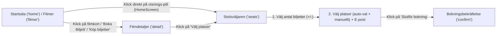

> Bygger på: [tokens.md](tokens.md), [components.md](components.md), [layout.md](layout.md) · Tillbaka till index: [DESIGN.md](../DESIGN.md) · Se även: [coverage.md](coverage.md)

## 6. Användarflöden

**Källfiler:** `src/App.tsx`, `src/components/HomeScreen.tsx`, `src/components/FilmerScreen.tsx`, `src/components/MovieDetailScreen.tsx`, `src/components/SeatSelectionScreen.tsx`, `src/components/BookingConfirmScreen.tsx`, `src/components/MyBookingsScreen.tsx`, `src/components/AdminScreen.tsx`.

### 6.1 Bokningsflöde (Från start till bekräftelse)

1. **Ingång till bokning (`App.tsx`):**
   - **Väg A (via Filmdetaljer):** Användaren klickar på `Boka Biljett` i hero eller på ett filmkort på `HomeScreen` (eller `Köp biljetter` på `FilmerScreen`). `handleSelectMovie(movie)` anropas: sätter `booking.movie = movie`, nollställer `screening`, `selectedSeats`, biljetträknare och `bookingRef`, samt navigerar till `'detail'`. På `MovieDetailScreen` klickar användaren på `Välj platser` för en visning, varpå `handleSelectScreening(movie, screening)` sätter `booking.screening = screening` och navigerar till `'seats'`.
   - **Väg B (direkt från Startsida):** Användaren klickar på en visnings-pill (`{time} · Stora` / `Lilla`) direkt på ett filmkort på `HomeScreen`. `handleSelectScreening(movie, s)` anropas direkt och byter skärm till `'seats'`.
2. **Val av biljetter och platser (`SeatSelectionScreen.tsx`):**
   - Vid inträde är `step = 1` (`1. Biljetter` i `StepIndicator`). Platskartan och e-postfältet är dolda och knappen visar `Välj biljetter` (`disabled`).
   - När användaren ökar minst en biljetträknare (`Vuxen`, `Pensionär` eller `Barn (under 12 år)`) så att `totalTickets > 0`:
     - `step` ändras till `2` (`2. Välj platser`).
     - Den gröna summeringsraden `Totalt: {totalPrice} kr för {totalTickets} biljett/biljetter` visas.
     - Platskartan (`2. Välj platser`) fälls ut och `useEffect` förväljer automatiskt sammanhängande lediga stolar (med start i mittenraderna `E`, `F`, `D` osv.).
   - Användaren kan klicka på stolar i matrisen för att avmarkera eller byta platser. Om färre platser än `totalTickets` är valda är CTA-knappen `disabled` med texten `Välj {diff} platser till` och e-postfältet döljs.
   - När `selectedSeats.length === totalTickets` visas inmatningsfältet `E-post för bokningsbekräftelse` och CTA-knappen blir aktiv med texten `Slutför bokning`.
3. **Slutförande och bekräftelse (`App.tsx` -> `BookingConfirmScreen.tsx`):**
   - Klick på `Slutför bokning` anropar `handleConfirmBooking()` i `App.tsx`, som genererar en unik bokningskod via `generateBookingRef()` (`FV-XXXXX`), sparar bokningen i `savedBookings` och byter skärm till `'confirm'`.
   - På `BookingConfirmScreen` kan användaren kopiera bokningskoden (`Kopiera` -> `Kopierat`), skriva ut (`Skriv ut / Spara som PDF` -> `window.print()`), gå till avbokning (`Avboka biljett` -> `'bookings'`) eller återgå till startsidan (`Tillbaka till startsidan` -> `'home'`).

### 6.2 Avbokningsflöde

1. **Från Bokningsbekräftelsen eller Navigeringen:**
   - Klick på `Avboka biljett` på `BookingConfirmScreen` (eller `Mina Bokningar` i `Nav` / `MobileDrawer`, eller `Biljetter` i `BottomNav`) navigerar till `'bookings'` (`MyBookingsScreen`).
2. **På Mina Sidor (`MyBookingsScreen.tsx`):**
   - Under fliken `Aktuella bokningar` listas alla bokningar i `savedBookings`.
   - Klick på `Visa biljett` öppnar `BookingConfirmScreen` för den valda bokningen (`handleViewConfirm`).
   - Klick på `Avboka` sätter `cancelTarget = booking` och öppnar avbokningsmodalen (`Är du säker på att du vill avboka?`).
   - I modalen kan användaren välja `Behåll bokning` eller `Bekräfta avbokning`. *(Notera: I prototypen stänger båda knapparna endast modalen via `setShowCancelModal(false)` utan att mutera `savedBookings` — se sektion 10).*

### 6.3 Admin-flöden

1. **Åtkomst till Admin (`AdminScreen.tsx`):**
   - Nåbar via länken `Admin` i sidfoten på `HomeScreen` eller via `Admin Backoffice` i `MobileDrawer`.
   - Klick på logotypen `FILMVISARNA` eller knappen `Logga ut` (`Ut` på mobil) i admin-toppbaren navigerar tillbaka till `'home'`.
2. **Flik 1 – Bokningar & Kassa (`BokningarTab.tsx`):**
   - Sökning i realtid på bokningsnummer eller e-post via fältet `Snabb incheckning`.
   - Val av visning i dropdownen `Filtrerar visning`.
   - Klick på `Markera betald` ändrar bokningens status från `'pending'` (`Inväntar`) till `'paid'` (`Betald`), markerar bokningsnumret i grönt och räknar om KPI-kort och `Kassaöversikt`.
   - Klick på `Avboka` raderar bokningen direkt ur listan.
3. **Flik 2 – Visningsschema (`SchemaTab.tsx`):**
   - Filtrera visningar med chipsen `Idag`, `Imorgon`, `Hela veckan`.
   - Klick på `Schemalägg ny visning` (desktop) / `+ Ny Visning` (mobil) öppnar modal / `BottomSheet`. Admin väljer film, salong, datum och starttid, ser automatiskt beräknad sluttid (`inkl. 15 min`) och klickar `Publicera visning`.
   - Klick på `Ställ in` på en visningsrad visar inline-knapparna `Bekräfta` och `Avbryt`. Vid `Bekräfta` ändras visningens status till `'cancelled'` (`Inställd`, `opacity: 0.5`).
4. **Flik 3 – Filmarkiv (`FilmarkivTab.tsx`):**
   - Sök på filmtitel eller regissör.
   - Klick på `Lägg till ny film` / `+ Ny Film` öppnar modal / `BottomSheet` med tomt formulär; klick på `Redigera` öppnar samma modal förifyllt med filmens värden.
   - Klick på `Spara film` sparar filmen i listan, visar grön knapp `Sparad!` och stänger modalen.
   - Klick på `Ta bort` visar inline-knapparna `Bekräfta` och `Avbryt`; vid `Bekräfta` tas filmen bort ur listan.
5. **Flik 4 – Salonger (`SalongerAdminTab.tsx`):**
   - Klick på `Lägg till ny salong` eller `Redigera rader & stolar` öppnar modalen där admin ställer in salongsnamn, rader (`1`–`20`), stolar per rad (`1`–`20`), teknik/format och rullstolsplatser med en `Live förhandsgranskning` av salongskartan.
   - Klick på `Ta bort` visar inline-knapparna `Bekräfta` och `Avbryt`.

---

## 7. Roller och behörigheter som prototypen visar

Prototypen har ingen riktig autentisering eller rollstyrning i state, utan presenterar olika rolltillstånd visuellt på respektive vy:

| Roll / Status | Var den visas i prototypen | Visuella kännetecken och behörigheter i prototypen | Källfil |
| :--- | :--- | :--- | :--- |
| **Ej inloggad besökare / Gäst** | `Nav.tsx`, `MobileDrawer.tsx`, `SeatSelectionScreen.tsx` | I `Nav` visas knapparna `Logga in` och `Bli Medlem`. I `MobileDrawer` visas avatar `G` med texten `Gäst` och `Inte inloggad`. I `SeatSelectionScreen` bokar gästen genom att ange sin e-postadress (`E-post för bokningsbekräftelse`) utan konto. | `src/components/Nav.tsx`, `src/components/MobileDrawer.tsx`, `src/components/SeatSelectionScreen.tsx` |
| **Gästmedlem** | `MyBookingsScreen.tsx` | Visar profilkort med initialer `AL`, e-post (`savedBookings[0]?.email` eller `anna.lindqvist@example.se`) och grön badge `Gästmedlem`. Kan se aktuella bokningar, öppna biljettbekräftelsen och öppna avbokningsmodalen. | `src/components/MyBookingsScreen.tsx` |
| **Aktiv medlem** | `ProfilScreen.tsx` | Visar avatar (`G` eller initialer från för-/efternamn), e-post med badge `VERIFIERAD`, grön status-pill `Aktiv medlem`, statistik (`Bokningar` och `Poäng: 240`), samt flikar för att redigera personuppgifter, byta lösenord och se bokningshistorik. | `src/components/ProfilScreen.tsx` |
| **Admin / Superadmin** | `AdminScreen.tsx` (samt ingångar i `HomeScreen.tsx` och `MobileDrawer.tsx`) | Visar i toppbaren badge `Backoffice` samt användarbricka med avatar `A`, `Admin: Ameer` och `Superadmin`. Har tillgång till samtliga 4 backoffice-flikar (`Bokningar & Kassa`, `Visningsschema`, `Filmarkiv`, `Salonger`). | `src/components/AdminScreen.tsx`, `src/components/HomeScreen.tsx`, `src/components/MobileDrawer.tsx` |

---

## 8. Ikoner och bilder

### 8.1 Ikoner

Prototypen använder inga externa ikonbibliotek i komponenterna, utan renderar **inline SVG-ikoner** (`viewBox="0 0 24 24"`, Material Design-paths) samt två emojis:

| Ikon / Symbol | Användning | Färg & Storlek | Källfil(er) |
| :--- | :--- | :--- | :--- |
| **Förstoringsglas (Sök)** | Sökknapp i `Nav`, sökfält i `FilmerScreen`, `BokningarTab`, `FilmarkivTab` | `16×16px`, `#94A3B8` | `src/components/Nav.tsx`, `src/components/FilmerScreen.tsx`, `src/components/admin/BokningarTab.tsx`, `src/components/admin/FilmarkivTab.tsx` |
| **Hamburgermeny (3 streck)** | Öppna `MobileDrawer` på mobil | `20×20px`, `#94A3B8` | `src/components/Nav.tsx` |
| **Stäng (Kryss `X`)** | Stäng `MobileDrawer`, `TrailerModal`, admin-modaler | `16×16px`, `#94A3B8` / `#ffffff` | `src/components/MobileDrawer.tsx`, `src/components/FilmerScreen.tsx`, `src/components/admin/SchemaTab.tsx`, `src/components/admin/FilmarkivTab.tsx`, `src/components/admin/SalongerAdminTab.tsx` |
| **Hem (Hus)** | `BottomNav` (fylld som aktiv, outline som inaktiv), `MobileDrawer` | `22×22px` (`BottomNav`), `20×20px` (`MobileDrawer`) | `src/components/BottomNav.tsx`, `src/components/MobileDrawer.tsx` |
| **Filmklappa / Filmremsa** | `BottomNav`, `MobileDrawer`, footer-logotyp (`HomeScreen`), tomt tillstånd (`MyBookingsScreen`), `AdminScreen` | `16×16px`–`32×32px` | `src/components/BottomNav.tsx`, `src/components/MobileDrawer.tsx`, `src/components/HomeScreen.tsx`, `src/components/MyBookingsScreen.tsx`, `src/components/AdminScreen.tsx` |
| **Biljett** | `BottomNav` (`Biljetter`), `MobileDrawer` (`Mina Bokningar`) | `22×22px` / `20×20px` | `src/components/BottomNav.tsx`, `src/components/MobileDrawer.tsx` |
| **Användare (Profil)** | `Nav` (mobil), `BottomNav`, `MobileDrawer` | `16×16px` / `22×22px` / `20×20px` | `src/components/Nav.tsx`, `src/components/BottomNav.tsx`, `src/components/MobileDrawer.tsx` |
| **Lager / Stack** | `Admin Backoffice`-länk i `MobileDrawer` | `20×20px`, `stroke-width: 1.5` | `src/components/MobileDrawer.tsx` |
| **Kaka (Cookie)** | Vänsterikon i `CookieBanner` | `20×20px`, `#E50914` | `src/components/CookieBanner.tsx` |
| **Play-triangel** | `Se Trailer`-knappar (`HomeScreen`, `FilmerScreen`), hero-overlay (`MovieDetailScreen`), `TrailerModal` | `14×14px`–`32×32px` | `src/components/HomeScreen.tsx`, `src/components/FilmerScreen.tsx`, `src/components/MovieDetailScreen.tsx` |
| **Chevron / Pilar** | `Boka Biljett` (`HomeScreen`), `Tillbaka` (`MovieDetailScreen`, `SeatSelectionScreen`, `ProfilScreen`), brödsmula (`AdminScreen`) | `12×12px`–`16×16px` | `src/components/HomeScreen.tsx`, `src/components/MovieDetailScreen.tsx`, `src/components/SeatSelectionScreen.tsx`, `src/components/ProfilScreen.tsx`, `src/components/AdminScreen.tsx` |
| **Kalender** | Datumfilter i `HomeScreen`, flikikon `Visningsschema` i `AdminScreen` | `14×14px` / `16×16px` | `src/components/HomeScreen.tsx`, `src/components/AdminScreen.tsx` |
| **Stjärna (IMDb)** | `StarRating` i `FilmerScreen` | `13×13px`, `#F59E0B` | `src/components/FilmerScreen.tsx` |
| **Ringklocka (Påminnelse)** | `Bli påmind vid biljettsläpp` / `Påminnelse aktiv` i `FilmerScreen` | `14×14px`, `#94A3B8` / `#10B981` | `src/components/FilmerScreen.tsx` |
| **Bock (Checkmark)** | `StepIndicator`, biljettsummering, `BookingConfirmScreen`, `SalongerScreen`, `ProfilScreen`, admin-knappar | `12×12px`–`36×36px`, `#10B981` / `#E50914` / `#ffffff` | `src/components/SeatSelectionScreen.tsx`, `src/components/BookingConfirmScreen.tsx`, `src/components/SalongerScreen.tsx`, `src/components/ProfilScreen.tsx`, `src/components/admin/*` |
| **Kopiera (Urklipp)** | `Kopiera`-knapp på `BookingConfirmScreen` | `14×14px`, `#94A3B8` | `src/components/BookingConfirmScreen.tsx` |
| **QR-kod (Mock)** | `21×21` SVG-matris i `BookingConfirmScreen` samt `6×6` CSS-grid i `ProfilScreen` | `112×112px` / `60×60px`, `#000000` på `#ffffff` | `src/components/BookingConfirmScreen.tsx`, `src/components/ProfilScreen.tsx` |
| **Rullstol / Tillgänglighet** | Badge i `SalongerScreen` och `SalongerAdminTab` | `14×14px` / `12×12px`, `#3B82F6` | `src/components/SalongerScreen.tsx`, `src/components/admin/SalongerAdminTab.tsx` |
| **Varningstriangel** | Avbokningsmodal i `MyBookingsScreen` | `24×24px`, `#E50914` | `src/components/MyBookingsScreen.tsx` |
| **Penna (Redigera)** | Avatar-knapp i `ProfilScreen`, `Redigera`-knappar i `SchemaTab`, `FilmarkivTab`, `SalongerAdminTab` | `12×12px`–`16×16px` | `src/components/ProfilScreen.tsx`, `src/components/admin/SchemaTab.tsx`, `src/components/admin/FilmarkivTab.tsx`, `src/components/admin/SalongerAdminTab.tsx` |
| **Öga / Öga med streck** | Visa/dölj lösenord i `ProfilScreen` | `18×18px`, `#94A3B8` | `src/components/ProfilScreen.tsx` |
| **Utloggning (Dörr med pil)** | `Logga ut`-knapp i `AdminScreen` | `14×14px`, `#94A3B8` | `src/components/AdminScreen.tsx` |
| **Klocka** | Beräknad sluttid i `SchemaTab` | `16×16px`, `#10B981` | `src/components/admin/SchemaTab.tsx` |
| **Plus (`+`)** | Skapa-knappar i `SchemaTab`, `FilmarkivTab`, `SalongerAdminTab` | `16×16px`–`18×18px`, `#ffffff` | `src/components/admin/SchemaTab.tsx`, `src/components/admin/FilmarkivTab.tsx`, `src/components/admin/SalongerAdminTab.tsx` |
| **Papperskorg** | `Ställ in` (`SchemaTab`) och `Ta bort` (`FilmarkivTab`, `SalongerAdminTab`) | `12×12px`–`16×16px`, `#ff6b6b` | `src/components/admin/SchemaTab.tsx`, `src/components/admin/FilmarkivTab.tsx`, `src/components/admin/SalongerAdminTab.tsx` |
| **Diskett (Spara)** | `Spara film` (`FilmarkivTab`) och `Spara salongskonfiguration` (`SalongerAdminTab`) | `16×16px`, `#ffffff` | `src/components/admin/FilmarkivTab.tsx`, `src/components/admin/SalongerAdminTab.tsx` |
| **Emojis (`🔍`, `🎬`)** | Tomt sökresultat i `FilmerScreen` (`🔍`), tom bokningshistorik i `ProfilScreen` (`🎬`) | `40px` | `src/components/FilmerScreen.tsx`, `src/components/ProfilScreen.tsx` |

### 8.2 Bilder och Filer i `src/assets/`

1. **Externa bilder (Unsplash — Exempeldata):**
   - Alla filmer i `MOVIES` (8 st) och `UPCOMING_MOVIES` (4 st) i `src/data.ts` använder Unsplash-URL:er med parametrarna `?w=400&h=600&fit=crop&auto=format` för `poster` (2:3-format) och `?w=1440&h=600&fit=crop&auto=format` för `backdrop` (12:5-format).
   - `SalongerScreen.tsx` använder två Unsplash-bilder i `?w=800&h=450&fit=crop&auto=format` (16:9-format) för Salong 1 och Salong 2.
   - `FilmarkivTab.tsx` har en fallback-poster och fallback-backdrop från Unsplash när nya filmer läggs till utan egen bild-URL.
2. **Filer i `docs/figma-make/src/assets/`:**
   - `docs/figma-make/src/assets/spec2.png`: Trots filändelsen `.png` är detta en UTF-8-textfil med exakt samma innehåll som `docs/figma-make/src/imports/pasted_text/filmvisarna-booking-spec.md`. Den importeras inte i koden.
   - `docs/figma-make/src/assets/upload.png`: Trots filändelsen `.png` är detta en UTF-8-textfil med exakt samma innehåll som `docs/figma-make/src/imports/pasted_text/cinema-app-screens.md`. Den importeras inte i koden.

---

## 9. Ej med i vår app

1. **Rollväxlare `"Byt roll (DEMO)"` och kontaktformulär på `Om oss`:**
   - Enligt projektreglerna ska varken `"Byt roll (DEMO)"` eller kontaktformulär på `Om oss` vara med i vår app.
   - I `docs/figma-make/src/` finns varken någon `"Byt roll (DEMO)"`-komponent eller någon `Om oss`-sida. Däremot har prototypen öppna demogenvägar till Admin utan inloggning:
     - Länken `Admin` längst ned till höger i sidfoten på `HomeScreen.tsx`.
     - Menyvalet `Admin Backoffice` med badgen `ADMIN` i `MobileDrawer.tsx`.
   - I den riktiga applikationen styrs åtkomst till admin av faktisk autentisering och behörighet.
2. **Funktioner i prototypen som saknar backend-stöd (endast visuell mock i prototypen):**
   - **Lojalitetspoäng (`Poäng: 240`)** och badge `VERIFIERAD` i `ProfilScreen.tsx`.
   - **Bevakning av kommande filmer (`Bli påmind vid biljettsläpp` / `Påminnelse aktiv`)** i `FilmerScreen.tsx`.
   - **Affisch som ren text-URL (`Affisch-bild URL`)** i `FilmarkivTab.tsx` (i vår app hanteras affischuppladdning även via filuppladdning `POST /api/upload`).

---

## 10. Inkonsekvenser och OKLART

Nedan listas alla identifierade inkonsekvenser mellan kravspecifikationerna i `src/imports/pasted_text/`, mellan olika skärmar i prototypen, samt delar som är ofullständiga eller oklara i `docs/figma-make/src/`.

### 10.1 Inkonsekvenser i salongskapacitet, rader och stolar

- **Salong 1 (Stora Salongen) och Salong 2 (Lilla Salongen) har tre olika konfigurationer i prototypen:**
  1. `SeatSelectionScreen.tsx` (rad 13–14) och `data.ts` (`generateOccupiedSeats`, rad 301–304): Använder alltid **10 rader (`A`–`J`) × 12 stolar per rad = 120 platser**, oavsett om visningen går i Stora eller Lilla Salongen.
  2. `SalongerScreen.tsx` (rad 13, 20–21, 28, 35–36): Anger för Salong 1 **10 rader × 8 stolar = 80 platser** och för Salong 2 **5 rader × 8 stolar = 40 platser**.
  3. `adminData.ts` (`ADMIN_SALONGER`, rad 68–69): Anger för Salong 1 **8 rader × 10 stolar = 80 platser** och för Salong 2 **5 rader × 8 stolar = 40 platser**.
- **OKLART:** Vilka exakta rad- och stolsmått som gäller för Salong 1 vid seedning (10×8, 8×10 eller 10×12). I vår app styrs detta dynamiskt av salongsdata från backend.

### 10.2 Inkonsekvens i stolsnumrering och rullstolsplatser

- **Stolsnumrering (Höger-till-vänster vs. Vänster-till-höger):**
  - Båda kravspecifikationerna (`cinema-app-screens.md` rad 50 och `filmvisarna-booking-spec.md` rad 71), rubriken i `SalongerAdminTab.tsx` (rad 149: `Salongskarta — numrering höger till vänster`) och kommentaren i `SeatSelectionScreen.tsx` (rad 133: `numbered right to left = seats 1..12`) anger att stolar ska numreras från **höger till vänster, framifrån och bakåt**.
  - Trots detta renderar `SeatSelectionScreen.tsx` (rad 302: `Array.from({ length: SEATS_PER_ROW }, (_, i) => i + 1)`) stolarna `1` till `12` från **vänster till höger** i DOM:en (utan `flex-row-reverse`).
- **Radsyntax (Bokstäver vs. Siffror):**
  - `cinema-app-screens.md` (rad 49, 58, 73) skriver `Rad 1 to Rad N` och `Rad 4, Stol 12, 13, 14`.
  - `filmvisarna-booking-spec.md` (rad 70) skriver `from A to J (or 1 to 10)` och alla komponenter (`SeatSelectionScreen.tsx`, `BookingConfirmScreen.tsx`, `adminData.ts`, `SalongerAdminTab.tsx`) använder bokstäver (`Rad A`–`Rad J`).
- **Rullstolsplatsers radplacering i `SalongerScreen.tsx`:**
  - Texten i `SalongerScreen.tsx` (rad 17, 32, 266) och `SalongerAdminTab.tsx` (rad 29, 68–69) säger att rullstolsplatser finns på **första raden (`Rad A`)**.
  - Men i `MiniAuditoriumMap` i `SalongerScreen.tsx` (rad 61: `const isAccessible = ri === rows - 1 && (si === 0 || si === seatsPerRow - 1)`) färgas i stället **sista raden** blå samtidigt som första raden (`ri === 0`) tonas ned med `opacity: 0.5`.

### 10.3 Inkonsekvenser i UI-texter och färger mellan spec och kod

1. **Huvudrubrik på `BookingConfirmScreen.tsx`:**
   - `cinema-app-screens.md` (rad 68) anger `"Bokning bekräftad!"`.
   - `filmvisarna-booking-spec.md` (rad 84) och `BookingConfirmScreen.tsx` (rad 63) använder `"Tack för din bokning!"`.
2. **Totalbelopp-etikett på `BookingConfirmScreen.tsx`:**
   - `cinema-app-screens.md` (rad 75) anger `"Att betala i biografens kassa: 360 kr"`.
   - `filmvisarna-booking-spec.md` (rad 89) och `BookingConfirmScreen.tsx` (rad 179) använder `"Att betala i kassan"`.
3. **Navigationslänkar på desktop (`Nav.tsx`):**
   - Specarna anger 3 länkar: `"Filmer"`, `"Salonger"`, `"Mina Bokningar"`.
   - `Nav.tsx` (rad 9–14) har 4 länkar: `"Hem"`, `"Filmer & Repertoar"`, `"Salonger"`, `"Mina Bokningar"`.
   - I `Nav.tsx` på mobil ligger både hamburgerknapp och profilknapp till höger om logotypen, medan `filmvisarna-booking-spec.md` (rad 32) beskriver `"Hamburger menu left, centered logo, profile icon right"`.
4. **Datumfilter-etikett:**
   - `filmvisarna-booking-spec.md` (rad 38) skriver `"Helgen"`.
   - `cinema-app-screens.md` (rad 6) och `data.ts` (rad 295) använder `"I helgen"`.
5. **Åldersbadges (Färger och textformat):**
   - `HomeScreen.tsx` (rad 208–212): Använder `#10B981` för `'Alla'` och `#E50914` för alla andra åldrar, med texten `Alla` eller `{ageRating} år`.
   - `FilmerScreen.tsx` (rad 118–123): Använder `#10B981` för `'Alla'`, `#E50914` för `'15'` och `#F59E0B` för övriga (`7`, `11`), men skriver ut `{ageRating}` **utan** `" år"`.
   - `FilmarkivTab.tsx` (rad 190, 259): Använder semitransparent grön för `'Alla'` och semitransparent röd (`#ff6b6b`) för övriga åldrar.
6. **Gränsvärde för "få platser kvar":**
   - `HomeScreen.tsx` (rad 254) och `FilmerScreen.tsx` (rad 193) rödmarkerar visnings-pills vid `seatsLeft < 10`.
   - `MovieDetailScreen.tsx` (rad 197) rödmarkerar texten `{seatsLeft} platser kvar` vid `seatsLeft < 15`.
7. **Salong 2-färg:**
   - På `SalongerScreen.tsx` (rad 34) har Salong 2 accentfärgen grön (`#10B981`).
   - I `SchemaTab.tsx` (rad 269–270, 373) har Salong 2-badgen blå bakgrund (`rgba(59, 130, 246, 0.12)`) och ljusblå text (`#60A5FA`).
8. **Admin live-salongskarta (`BokningarTab.tsx` rad 28, 34):**
   - Färgar `Bokad` röd (`#E50914`) och `Inväntar` grön (`#10B981`), medan status-badgen för `Inväntar` i samma komponent (rad 70–71, 349) är bärnstensgul (`#F59E0B`).
9. **Städbuffert vid schemaläggning (`SchemaTab.tsx` rad 9, 181):**
   - `calcEndTime` i `SchemaTab.tsx` lägger på **15 minuter** (`inkl. 15 min`), medan backend-kontraktet i projektet använder 20 minuters städbuffert.
10. **Max antal biljetter i `SeatSelectionScreen.tsx` (rad 95):**
    - Varje biljetträknare tillåter upp till `8` biljetter per kategori (`Math.min(8, count + 1)`), alltså upp till 24 biljetter totalt, medan `SEATS_PER_ROW` är 12 (och projektets backend tillåter max 10 biljetter per bokning).

### 10.4 Tekniska brister och OKLART i prototypkoden

- **Odefinierad CSS-variabel i `src/index.css` (rad 108):** Klassen `.chip` sätter `font-family: var(--font-outfit);`, men `--font-outfit` existerar inte i `:root` (endast `--font-display`, `--font-sans` och `--font-jetbrains` är definierade).
- **Saknade sidor och vyer (OKLART i prototypen):**
  - **OKLART – `/om-oss`:** Sida för "Om oss" saknas helt i `docs/figma-make/src/`.
  - **OKLART – `/admin/kiosk`:** Vy/flik för kioskhantering i admin saknas helt i `docs/figma-make/src/`.
  - **OKLART – Inloggnings-, registrerings- och e-postavbokningsvyer:** Knappen `Logga in` i `Nav.tsx` går direkt till `ProfilScreen`, och knappen `Bli Medlem` har ingen funktion. Det finns inget separat login- eller registreringsformulär och ingen vy för avbokning via e-postlänk (`cancel-preview`) i prototypen.
  - **OKLART – Laddnings- och feltillstånd (Loading & Error states):** Prototypen använder lokal synkron mockdata och saknar helt laddningsskelett/spinners samt felmeddelanden vid API-/valideringsfel.
- **Knappar utan funktion i prototypen:**
  - Sökknappen och `Bli Medlem` i `Nav.tsx`.
  - `Logga ut` i `MobileDrawer.tsx`.
  - `Se Trailer` och kalenderknappen på `HomeScreen.tsx`.
  - Play-knappen och datumchipsen (`Imorgon`, `Lördag`, `Söndag`) på `MovieDetailScreen.tsx`.
  - `Integritetspolicy` och `Cookie-inställningar` i footern på `HomeScreen.tsx`.
  - `Bekräfta avbokning` i `MyBookingsScreen.tsx` (stänger endast modalen utan att ta bort bokningen).
  - Avatar-redigeringsknappen, `Uppdatera lösenord` och underfliken `Tidigare besök` i `ProfilScreen.tsx`.
  - `Checka in`-knappen i `BokningarTab.tsx` och `Redigera`-knappen i `SchemaTab.tsx`.

