> Bygger på: [tokens.md](tokens.md), [components.md](components.md), [layout.md](layout.md) · Tillbaka till index: [DESIGN.md](../DESIGN.md) · Se även: [coverage.md](coverage.md)

## 6. Användarflöden

**Källfiler:** `src/App.tsx`, `src/components/HomeScreen.tsx`, `src/components/FilmerScreen.tsx`, `src/components/MovieDetailScreen.tsx`, `src/components/SeatSelectionScreen.tsx`, `src/components/BookingConfirmScreen.tsx`, `src/components/MyBookingsScreen.tsx`, `src/components/AdminScreen.tsx`.

### 6.1 Bokningsflöde (Från start till bekräftelse)

**Gällande säkerhetskrav:** [booking-security.md](booking-security.md) och [bokningssidans implementation](pages/seat-selection.md#bokningsskydd-och-gästbekräftelse--gällande-implementation) har företräde framför prototypflödet nedan. En verifierad medlem kan slutföra bokningen direkt. En gäst skickar en separat förfrågan, får en kortlivad mejllänk och måste uttryckligen bekräfta. Ingen gästförfrågan tar platser före bekräftelsen. Alla bokningar omfattas av backendens gemensamma kvoter och idempotensskydd.

```mermaid
flowchart LR
  A["Startsida ('home') / Filmer ('filmer')"] -->|"Klick på filmkort / 'Boka Biljett' / 'Köp biljetter'"| B["Filmdetaljer ('detail')"]
  A -->|"Klick direkt på visnings-pill (HomeScreen)"| C["Stolsväljaren ('seats')"]
  B -->|"Klick på 'Välj platser'"| C
  C -->|"1. Välj antal biljetter (+/-)"| D["2. Välj platser (auto-val + manuellt) + E-post"]
  D -->|"Verifierad medlem: Slutför bokning"| E["Bokningsbekräftelse från API"]
  D -->|"Gäst: Skicka bekräftelsemejl"| F["Separat gästförfrågan utan reserverade platser"]
  F -->|"Öppna kortlivad mejllänk"| G["Granska val och klicka Bekräfta bokning"]
  G -->|"API kontrollerar ledighet och kvoter"| E
```

1. **Ingång till bokning (`App.tsx`):**
   - **Väg A (via Filmdetaljer):** Användaren klickar på `Boka Biljett` i hero eller på ett filmkort på `HomeScreen` (eller `Köp biljetter` på `FilmerScreen`). `handleSelectMovie(movie)` anropas: sätter `booking.movie = movie`, nollställer `screening`, `selectedSeats`, biljetträknare och `bookingRef`, samt navigerar till `'detail'`. På `MovieDetailScreen` klickar användaren på `Välj platser` för en visning, varpå `handleSelectScreening(movie, screening)` sätter `booking.screening = screening` och navigerar till `'seats'`.
   - **Väg B (direkt från Startsida):** Användaren klickar på en visnings-pill (`{time} · Stora` / `Lilla`) direkt på ett filmkort på `HomeScreen`. `handleSelectScreening(movie, s)` anropas direkt och byter skärm till `'seats'`.
2. **Val av biljetter och platser (`SeatSelectionScreen.tsx`):**
   - Vid inträde är `step = 1` (`1. Biljetter` i `StepIndicator`). Platskartan och e-postfältet är dolda och knappen visar `Välj biljetter` (`disabled`).
   - När användaren ökar minst en biljetträknare (`Vuxen`, `Pensionär` eller `Barn (under 12 år)`) så att `totalTickets > 0`:
     - `step` ändras till `2` (`2. Välj platser`).
     - Den gröna summeringsraden `Totalt: {totalPrice} kr för {totalTickets} biljett/biljetter` visas.
     - Platskartan (`2. Välj platser`) fälls ut och `useEffect` förväljer automatiskt sammanhängande lediga stolar (med start i mittenraderna `E`, `F`, `D` osv.).
   - Användaren kan klicka på stolar i matrisen för att avmarkera eller byta platser. Om färre platser än `totalTickets` är valda är CTA-knappen `disabled` med texten `Välj {diff} platser till` och e-postfältet döljs.
   - När `selectedSeats.length === totalTickets` visas inmatningsfältet `E-post för bokningsbekräftelse` och CTA-knappen blir aktiv med texten `Slutför bokning`.
3. **Slutförande och bekräftelse (`ScreeningDetail.tsx` / `ConfirmGuestBooking.tsx`):**
   - Backend genererar bokningsreferensen och skapar biljetter atomärt först efter godkänd autentisering/verifiering, ledighetskontroll och kvoter. Klienten får inte generera en lyckad bokning lokalt.
   - Gästförfrågningar är separata och obekräftade tills gästen uttryckligen godkänner bokningen via mejllänken. De ingår inte i adminbokningar eller statistik.
   - Kvittot sparas från API-svaret och sidan navigerar till `/bekraftelse/:kod`, där kunden kan visa, kopiera och skriva ut bokningsreferensen. Avbokning följer befintligt API och dess tidsgräns.

### 6.2 Avbokningsflöde

1. **Från Bokningsbekräftelsen eller Navigeringen:**
   - Klick på `Avboka biljett` på `BookingConfirmScreen` (eller `Mina Bokningar` i `Nav` / `MobileDrawer`, eller `Biljetter` i `BottomNav`) navigerar till `'bookings'` (`MyBookingsScreen`).
2. **På Mina Sidor (`MyBookingsScreen.tsx`):**
   - Under fliken `Aktuella bokningar` listas alla bokningar i `savedBookings`.
   - Klick på `Visa biljett` öppnar `BookingConfirmScreen` för den valda bokningen (`handleViewConfirm`).
   - Klick på `Avboka` sätter `cancelTarget = booking` och öppnar avbokningsmodalen (`Är du säker på att du vill avboka?`).
   - I modalen kan användaren välja `Behåll bokning` eller `Bekräfta avbokning`. *(Notera: I prototypen stänger båda knapparna endast modalen via `setShowCancelModal(false)` utan att mutera `savedBookings` — se sektion 10).*

### 6.3 Admin-flöden

**Framtida missbrukshantering:** Följ [booking-security.md](booking-security.md#åtskillnad-och-framtida-adminarbete--krav-inte-implementerad-adminfunktion). Gästförfrågningar ska hållas utanför bekräftade bokningar och statistik. Framtida adminarbete ska stödja beteendebaserad flaggning, säker granskning, uttrycklig adminavbokning som frigör platser och skyddad loggning av åtgärder. Detta dokumenterar krav; ingen sådan adminfunktion byggs i den aktuella ändringen.

1. **Åtkomst till Admin (`/admin`):**
   - Nåbar för inloggade administratörer (`user.role === 'admin'`) via `Backoffice` (`/admin`, badge `ADMIN`) i den publika desktopmenyn, avatar-dropdownen eller mobilens sidomeny. Adminrouten skyddas även vid direktnavigering.
   - Inne i admin finns `Backoffice` som första länk både i desktopmenyn och sidomenyn. Den öppnar administrationsöversikten och är aktiv bara vid exakt `/admin`. Övriga länkar öppnar bokningar, visningsschema, filmarkiv och salonger. `Till biografen` och logotypen går till den publika hemsidan. Utloggning sker via avatar-dropdownen eller sidomenyn.
   - Filmarkiv och Visningsschema delar `AdminPageHeader`, där `Backoffice` i brödsmulan också leder till översikten. Brödsmulorna ligger uppe till höger på desktop och under rubrikblocket på mobil.
2. **Flik 1 – Bokningar & Kassa (`BokningarTab.tsx`):**
   - Sökning i realtid på bokningsnummer eller e-post via fältet `Snabb incheckning`.
   - Val av visning i dropdownen `Filtrerar visning`.
   - Klick på `Markera betald` ändrar bokningens status från `'pending'` (`Inväntar`) till `'paid'` (`Betald`), markerar bokningsnumret i grönt och räknar om KPI-kort och `Kassaöversikt`.
   - Klick på `Avboka` raderar bokningen direkt ur listan.
3. **Visningsschema (`AdminScreenings.tsx`, aktuell implementation):**
   - Filtrera med `Alla kommande`, `Idag`, `Imorgon`, `Hela veckan`, datumkalender och salongsval. Listan visar 15 poster per sida, som kort under `1200px` och tabell från `1200px`.
   - `Schemalägg ny visning` och `Redigera` öppnar samma responsiva formulär. Admin väljer film, salong, datum och starttid; sluttiden inkluderar 20 minuters städning. Lyckat API-svar stänger formuläret, laddar om listan och visar grön återkoppling.
   - `Ställ in` kräver `Ja, ställ in` / `Avbryt`. Visningar med bokningar kan inte ställas in och har låst datum, tid och salong vid redigering; orsaken visas i klartext. Se [Visningsschema](pages/admin-visningar.md).
4. **Filmarkiv (`AdminMovies.tsx`, aktuell implementation):**
   - Sök på filmtitel eller regissör; räknare och sidnumrering uppdateras, med 10 filmer per sida.
   - `Lägg till film` öppnar ett tomt formulär, `Redigera` ett förifyllt. Admin kan mata in manuellt eller söka i TMDB, välja ett förslag och granska metadata samt skådespelare före sparning.
   - Affisch kan väljas som fil med förhandsvisning eller bild-URL. Rollistan återanvänder personprofiler och kan kompletteras med bilder, biografier och rollfigurer. Ett öppet profilutkast måste sparas eller avbrytas innan filmen sparas.
   - Efter lyckad filmsparning visas grön `Sparad!` i dialog och lista. Dialogen förblir öppen, stängs med `Stäng`, och fortsatt redigering uppdaterar samma film-ID.
   - Borttagning använder inline-bekräftelse. Registrerade visningar, även tidigare, blockerar borttagning med synlig svensk förklaring. Att ta bort en skådespelare från filmen raderar bara filmkopplingen. Se [Filmarkiv](pages/admin-filmer.md).
5. **Flik 4 – Salonger (`SalongerAdminTab.tsx`):**
   - Klick på `Lägg till ny salong` eller `Redigera rader & stolar` öppnar modalen där admin ställer in salongsnamn, rader (`1`–`20`), stolar per rad (`1`–`20`), teknik/format och rullstolsplatser med en `Live förhandsgranskning` av salongskartan.
   - Klick på `Ta bort` visar inline-knapparna `Bekräfta` och `Avbryt`.

---

## 7. Roller och behörigheter som prototypen visar

Prototypen har ingen riktig autentisering eller rollstyrning i state, utan presenterar olika rolltillstånd visuellt på respektive vy:

| Roll / Status | Var den visas i prototypen | Visuella kännetecken och behörigheter i prototypen | Källfil |
| :--- | :--- | :--- | :--- |
| **Ej inloggad besökare / Gäst** | `Nav.tsx`, `MobileDrawer.tsx`, `SeatSelectionScreen.tsx` | I `Nav` visas knapparna `Logga in` och `Bli Medlem`. I `MobileDrawer` visas avatar `G` med texten `Gäst` och `Inte inloggad`. I `SeatSelectionScreen` bokar gästen genom att ange sin e-postadress (`E-post för bokningsbekräftelse`) utan konto. | `src/components/Nav.tsx`, `src/components/MobileDrawer.tsx`, `src/components/SeatSelectionScreen.tsx` |
| **Gästmedlem** | `MyBookingsScreen.tsx` | Visar profilkort med initialer `AL`, e-post (`savedBookings[0]?.email` eller `anna.lindqvist@example.se`) och grön badge `Gästmedlem`. Kan se aktuella bokningar, öppna biljettbekräftelsen och öppna avbokningsmodalen. | `src/components/MyBookingsScreen.tsx` |
| **Aktiv medlem** | `ProfilScreen.tsx` | Visar avatar (`G` eller initialer från för-/efternamn), e-post med badge `VERIFIERAD`, grön status-pill `Aktiv medlem`, statistik (`Bokningar` och `Poäng: 240`), samt flikar för att redigera personuppgifter, byta lösenord och se bokningshistorik. | `src/components/ProfilScreen.tsx` |
| **Admin / Superadmin** | `Navbar.tsx`, `MobileDrawer.tsx`, `BottomNav.tsx` & `/admin/*` | I den aktuella appen har rollen `admin` tillgång till `Backoffice` (`/admin`, `ADMIN`-badge) via desktopmeny och mobil sidomeny. Inne i admin finns en länk tillbaka till översikten samt vyerna för bokningar, visningar, filmer och salonger. Route- och API-skydd baseras på serverns session. | `Frontend/src/components/Navbar.tsx`, `Frontend/src/components/MobileDrawer.tsx`, `Frontend/src/components/BottomNav.tsx` |

---

## 8. Ikoner och bilder

### 8.1 Ikoner

Prototypen använder inga externa ikonbibliotek i komponenterna, utan renderar **inline SVG-ikoner** (`viewBox="0 0 24 24"`, Material Design-paths) samt två emojis:

| Ikon / Symbol | Användning | Färg & Storlek | Källfil(er) |
| :--- | :--- | :--- | :--- |
| **Förstoringsglas (Sök)** | Sökknapp i `Nav`, sökfält i `FilmerScreen`, `BokningarTab`, `FilmarkivTab` | `16×16px`, `#94A3B8` | `src/components/Nav.tsx`, `src/components/FilmerScreen.tsx`, `src/components/admin/BokningarTab.tsx`, `src/components/admin/FilmarkivTab.tsx` |
| **Hamburgermeny (3 streck)** | Öppna `MobileDrawer` på mobil | `20×20px`, `#94A3B8` | `src/components/Nav.tsx` |
| **Stäng (Kryss `X`)** | Stäng `MobileDrawer`, `TrailerModal`, admin-modaler | `16×16px`, `#94A3B8` / `#ffffff` | `src/components/MobileDrawer.tsx`, `src/components/FilmerScreen.tsx`, `src/components/admin/SchemaTab.tsx`, `src/components/admin/FilmarkivTab.tsx`, `src/components/admin/SalongerAdminTab.tsx` |
| **Hem (Hus)** | `BottomNav` (fylld som aktiv, outline som inaktiv), `MobileDrawer` | `22×22px` (`BottomNav`), `20×20px` (`MobileDrawer`) | `src/components/BottomNav.tsx`, `src/components/MobileDrawer.tsx` |
| **Filmklappa / Filmremsa** | `BottomNav`, `MobileDrawer`, footer-logotyp (`HomeScreen`), tomt tillstånd (`MyBookingsScreen`), `AdminScreen` | `16×16px`–`32×32px` | `src/components/BottomNav.tsx`, `src/components/MobileDrawer.tsx`, `src/components/HomeScreen.tsx`, `src/components/MyBookingsScreen.tsx`, `src/components/AdminScreen.tsx` |
| **Biljett** | `BottomNav` (`Biljetter`), `MobileDrawer` (`Mina Bokningar`) | `22×22px` / `20×20px` | `src/components/BottomNav.tsx`, `src/components/MobileDrawer.tsx` |
| **Användare (Profil)** | `Nav` (mobil), `BottomNav`, `MobileDrawer` | `16×16px` / `22×22px` / `20×20px` | `src/components/Nav.tsx`, `src/components/BottomNav.tsx`, `src/components/MobileDrawer.tsx` |
| **Lager / Stack** | `Admin Backoffice`-länk i `MobileDrawer` | `20×20px`, `stroke-width: 1.5` | `src/components/MobileDrawer.tsx` |
| **Kaka (Cookie)** | Vänsterikon i `CookieBanner` | `20×20px`, `#E50914` | `src/components/CookieBanner.tsx` |
| **Play-triangel** | `Se Trailer`-knappar (`HomeScreen`, `FilmerScreen`), hero-overlay (`MovieDetailScreen`), `TrailerModal` | `14×14px`–`32×32px` | `src/components/HomeScreen.tsx`, `src/components/FilmerScreen.tsx`, `src/components/MovieDetailScreen.tsx` |
| **Chevron / Pilar** | `Boka Biljett` (`HomeScreen`), `Tillbaka` (`MovieDetailScreen`, `SeatSelectionScreen`, `ProfilScreen`), brödsmula (`AdminScreen`) | `12×12px`–`16×16px` | `src/components/HomeScreen.tsx`, `src/components/MovieDetailScreen.tsx`, `src/components/SeatSelectionScreen.tsx`, `src/components/ProfilScreen.tsx`, `src/components/AdminScreen.tsx` |
| **Kalender** | Datumfilter i `HomeScreen`, flikikon `Visningsschema` i `AdminScreen` | `14×14px` / `16×16px` | `src/components/HomeScreen.tsx`, `src/components/AdminScreen.tsx` |
| **Stjärna (IMDb)** | `StarRating` i `FilmerScreen` | `13×13px`, `#F59E0B` | `src/components/FilmerScreen.tsx` |
| **Ringklocka (Påminnelse)** | `Bli påmind vid biljettsläpp` / `Påminnelse aktiv` i `FilmerScreen` | `14×14px`, `#94A3B8` / `#10B981` | `src/components/FilmerScreen.tsx` |
| **Bock (Checkmark)** | `StepIndicator`, biljettsummering, `BookingConfirmScreen`, `SalongerScreen`, `ProfilScreen`, admin-knappar | `12×12px`–`36×36px`, `#10B981` / `#E50914` / `#ffffff` | `src/components/SeatSelectionScreen.tsx`, `src/components/BookingConfirmScreen.tsx`, `src/components/SalongerScreen.tsx`, `src/components/ProfilScreen.tsx`, `src/components/admin/*` |
| **Kopiera (Urklipp)** | `Kopiera`-knapp på `BookingConfirmScreen` | `14×14px`, `#94A3B8` | `src/components/BookingConfirmScreen.tsx` |
| **QR-kod (Mock)** | `21×21` SVG-matris i `BookingConfirmScreen` samt `6×6` CSS-grid i `ProfilScreen` | `112×112px` / `60×60px`, `#000000` på `#ffffff` | `src/components/BookingConfirmScreen.tsx`, `src/components/ProfilScreen.tsx` |
| **Rullstol / Tillgänglighet** | Badge i `SalongerScreen` och `SalongerAdminTab` | `14×14px` / `12×12px`, `#3B82F6` | `src/components/SalongerScreen.tsx`, `src/components/admin/SalongerAdminTab.tsx` |
| **Varningstriangel** | Avbokningsmodal i `MyBookingsScreen` | `24×24px`, `#E50914` | `src/components/MyBookingsScreen.tsx` |
| **Penna (Redigera)** | Avatar-knapp i `ProfilScreen`, `Redigera`-knappar i `SchemaTab`, `FilmarkivTab`, `SalongerAdminTab` | `12×12px`–`16×16px` | `src/components/ProfilScreen.tsx`, `src/components/admin/SchemaTab.tsx`, `src/components/admin/FilmarkivTab.tsx`, `src/components/admin/SalongerAdminTab.tsx` |
| **Öga / Öga med streck** | Visa/dölj lösenord i `ProfilScreen` | `18×18px`, `#94A3B8` | `src/components/ProfilScreen.tsx` |
| **Utloggning (Dörr med pil)** | `Logga ut`-knapp i `AdminScreen` | `14×14px`, `#94A3B8` | `src/components/AdminScreen.tsx` |
| **Klocka** | Beräknad sluttid i `SchemaTab` | `16×16px`, `#10B981` | `src/components/admin/SchemaTab.tsx` |
| **Plus (`+`)** | Skapa-knappar i `SchemaTab`, `FilmarkivTab`, `SalongerAdminTab` | `16×16px`–`18×18px`, `#ffffff` | `src/components/admin/SchemaTab.tsx`, `src/components/admin/FilmarkivTab.tsx`, `src/components/admin/SalongerAdminTab.tsx` |
| **Papperskorg** | `Ställ in` (`SchemaTab`) och `Ta bort` (`FilmarkivTab`, `SalongerAdminTab`) | `12×12px`–`16×16px`, `#ff6b6b` | `src/components/admin/SchemaTab.tsx`, `src/components/admin/FilmarkivTab.tsx`, `src/components/admin/SalongerAdminTab.tsx` |
| **Diskett (Spara)** | `Spara film` (`FilmarkivTab`) och `Spara salongskonfiguration` (`SalongerAdminTab`) | `16×16px`, `#ffffff` | `src/components/admin/FilmarkivTab.tsx`, `src/components/admin/SalongerAdminTab.tsx` |
| **Emojis (`🔍`, `🎬`)** | Tomt sökresultat i `FilmerScreen` (`🔍`), tom bokningshistorik i `ProfilScreen` (`🎬`) | `40px` | `src/components/FilmerScreen.tsx`, `src/components/ProfilScreen.tsx` |

### 8.2 Bilder och Filer i `src/assets/`

1. **Externa bilder (Unsplash — Exempeldata):**
   - Alla filmer i `MOVIES` (8 st) och `UPCOMING_MOVIES` (4 st) i `src/data.ts` använder Unsplash-URL:er med parametrarna `?w=400&h=600&fit=crop&auto=format` för `poster` (2:3-format) och `?w=1440&h=600&fit=crop&auto=format` för `backdrop` (12:5-format).
   - `SalongerScreen.tsx` använder två Unsplash-bilder i `?w=800&h=450&fit=crop&auto=format` (16:9-format) för Salong 1 och Salong 2.
   - `FilmarkivTab.tsx` har en fallback-poster och fallback-backdrop från Unsplash när nya filmer läggs till utan egen bild-URL.
2. **Filer i `docs/figma-make/src/assets/`:**
   - `docs/figma-make/src/assets/spec2.png`: Trots filändelsen `.png` är detta en UTF-8-textfil med exakt samma innehåll som `docs/figma-make/src/imports/pasted_text/filmvisarna-booking-spec.md`. Den importeras inte i koden.
   - `docs/figma-make/src/assets/upload.png`: Trots filändelsen `.png` är detta en UTF-8-textfil med exakt samma innehåll som `docs/figma-make/src/imports/pasted_text/cinema-app-screens.md`. Den importeras inte i koden.

---

## 9. Ej med i vår app

1. **Rollväxlare `"Byt roll (DEMO)"` och kontaktformulär på `Om oss`:**
   - Enligt projektreglerna ska varken `"Byt roll (DEMO)"` eller kontaktformulär på `Om oss` vara med i vår app.
   - I `docs/figma-make/src/` finns varken någon `"Byt roll (DEMO)"`-komponent eller någon `Om oss`-sida. Däremot har prototypen öppna demogenvägar till Admin utan inloggning:
     - Länken `Admin` längst ned till höger i sidfoten på `HomeScreen.tsx`.
     - Menyvalet `Admin Backoffice` med badgen `ADMIN` i `MobileDrawer.tsx`.
   - I den riktiga applikationen styrs åtkomst till admin av faktisk autentisering och behörighet.
2. **Funktioner i prototypen och backend-stöd:**
   - **Lojalitetspoäng:** Backend har fullt stöd för lojalitetspoäng. När en medlemsbokning bekräftas som betald av administratör (`PATCH /api/bookings/:id/pay`) tilldelas medlemmen automatiskt 1 poäng per krona (1 SEK = 1 poäng) baserat på totalbeloppet. Poängsaldot returneras i `/api/auth/me` och visas på `/profil`. (Erbjudanden och poänginlösning är ännu inte implementerat och ska inte mockas i UI).
   - **Bevakning av kommande filmer (`Bli påmind vid biljettsläpp` / `Påminnelse aktiv`)** i `FilmerScreen.tsx` (saknar backend-stöd, visas inte som interaktiv funktion).
   - **Affisch som ren text-URL (`Affisch-bild URL`)** i `FilmarkivTab.tsx` (i vår app hanteras affischuppladdning även via filuppladdning `POST /api/upload`).

---

## 10. Inkonsekvenser och OKLART

Nedan listas alla identifierade inkonsekvenser mellan kravspecifikationerna i `src/imports/pasted_text/`, mellan olika skärmar i prototypen, samt delar som är ofullständiga eller oklara i `docs/figma-make/src/`.

### 10.1 Inkonsekvenser i salongskapacitet, rader och stolar

- **Salong 1 (Stora Salongen) och Salong 2 (Lilla Salongen) har tre olika konfigurationer i prototypen:**
  1. `SeatSelectionScreen.tsx` (rad 13–14) och `data.ts` (`generateOccupiedSeats`, rad 301–304): Använder alltid **10 rader (`A`–`J`) × 12 stolar per rad = 120 platser**, oavsett om visningen går i Stora eller Lilla Salongen.
  2. `SalongerScreen.tsx` (rad 13, 20–21, 28, 35–36): Anger för Salong 1 **10 rader × 8 stolar = 80 platser** och för Salong 2 **5 rader × 8 stolar = 40 platser**.
  3. `adminData.ts` (`ADMIN_SALONGER`, rad 68–69): Anger för Salong 1 **8 rader × 10 stolar = 80 platser** och för Salong 2 **5 rader × 8 stolar = 40 platser**.
- **Fastställt projektbeslut:** Endast två salonger. Stora Salongen har 8×10 platser (A–H), Lilla Salongen 5×8 (A–E). Appen renderar backendens faktiska stolar; prototypens alternativa mått gäller inte. Seed ska inte skapa extra salonger för att visa paginering.

### 10.2 Inkonsekvens i stolsnumrering och rullstolsplatser

- **Stolsnumrering (Höger-till-vänster vs. Vänster-till-höger):**
  - Båda kravspecifikationerna (`cinema-app-screens.md` rad 50 och `filmvisarna-booking-spec.md` rad 71), rubriken i `SalongerAdminTab.tsx` (rad 149: `Salongskarta — numrering höger till vänster`) och kommentaren i `SeatSelectionScreen.tsx` (rad 133: `numbered right to left = seats 1..12`) anger att stolar ska numreras från **höger till vänster, framifrån och bakåt**.
  - Trots detta renderar `SeatSelectionScreen.tsx` (rad 302: `Array.from({ length: SEATS_PER_ROW }, (_, i) => i + 1)`) stolarna `1` till `12` från **vänster till höger** i DOM:en (utan `flex-row-reverse`).
- **Radsyntax (Bokstäver vs. Siffror):**
  - `cinema-app-screens.md` (rad 49, 58, 73) skriver `Rad 1 to Rad N` och `Rad 4, Stol 12, 13, 14`.
  - `filmvisarna-booking-spec.md` (rad 70) skriver `from A to J (or 1 to 10)` och alla komponenter (`SeatSelectionScreen.tsx`, `BookingConfirmScreen.tsx`, `adminData.ts`, `SalongerAdminTab.tsx`) använder bokstäver (`Rad A`–`Rad J`).
- **Rullstolsplatsers radplacering i `SalongerScreen.tsx`:**
  - Texten i `SalongerScreen.tsx` (rad 17, 32, 266) och `SalongerAdminTab.tsx` (rad 29, 68–69) säger att rullstolsplatser finns på **första raden (`Rad A`)**.
  - Men i `MiniAuditoriumMap` i `SalongerScreen.tsx` (rad 61: `const isAccessible = ri === rows - 1 && (si === 0 || si === seatsPerRow - 1)`) färgas i stället **sista raden** blå samtidigt som första raden (`ri === 0`) tonas ned med `opacity: 0.5`.

### 10.3 Inkonsekvenser i UI-texter och färger mellan spec och kod

1. **Huvudrubrik på `BookingConfirmScreen.tsx`:**
   - `cinema-app-screens.md` (rad 68) anger `"Bokning bekräftad!"`.
   - `filmvisarna-booking-spec.md` (rad 84) och `BookingConfirmScreen.tsx` (rad 63) använder `"Tack för din bokning!"`.
2. **Totalbelopp-etikett på `BookingConfirmScreen.tsx`:**
   - `cinema-app-screens.md` (rad 75) anger `"Att betala i biografens kassa: 360 kr"`.
   - `filmvisarna-booking-spec.md` (rad 89) och `BookingConfirmScreen.tsx` (rad 179) använder `"Att betala i kassan"`.
3. **Navigationslänkar på desktop (`Nav.tsx`):**
   - Specarna anger 3 länkar: `"Filmer"`, `"Salonger"`, `"Mina Bokningar"`.
   - `Nav.tsx` (rad 9–14) har 4 länkar: `"Hem"`, `"Filmer & Repertoar"`, `"Salonger"`, `"Mina Bokningar"`.
   - I `Nav.tsx` på mobil ligger både hamburgerknapp och profilknapp till höger om logotypen, medan `filmvisarna-booking-spec.md` (rad 32) beskriver `"Hamburger menu left, centered logo, profile icon right"`.
4. **Datumfilter-etikett:**
   - `filmvisarna-booking-spec.md` (rad 38) skriver `"Helgen"`.
   - `cinema-app-screens.md` (rad 6) och `data.ts` (rad 295) använder `"I helgen"`.
5. **Åldersbadges (Färger och textformat):**
   - `HomeScreen.tsx` (rad 208–212): Använder `#10B981` för `'Alla'` och `#E50914` för alla andra åldrar, med texten `Alla` eller `{ageRating} år`.
   - `FilmerScreen.tsx` (rad 118–123): Använder `#10B981` för `'Alla'`, `#E50914` för `'15'` och `#F59E0B` för övriga (`7`, `11`), men skriver ut `{ageRating}` **utan** `" år"`.
   - `FilmarkivTab.tsx` (rad 190, 259): Använder semitransparent grön för `'Alla'` och semitransparent röd (`#ff6b6b`) för övriga åldrar.
6. **Gränsvärde för "få platser kvar":**
   - `HomeScreen.tsx` (rad 254) och `FilmerScreen.tsx` (rad 193) rödmarkerar visnings-pills vid `seatsLeft < 10`.
   - `MovieDetailScreen.tsx` (rad 197) rödmarkerar texten `{seatsLeft} platser kvar` vid `seatsLeft < 15`.
7. **Salong 2-färg:**
   - På `SalongerScreen.tsx` (rad 34) har Salong 2 accentfärgen grön (`#10B981`).
   - I `SchemaTab.tsx` (rad 269–270, 373) har Salong 2-badgen blå bakgrund (`rgba(59, 130, 246, 0.12)`) och ljusblå text (`#60A5FA`).
8. **Admin live-salongskarta (`BokningarTab.tsx` rad 28, 34):**
   - Färgar `Bokad` röd (`#E50914`) och `Inväntar` grön (`#10B981`), medan status-badgen för `Inväntar` i samma komponent (rad 70–71, 349) är bärnstensgul (`#F59E0B`).
9. **Städbuffert vid schemaläggning (`SchemaTab.tsx` rad 9, 181):**
   - `calcEndTime` i `SchemaTab.tsx` lägger på **15 minuter** (`inkl. 15 min`), medan backend-kontraktet i projektet använder 20 minuters städbuffert.
10. **Max antal biljetter i `SeatSelectionScreen.tsx` (rad 95):**
    - Varje biljetträknare tillåter upp till `8` biljetter per kategori (`Math.min(8, count + 1)`), alltså upp till 24 biljetter totalt, medan `SEATS_PER_ROW` är 12 (och projektets backend tillåter max 10 biljetter per bokning).

### 10.4 Tekniska brister och OKLART i prototypkoden

- **Odefinierad CSS-variabel i `src/index.css` (rad 108):** Klassen `.chip` sätter `font-family: var(--font-outfit);`, men `--font-outfit` existerar inte i `:root` (endast `--font-display`, `--font-sans` och `--font-jetbrains` är definierade).
- **Saknade sidor och vyer (OKLART i prototypen):**
  - **OKLART – `/om-oss`:** Sida för "Om oss" saknas helt i `docs/figma-make/src/`.
  - **OKLART – `/admin/kiosk`:** Vy/flik för kioskhantering i admin saknas helt i `docs/figma-make/src/`.
  - **OKLART – Inloggnings-, registrerings- och e-postavbokningsvyer:** Knappen `Logga in` i `Nav.tsx` går direkt till `ProfilScreen`, och knappen `Bli Medlem` har ingen funktion. Det finns inget separat login- eller registreringsformulär och ingen vy för avbokning via e-postlänk (`cancel-preview`) i prototypen.
  - **OKLART – Laddnings- och feltillstånd (Loading & Error states):** Prototypen använder lokal synkron mockdata och saknar helt laddningsskelett/spinners samt felmeddelanden vid API-/valideringsfel.
- **Knappar utan funktion i prototypen:**
  - Sökknappen och `Bli Medlem` i `Nav.tsx`.
  - `Logga ut` i `MobileDrawer.tsx`.
  - `Se Trailer` och kalenderknappen på `HomeScreen.tsx`.
  - Play-knappen och datumchipsen (`Imorgon`, `Lördag`, `Söndag`) på `MovieDetailScreen.tsx`.
  - `Integritetspolicy` och `Cookie-inställningar` i footern på `HomeScreen.tsx`.
  - `Bekräfta avbokning` i `MyBookingsScreen.tsx` (stänger endast modalen utan att ta bort bokningen).
  - Avatar-redigeringsknappen, `Uppdatera lösenord` och underfliken `Tidigare besök` i `ProfilScreen.tsx`.
  - `Checka in`-knappen i `BokningarTab.tsx` och `Redigera`-knappen i `SchemaTab.tsx`.

